# IaaS 03：ASRの構成と初期複製

[前へ](./02-configure-apache.md) | [全体・進捗チェック](../../../ハンズオン/01-IaaS-ASRによるDRハンズオン.md) | [次へ](./04-test-failover.md)

> 現在位置：3 / 8。このページの到達点：初期複製が完了し、HTML構成後の復旧ポイントを確認できる。

[前のページ](./02-configure-apache.md)の完了条件を満たしてから進んでください。

## このページの手順

### Step 3：PortalでASRを有効化し、初期複製を待つ

#### 3.1 作成済みのRecovery Servicesコンテナーを確認する

[Bicepによる初期リソースの作成](../preparation/00-create-initial-resources.md)を完了していることを前提とします。コンテナー・両リージョンのキャッシュストレージは作成済みですが、アクセス権限の付与とASRの複製有効化はBicepに含まれません。

1. Portalで、Bicep出力`recoveryVaultId`に対応するRecovery Servicesコンテナーを開きます。
2. 名前が`rsv-bcdr-<演習ID>`、所属グループが`rg-bcdr-dr-<演習ID>`、リージョンがRegion Bであることを確認します。
3. コンテナーの **ID（Identity）→ システム割り当て** を開き、**状態：オン** を確認します。**オフの場合はオンに変更し、保存を押して、確認画面が表示された場合は承認します。**
4. 保存が完了し、状態が **オン**、**オブジェクト（プリンシパル）ID** が表示されていることを確認します。このマネージドIDを、次のストレージへの権限付与先にします。

<p align="center">
  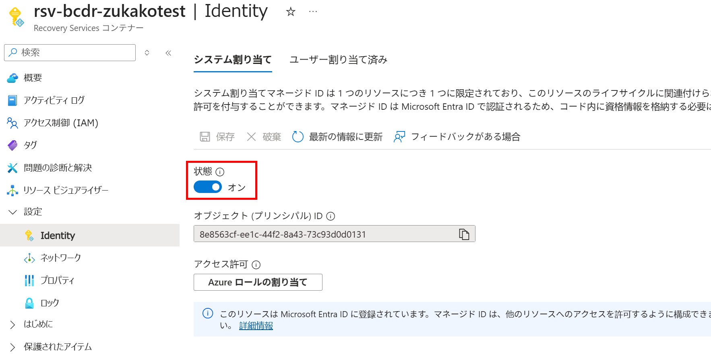
</p>


#### 3.1.1 キャッシュストレージとアクセス権限を準備する

キャッシュストレージは、複製元のVMと同じリージョンに必要です。通常のA→B用をRegion Aに、再保護のB→A用をRegion Bに用意します。

**レプリケーションを有効化する前に、両方のストレージへの権限付与を完了してください。** `<演習ID>`は自分の演習IDに置き換えます。ストレージ名は演習IDを含むリソースグループのIDから一意に生成されるため、固定値ではなく、自分のBicep出力で確認します。

| 用途 | ストレージアカウント | リソースグループ | リージョン |
|---|---|---|---|
| A→Bの複製用 | Bicep出力`sourceCacheStorageAccountName` | `rg-bcdr-src-<演習ID>` | Region A |
| B→Aの再保護用 | Bicep出力`recoveryCacheStorageAccountName` | `rg-bcdr-dr-<演習ID>` | Region B |

1. Bicep出力`sourceCacheStorageAccountName`（Region Aの元RG）と`recoveryCacheStorageAccountName`（Region BのDR用RG）のストレージを確認します。Bicepで**Standard・LRS・StorageV2**、HTTPSのみ・最小TLS 1.2、匿名Blobアクセス・共有キーアクセス無効として作成済みです。
2. **両方のストレージそれぞれ**の **アクセス制御（IAM）→ 追加 → ロールの割り当ての追加** から、以下の2つのロールを3.1で確認・有効化したコンテナーのマネージドIDへ付与します。割り当て先は **マネージドID** とし、自分のユーザーやAutomationアカウントのIDを選ばないでください。

   - **ロール** タブで下表のロールを1つ選び、**次へ** を押します。
   - **メンバー** タブで **アクセスの割り当て先：マネージドID → メンバーを選択する** を開きます。
   - 演習用サブスクリプションと、Recovery Servicesコンテナーに対応するマネージドIDの種類を選び、自分の演習IDに対応する`rsv-bcdr-<演習ID>`を選択します。
   - **選択 → レビューと割り当て** で確定します。もう1つのロールについても同じ操作を行い、もう一方のストレージでも繰り返します。

   | ロール | スコープ |
   |---|---|
   | **共同作成者（Contributor）** | 対象のストレージアカウントのみ |
   | **ストレージ BLOB データ共同作成者（Storage Blob Data Contributor）** | 対象のストレージアカウントのみ |

<p align="center">
  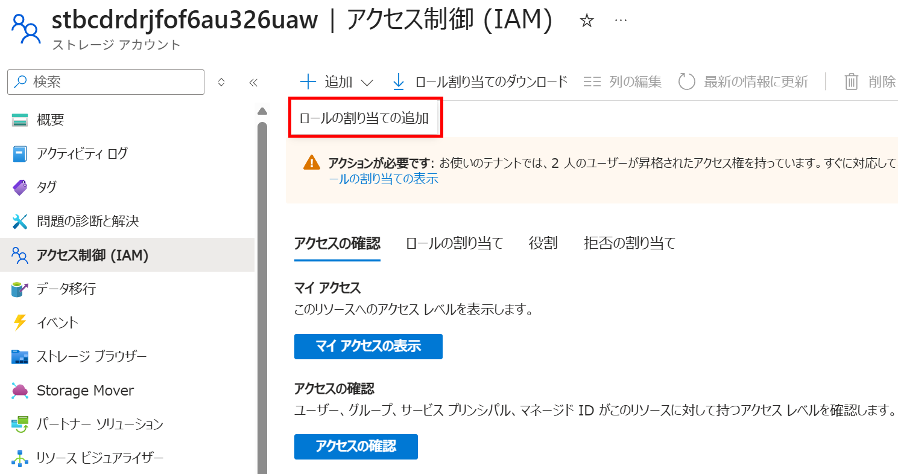
</p>


<p align="center">
  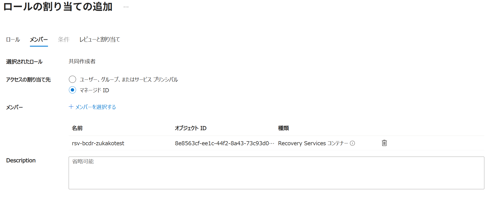
</p>


> 参考：[ASRで使用するストレージへのアクセス権限（Microsoft Learn）](https://learn.microsoft.com/azure/site-recovery/site-recovery-faq#security)

3. **ロールの割り当て**で2つのロールと付与先を確認し、反映を待ちます。ストレージ名・リージョン・IDを記録します。権限がない場合はサブスクリプション管理者へ割り当てを依頼します。

#### 3.2 Azure VMのレプリケーションを有効にする

Trusted LaunchのLinux VMは、VM作成画面のSite Recovery同時有効化ではなく、以下のコンテナーからの手順を使います。
> - Ubuntu 22.04と実際のカーネルが[サポート対象](https://learn.microsoft.com/ja-jp/azure/site-recovery/concepts-trusted-vm)であることを確認します。
> - ASRはSecure Boot・vTPM設定を保持しますが、ブート整合性監視の状態は複製しません。

1. コンテナーの **Site Recovery** を開き、**Azure仮想マシン → レプリケーションを有効にする（Enable replication）** を選択します。

<p align="center">
  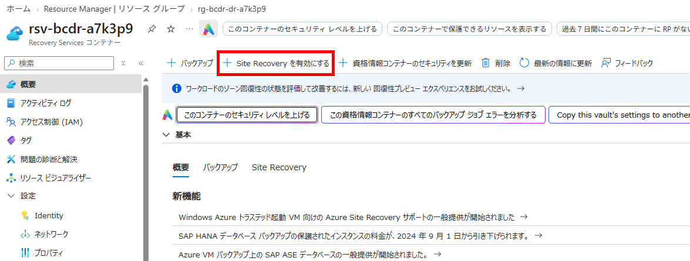
</p>


<p align="center">
  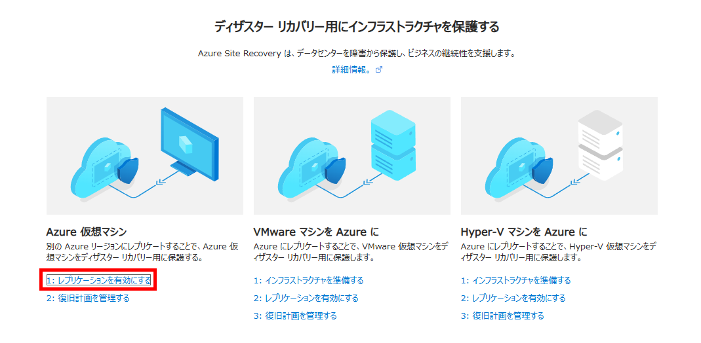
</p>


2. **ソース** でRegion A、演習用サブスクリプション、元のリソースグループを選択します。ゾーン間DRではなくリージョン間DRを選択します。

<p align="center">
  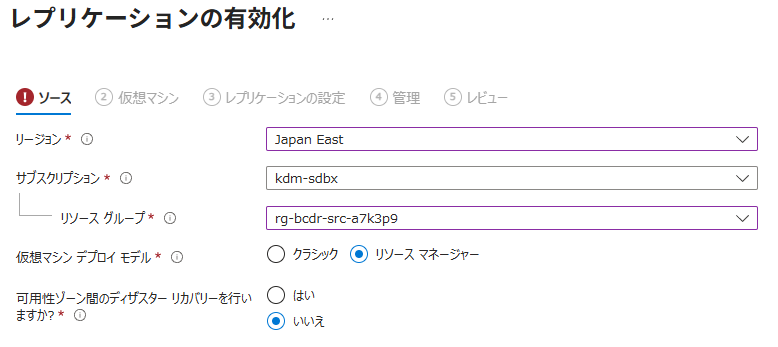
</p>


3. **仮想マシン** で自分の元VMだけを選択します。

<p align="center">
  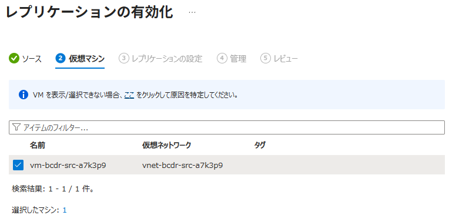
</p>


4. **レプリケーション設定** で、以下の各パートを順に設定します。自動提案された値をそのまま使わず、自分の演習環境に合わせてください。

##### 4.1 場所およびリソースグループ

画面上部の **場所およびリソースグループ** で、復旧先を指定します。

| 項目 | 設定・確認 |
|---|---|
| ターゲットの場所 | Region B |
| ターゲットサブスクリプション | 演習用サブスクリプション |
| ターゲットリソースグループ | 作成済みの`rg-bcdr-dr-<演習ID>` |

##### 4.2 ネットワーク

続いて **ネットワーク** で、Region BのDR用グループにある作成済みVNetを選択します。自動作成候補や元用（`src`）・テスト用（`test`）VNetは選びません。

| 項目 | 設定・確認 |
|---|---|
| フェールオーバー仮想ネットワーク | `vnet-bcdr-dr-<演習ID>` |
| フェールオーバーサブネット | `subnet-web` |

<p align="center">
  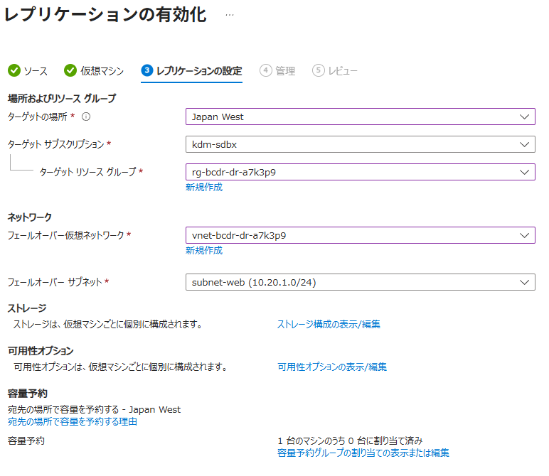
</p>

テスト用VNetはここでは選択せず、テストフェールオーバー時に指定します。
##### 4.3 ストレージ

**ストレージ構成の表示／編集** を開きます。

<p align="center">
  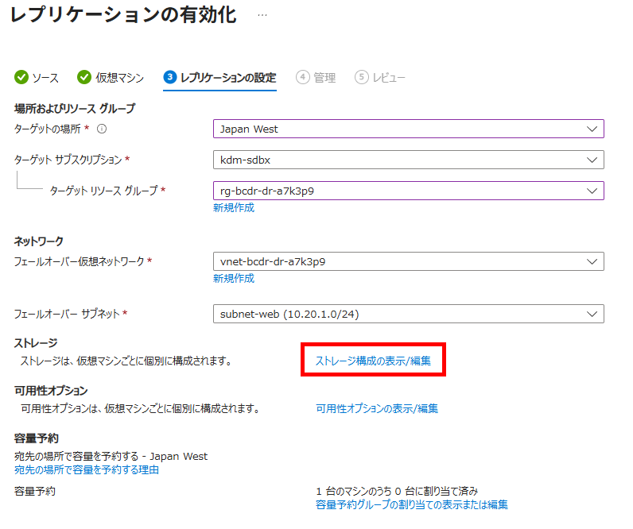
</p>

開いた設定画面で、複製対象ディスクとキャッシュストレージを設定します。**キャッシュストレージは自動作成候補を使わず、3.1.1で権限付与したRegion Aの既存ストレージを選んでください。**

| 項目 | 設定・確認 |
|---|---|
| レプリケーション用にディスクを含める | はい |
| キャッシュストレージ | Bicep出力`sourceCacheStorageAccountName`と同じ名前。所属グループは`rg-bcdr-src-<演習ID>`、リージョンはRegion A |
| VMのチャーン（データ変更率） | 通常の変更率（Normal Churn／ノーマル チャーン） |

<p align="center">
  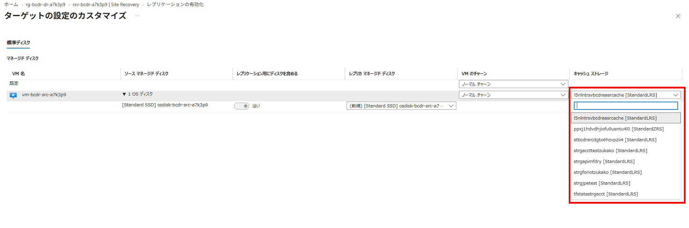
</p>

設定を確認して変更を保存し、レプリケーション設定画面へ戻ります。Region Bのキャッシュストレージは、後の逆方向の再保護用で、ここでは指定しません。

5. **管理** で複製ポリシーを確認します。本演習は単一VMのため、複数VMの整合性用グループを新たに構成しません。**拡張機能の設定 → 設定の更新** は **ASRに管理を許可します** を選択し、**Automationアカウント** 欄の新規作成候補を確認して **作成** を押します。これはVM内のMobilityサービス（複製エージェント）の更新を自動化するための設定で、OSやApacheの更新ではありません。作成されたAutomationアカウントの名前と所属グループを確認します。

<p align="center">
  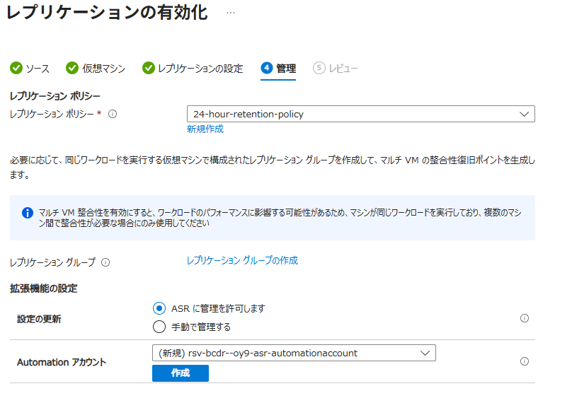
</p>


6. **確認** 画面で、ターゲットがRegion Bの`rg-bcdr-dr-<演習ID>`・`vnet-bcdr-dr-<演習ID>`・`subnet-web`であることと、キャッシュストレージがBicep出力`sourceCacheStorageAccountName`と一致していることを確認してから、**レプリケーションを有効にする** を実行します。
7. コンテナーの **Site Recoveryジョブ** で有効化処理を、**レプリケートされたアイテム** で初期複製の進行状況を確認します。

<p align="center">
  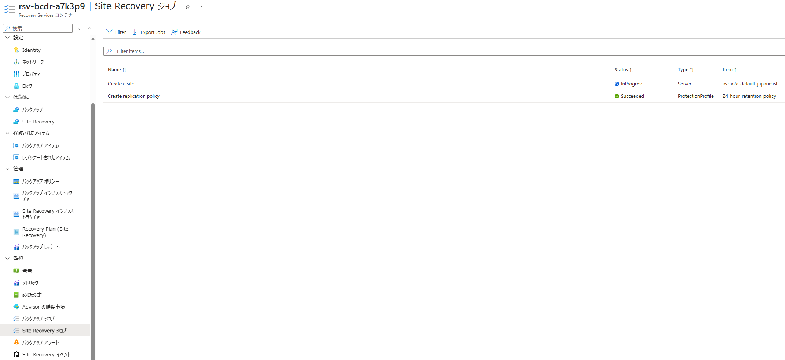
</p>


**確認結果**：自分のVMがレプリケートされたアイテムに登録され、指定したRegion Bへの初期複製が開始すること。Mobilityサービスなど必要な構成はASRの有効化処理で導入されます。

#### 3.2.1 初期複製中にネットワークマッピングを確認する

1. Recovery Servicesコンテナーの **Site Recoveryインフラストラクチャ → Azure仮想マシン → ネットワーク マッピング** を開き、Region Aの元VNetからRegion Bの復旧先VNetへのマッピングを確認します。手順3.2で復旧先ネットワークを選んだとき、対応するマッピングが自動作成されている場合があります。
2. 反対方向（Region BからRegion A）のマッピングも確認します。再保護・フェールバック時に逆方向のネットワーク選択の既定値として使われます。


<p align="center">
  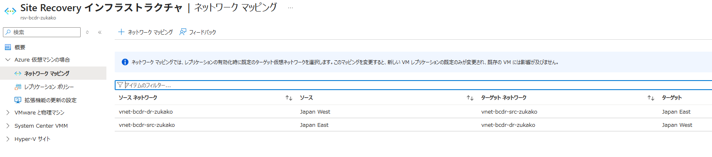
</p>


ネットワークマッピングは、元VNetにいるVMをフェールオーバーしたときに接続する復旧先VNetの対応関係です。VNetそのものを複製したり、VNet間の接続（ピアリング、VPN、ルート、DNS、NSG）を作成したりする機能ではありません。サブネットは名前が一致すれば復旧先でも同名のものが選ばれ、なければ復旧先VNetの先頭のサブネットが既定で選ばれます。実際の復旧VMのネットワークは、レプリケートされたアイテムの **ネットワーク** 設定で個別に確認できます。マッピングの変更は既存VMのネットワーク設定を変更せず、新しく複製を有効にするVMの既定値に影響します。

> **この演習のネットワーク**：通常の復旧ではRegion Bの復旧先VNetを使います。テストフェールオーバーでは、本番ネットワークとの競合を避けるため、別途テスト専用VNetを指定します。ネットワークマッピングがあっても、テスト用VNetに自動で切り替わるわけではありません。

参考：[Azure Site Recovery のネットワーク マッピングとIPアドレス設定](https://learn.microsoft.com/azure/site-recovery/azure-to-azure-network-mapping)

#### 3.2.2 初期複製中に複製ポリシーを確認する

初期複製の完了を待つ間に、対象VMに割り当てたポリシーと復旧ポイントの考え方を確認します。**設定値は変更しません。** 複製ポリシーの変更は、そのポリシーを使っている既存の複製にも適用されます。

1. Recovery Servicesコンテナーの **Site Recoveryインフラストラクチャ → レプリケーション ポリシー** を開き、対象VMに割り当てられたポリシーを選択します。
2. 次の項目を画面で確認します。

   | 項目 | 確認する内容 |
   |---|---|
   | 復旧ポイントの保持期間 | どれだけ過去まで復旧ポイントを保持するかを決めます。Azure VM間の新規ポリシーは通常24時間（1日）です。これは複製の間隔ではありません。 |
   | アプリ整合性スナップショットの頻度 | `0`時間なら無効です。`0`以外なら指定間隔でアプリ整合性の復旧ポイントを作成します。アプリがメモリ上のデータや処理中のトランザクションをディスクへ反映できるよう調整します。 |
   | クラッシュ整合性の復旧ポイント | 既定で5分ごとに作成され、この間隔は変更できません。アプリ整合性が無効でも作成されます。 |

> **クラッシュ整合性とアプリ整合性の使い分け**
>
> - **クラッシュ整合性**は、スナップショット時点でディスクに書き込まれていたデータを記録します。メモリ上に残っていたデータや処理中のトランザクションは含まれず、VMの電源が突然切れたときに近い状態です。OSや、再起動後に自力で回復できる多くのアプリではこれで十分な場合があります。
> - **アプリ整合性**は、スナップショット前にアプリのデータをディスクへ反映させ、処理中の処理を考慮した状態を作ります。データベースやトランザクション処理など、クラッシュ後の回復に任せるだけでは不十分なワークロードで使います。アプリ整合性の取得にはアプリの処理やVM性能への影響があり、アプリ側の対応状況も確認が必要です。
>
> アプリ整合性でも、アプリケーションの論理的な正しさや外部システムとの整合性まで保証するものではなく、バックアップの代わりにもなりません。本演習のApacheと静的HTMLは、ディスクへの書き込みが完了していればクラッシュ整合性で復旧できる想定です。

3. ASRによって、VMのディスク書き込みは継続的に複製元リージョンのキャッシュストレージへ転送され、処理後に復旧先へ送られます。複製先のデータから復旧ポイントが作られ、ポリシーの保持期間に従って古いポイントが整理されます。
4. 保持期間が24時間、アプリ整合性の頻度が1時間の例では、クラッシュ整合性ポイントは直近2時間分が5分間隔で残り、それより古い時間帯ではおおむね1時間ごとのポイントに間引かれます。つまり、**「5分」は新しいクラッシュ整合性ポイントの作成間隔を意味し、「保持期間」は復旧ポイントを遡れる範囲を意味します**です。1時間後にすべて削除されるわけではありません。

実際のポリシー値や選択可能な復旧ポイントは環境・状態により異なります。ポリシー画面の値と、保護対象VMの **テストフェールオーバー** 画面に表示される復旧ポイントを照合してください。

> 参考：[Azure Site Recovery の Azure-to-Azure レプリケーション ポリシー](https://learn.microsoft.com/azure/site-recovery/azure-to-azure-architecture#replication-policy)、[復旧ポイントに関するFAQ](https://learn.microsoft.com/azure/site-recovery/azure-to-azure-troubleshoot-errors#replication-policy)

> [!IMPORTANT]
> **ここから初期複製の完了待ちです。** ASR 有効化後に、初回の同期が完了するのを待つ必要があります。
>
> 待ち時間は、座学・質疑応答・休憩に充ててください。再開後は、**初期複製の完了と復旧ポイントを確認してから**先へ進みます。

#### 3.3 初期複製完了後の確認

##### 3.3.1 初期複製完了と構成後の復旧ポイントを確認する

1. Portalで **Recovery Servicesコンテナー → 保護されたアイテム → レプリケートされたアイテム → 対象VM** を開きます。**概要** で初期複製の完了、レプリケーションの正常性、最新の復旧ポイントの時刻を確認します。選択可能な復旧ポイントを確認する場合は **テストフェールオーバー** の設定画面を開きます。ここでは実行せず、確認後に画面を閉じます。テストの実行は次のStepで行います。

<p align="center">
  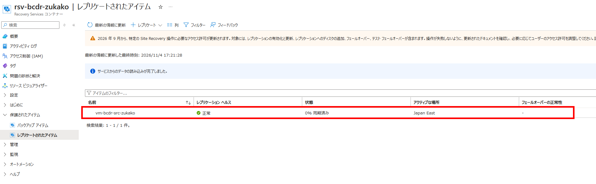
</p>

2. 最新の復旧ポイントの時刻が、HTMLファイルを変更した時刻より後であることを確認します。その復旧ポイントを使うと、変更後のHTMLが復旧先に反映されます。

<p align="center">
  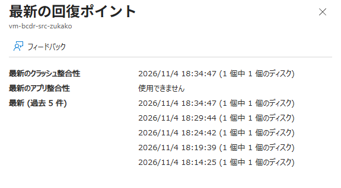
</p>

3. 復旧ポイントの確認ができたら、対象VMの画面で、レプリケーションの正常性・RPO（復旧ポイントの遅れ）・エージェントの状態・関連ジョブなど、気になる情報を自由に確認してみてください。この手順での記録は任意です。設定の変更やフェールオーバーの実行は行いません。

**確認結果**：初期複製が完了し、ApacheとHTMLを構成した後の復旧ポイントを選択できること。

HTMLの復旧は[次のテストフェールオーバー](./04-test-failover.md)で確認します。待機上限を超えたら停止して原因を調べます。復旧先でApacheやHTMLを作り直して成功扱いにしません。

###### 参考：Azure CLIで初期複製の進捗を確認する

参加者PCのPowerShellで実行します（Ubuntu VM内ではありません）。Azure CLIで演習用サブスクリプションへログインし、`<演習ID>`を自分のBicepパラメータに合わせて置き換えてください。以下は状態を読み取るだけで、構成を変更しません。

```powershell
$exerciseId = '<演習ID>'
$subscriptionId = az account show --query id -o tsv
if ($LASTEXITCODE -ne 0) { throw 'Subscription lookup failed.' }
$vaultId = "/subscriptions/$subscriptionId/resourceGroups/rg-bcdr-dr-$exerciseId/providers/Microsoft.RecoveryServices/vaults/rsv-bcdr-$exerciseId"
az rest --method get --url "https://management.azure.com$vaultId/replicationProtectedItems?api-version=2024-04-01" --query 'value[].{VM:properties.friendlyName,State:properties.protectionState,Health:properties.replicationHealth,ProgressPercent:properties.providerSpecificDetails.monitoringPercentageCompletion}' -o table
if ($LASTEXITCODE -ne 0) { throw 'Replication status lookup failed.' }
```

- `State`：`InitialReplicationInProgress`は初期複製中です。
- `ProgressPercent`：初期複製の進捗率です。**復旧ポイント生成そのものの進捗率ではありません。** 表示の更新に間隔があるため、しばらく同じ値になる場合があります。
- `Health`：`Normal`は正常性の表示であり、初期複製完了を意味しません。

進捗を再確認するときは、最後の`az rest`コマンドを再実行します。初期複製完了後は、この節のPortal手順で最新の復旧ポイントの時刻を確認してください。一覧が空の場合は、まだ保護対象VMが登録されていない可能性があるため、Site Recoveryジョブの状態を確認します。

##### 3.3.2 ターゲットVMサイズを確認する

ASRは通常、元VMと同じサイズ、または近いサイズを復旧先に自動選択します。**ターゲットVMサイズは、レプリケーション後の対象アイテムで確認します。**

1. Recovery Servicesコンテナーの **レプリケートされたアイテム** から、自分の元VMに対応するアイテムを開きます。
2. **コンピューティングとネットワーク（Compute and Network）** を開き、ターゲットVMサイズを確認します。

   | 項目 | 確認する内容 |
   |---|---|
   | ターゲットVMサイズ | 演習で使用するサイズ（既定は`Standard_D2s_v5`）になっており、Region Bでサービス対応・クォータ・容量を確認していること |

<p align="center">
  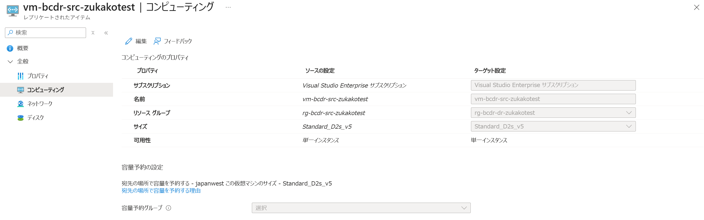
</p>

3. ネットワークや、ディスクについても現在の設定を確認しましょう。
> それぞれ、**編集** から確認済みのサイズを選択して変更することができます。


## このページの完了チェック

- [ ] Bicepで作成済みのコンテナーを確認し、対象VMのリージョン間複製を有効化した。
- [ ] 両リージョンのキャッシュストレージにコンテナーのIDへのロールを付与し、複製元と同じリージョンのストレージを選択した。
- [ ] 初期複製中にネットワークマッピングの方向と役割、割り当てポリシーの各項目、および複製・復旧ポイント生成の流れを確認した（設定値は変更していない）。
- [ ] 初期複製が完了し、構成後の復旧ポイントと複製正常性を確認した。
- [ ] ターゲットVMサイズが演習で使用するサイズになっていることを確認した。

完了したら[全体ページ](../../../ハンズオン/01-IaaS-ASRによるDRハンズオン.md)の対応するチェックを更新します。未完了の場合は進捗メモに停止箇所と理由を残してください。

[前へ](./02-configure-apache.md) | [全体・進捗チェック](../../../ハンズオン/01-IaaS-ASRによるDRハンズオン.md) | [次へ](./04-test-failover.md)
