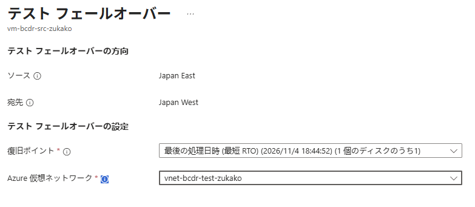
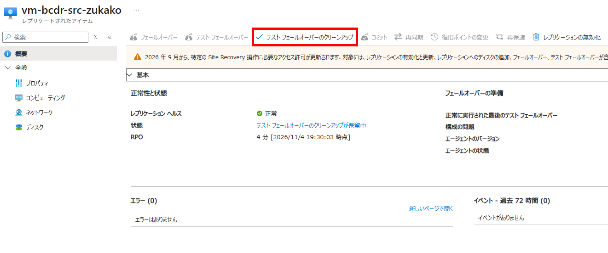
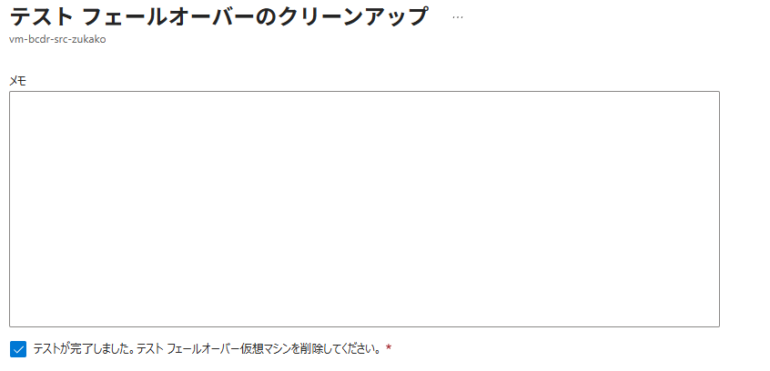

# IaaS 04：テストフェールオーバーと復旧確認

[前へ](./03-configure-asr.md) | [全体・進捗チェック](../../../ハンズオン/01-IaaS-ASRによるDRハンズオン.md) | [次へ](./05-failover-and-update.md)

> 現在位置：4 / 8。このページの到達点：テスト用VMで復旧を確認し、テストを終了して実切り替えに進める。

[前のページ](./03-configure-asr.md)の完了条件を満たしてから進んでください。

**テストフェールオーバーでは、元のVMとは独立したテスト用VMを復旧ポイントから作成します。** 元のVMの稼働とレプリケーションは継続し、テスト用VMで変更した内容が元のVMへ反映されることはありません。本演習ではテスト専用VNetを使い、元の環境とネットワークも分離します。テスト終了後のクリーンアップではテスト用VMが削除され、テスト用VMでの変更内容も失われます。

## Step 4：テストフェールオーバーを実行する

1. 対象のレプリケートされたアイテムで **テストフェールオーバー（Test Failover）** を選択します。通常の **フェールオーバー** は選択しません。
2. 基本演習では **最新の処理済み（Latest processed）** を選び、表示された復旧ポイントの時刻を記録します。[Step 3](./03-configure-asr.md)で確認した構成後の時刻であることを再確認します。

<p align="center">
  
</p>

3. Region Bの指定された **テスト用VNet** を選択します。元の業務ネットワークは選択しません。
4. 対象・復旧ポイント・接続先が自分の演習環境であることを確認します。
5. 実行し、操作開始時刻を記録します。
6. **Site Recoveryジョブ（Site Recovery jobs）** で進行状況を確認し、ジョブID、各工程、完了または失敗の状態を記録します。

**確認結果**：テストフェールオーバージョブが成功し、Region Bにテスト用VMが作成されること。

待機上限は開始前に自分で決めます。超過または失敗時はエラーを保存して原因を調べ、同じ操作の反復や通常フェールオーバーでの代替はしません。

## Step 5：復旧先のApache・HTML・通信経路を確認する

### 5.1 OSとファイルの復旧を確認する

> **学びポイント：元VMのPublic IPは、ASRのフェールオーバーで復旧先へ引き継がれません。VMが復旧しても、元と同じ公開IPでアクセスできるわけではありません。** 本演習では復旧先に別のPublic IPを関連付けて確認します。実運用では、DNSやFront Doorなど、利用者の接続先を切り替える仕組みも別途設計します。

1. Portalでテスト用VMのリージョン、稼働状態、VMサイズ、接続先VNet・IPアドレスを確認します。Trusted Launch、Secure Boot・vTPMの有効状態も元VMと照合します。ブート整合性監視の状態は複製されません。
   ASRが作成したテストVMのRGは固定と仮定せず、Portalで実際の配置先を記録します。テスト用ネットワーク自体は`rg-bcdr-test-<演習ID>`にあります。
2. テスト用VMの **ネットワーク設定** から実際のNICを開き、テスト専用VNet・`subnet-web`に接続していることを確認します。
3. NICの **IP構成** で主IP構成を開き、Region Bの演習専用Standard SKUの公開IPv4を新規作成して関連付けます。元VMの公開IPが自動で引き継がれるとは仮定しません。新規作成の導線がない場合は、Portalの **パブリックIPアドレス → 作成** で作成してから選択します。
4. テスト用NSGがサブネットに関連付いていることと、NICにもNSGがある場合の実効規則を確認します。[01：Bicepデプロイ結果の確認](./01-verify-deployment.md)にあるSSH許可・拒否とHTTP許可の設定を確認し、公開IPと関連リソース名を記録します。
5. **テスト用VM**の **接続 → Bastion** から、テスト専用VNetのBastion Developerと`azureuser`・自分で設定した演習専用パスワードで接続します。元VMのセッションを閉じ、接続先VM名とプライベートIPを確認します。公開IPはHTTP確認専用です。
6. 次のコマンドでApacheとHTMLを確認します。復旧先でインストールやページ配置をやり直しません。

```bash
systemctl is-enabled apache2 &&
systemctl is-active apache2 &&
cat /var/www/html/index.html &&
curl --fail --silent --show-error --connect-timeout 5 --max-time 15 http://127.0.0.1/
```

**確認結果**：Apacheが自動起動し、HTMLマーカーが元の記録と一致すること。

### 5.2 利用者の接続経路から表示を確認する

1. 参加者のブラウザーで`http://<テスト用VMの公開IP>/`を開きます。
2. 元のURLではなくテスト用VMのURLであることを確認し、HTMLマーカーを照合します。キャッシュが疑わしい場合は強制再読み込みと実リクエストを確認します。
3. 5秒以上の間隔で3回連続して正常表示を確認し、時刻と確認場所を記録します。
4. 元のVMのページも引き続き表示できることを確認します。

**確認結果**：VM内のローカルHTTPだけでなく、指定の利用者経路からも復旧先ページが利用できること。

## Step 6：テストフェールオーバーを終了する

1. レプリケートされたアイテムで **テストフェールオーバーのクリーンアップ（Cleanup test failover）** を選択します。

<p align="center">
  
</p>

2. 表示された確認項目に従い、クリーンアップを実行します。

<p align="center">
  
</p>

3. クリーンアップジョブが成功し、テスト用VMが削除されたことを確認します。手動作成したテスト用公開IPが残っている場合は、他のリソースで使用していないことを確認して削除します。

**確認結果**：テストが終了し、実フェールオーバーへ進めること。この時点では、元のVM、コンテナー、複製設定、通常復旧先VNetを削除しません。

テスト用VMの削除はフェールバックではありません。次のページで元VMを停止し、通常復旧先VNetへ実際に切り替えます。

## このページの完了チェック

- [ ] テスト用VNetへテストフェールオーバーし、接続経路を設定した。
- [ ] 復旧先でApacheが起動し、HTMLマーカーが元と一致することを確認した。
- [ ] 利用者経路から3回連続でページを表示できることを確認した。
- [ ] テストをクリーンアップし、元の環境と複製の正常性を確認した。

完了したら[全体ページ](../../../ハンズオン/01-IaaS-ASRによるDRハンズオン.md)の対応するチェックを更新します。未完了の場合は進捗メモに停止箇所と理由を残してください。

[前へ](./03-configure-asr.md) | [全体・進捗チェック](../../../ハンズオン/01-IaaS-ASRによるDRハンズオン.md) | [次へ](./05-failover-and-update.md)
