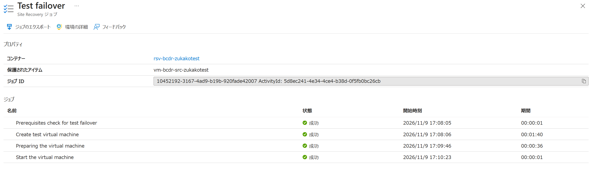
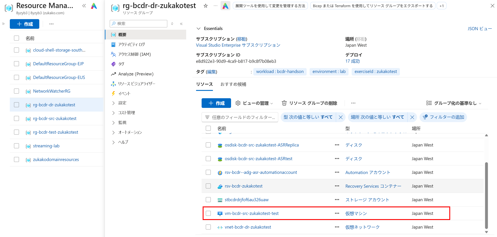
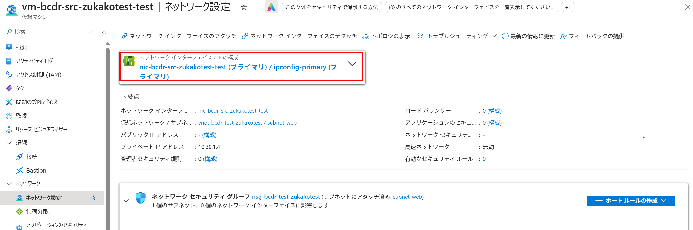
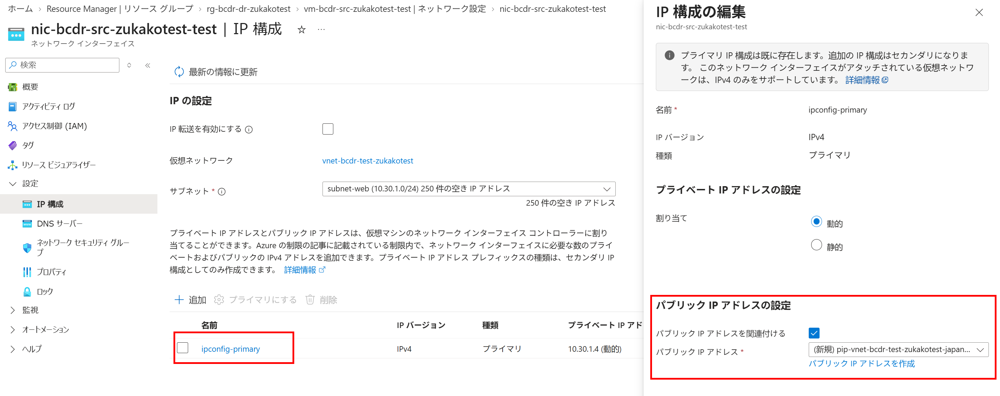
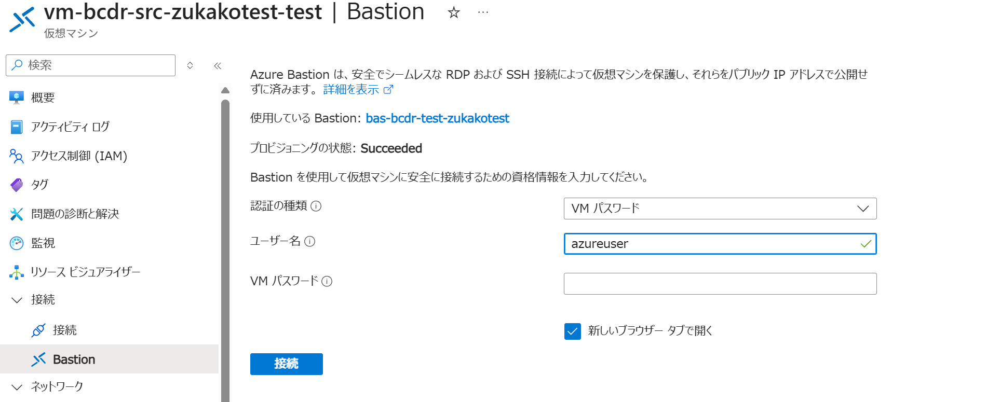
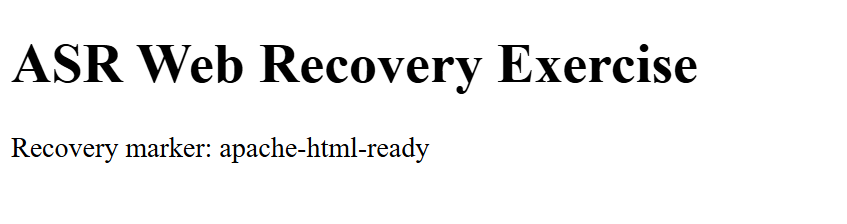

# IaaS 04：テストフェールオーバーと復旧確認

[前へ](./03-configure-asr.md) | [全体・進捗チェック](../../../ハンズオン/01-IaaS-ASRによるDRハンズオン.md) | [次へ](./05-failover-and-update.md)

> 現在位置：4 / 8。このページの到達点：テスト用 VM で復旧を確認し、テストを終了して実切り替えに進める。

[前のページ](./03-configure-asr.md)の完了条件を満たしてから進んでください。

テストフェールオーバーでは、復旧ポイントから独立したテスト用 VM を作成します。元 VM の稼働とレプリケーションは継続し、テスト用 VM での変更は元 VM に反映されません。

## Step 4：テストフェールオーバーを実行する

> [!IMPORTANT]
> **テストフェールオーバー**と、Region B の**テスト専用 VNet** を選択します。通常のフェールオーバーや元の業務ネットワークは使用しません。
>
> 開始前に待機上限を決めます。上限超過や失敗時はエラーを保存して原因を調べ、同じ操作の反復や通常フェールオーバーでの代替はしないでください。

1. 対象のレプリケートされたアイテムで **テストフェールオーバー（Test Failover）** を選択します。通常の **フェールオーバー** は選択しません。
2. 基本演習では **最新の処理済み（Latest processed）** を選び、表示された復旧ポイントの時刻を記録します。[Step 3](./03-configure-asr.md) で確認した構成後の時刻であることを再確認します。

<p align="center">
  
</p>

3. Region B の指定された **テスト用 VNet** を選択します。元の業務ネットワークは選択しません。
4. **Site Recovery ジョブ（Site Recovery jobs）** で進行状況を確認し、ジョブ ID、各工程、完了または失敗の状態を記録します。

<p align="center">
  
</p>

**確認結果**：テストフェールオーバージョブが成功し、Region B にテスト用 VM が作成されること。

## Step 5：復旧先の Apache・HTML・通信経路を確認する

### 5.1 OS とファイルの復旧を確認する

> [!NOTE]
> 元 VM の公開 IP は復旧先へ引き継がれません。本演習では、復旧先に別の公開 IP を関連付けます。実運用では、DNS や Front Door など、利用者の接続先を切り替える仕組みも別途設計します。

1. DR 用リソースグループを開き、作成されたテスト用 VM（名前の末尾が `-test`）を選択します。

<p align="center">
  
</p>

2. リージョン、稼働状態、VM サイズ、接続先 VNet・IP アドレスを確認します。
3. テスト用 VM の **ネットワーク設定** から適用されている NSG 規則を確認します。
4. 実際の NIC を開き、テスト専用 VNet・`subnet-web` に接続していることを確認します。

<p align="center">
  
</p>

5. NIC の **IP 構成** で主 IP 構成を開き、Region B の演習専用 Standard SKU の公開 IPv4 を新規作成して関連付けます。

<p align="center">
  
</p>

6. **テスト用 VM** の **接続 → Bastion** から、テスト専用 VNet の Bastion Developer と `azureuser`・自分で設定した演習専用パスワードで接続します。

<p align="center">
  
</p>

7. 次のコマンドで Apache と HTML を確認します。復旧先でインストールやページ配置は行いません。

```bash
systemctl is-enabled apache2 &&
systemctl is-active apache2 &&
cat /var/www/html/index.html &&
curl --fail --silent --show-error --connect-timeout 5 --max-time 15 http://127.0.0.1/
```

<p align="center">
  
</p>

**確認結果**：Apache が自動起動し、タイトル `ASR Web Recovery Exercise` と HTML マーカー `apache-html-ready` が元の記録と一致すること。

### 5.2 利用者の接続経路から表示を確認する

1. テスト用 VM の概要画面から、パブリック IP を確認し、参加者のブラウザーで `http://<テスト用VMの公開IP>/` を開きます。
2. 元の URL ではなくテスト用 VM の URL を開いていることを確認し、HTML マーカーを照合します。表示が更新されない場合は、ブラウザーを強制再読み込みし、VM 内の `curl` 応答と比較します。
3. 5 秒以上の間隔で 3 回連続して正常表示を確認し、時刻と確認場所を記録します。
4. 元 VM のページも引き続き表示できることを確認します。

**確認結果**：VM 内のローカル HTTP だけでなく、指定の利用者経路からも復旧先ページが利用できること。

## Step 6：テストフェールオーバーを終了する

> [!CAUTION]
> クリーンアップによりテスト用 VM と、その VM での変更内容が削除されます。元 VM、コンテナー、複製設定、通常復旧先 VNet は削除しないでください。

1. レプリケートされたアイテムで **テストフェールオーバーのクリーンアップ（Cleanup test failover）** を選択します。

<p align="center">
  
</p>

2. 表示された確認項目に従い、クリーンアップを実行します。

<p align="center">
  
</p>

3. クリーンアップジョブが成功し、テスト用 VM が削除されたことを確認します。手動作成したテスト用公開 IP が残っている場合は、他のリソースで使用していないことを確認して削除します。

**確認結果**：テストが終了し、テスト用 VM が削除され、元の環境と複製が正常であること。

> [!NOTE]
> テスト用 VM の削除はフェールバックではありません。次のページで元 VM を停止し、通常復旧先 VNet へ実際に切り替えます。

## このページの完了チェック

- [ ] テスト用 VNet へテストフェールオーバーし、接続経路を設定した。
- [ ] 復旧先で Apache が起動し、HTML マーカーが元と一致することを確認した。
- [ ] 利用者経路から 3 回連続でページを表示できることを確認した。
- [ ] テストをクリーンアップし、元の環境と複製の正常性を確認した。

完了したら[全体ページ](../../../ハンズオン/01-IaaS-ASRによるDRハンズオン.md)の対応するチェックを更新します。未完了の場合は進捗メモに停止箇所と理由を残してください。

[前へ](./03-configure-asr.md) | [全体・進捗チェック](../../../ハンズオン/01-IaaS-ASRによるDRハンズオン.md) | [次へ](./05-failover-and-update.md)
