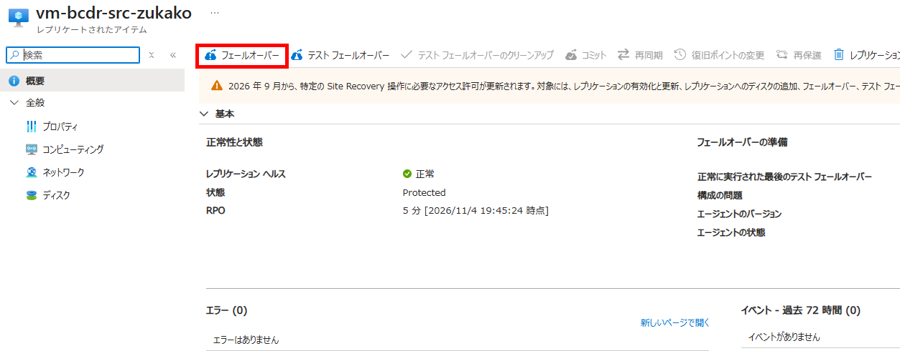
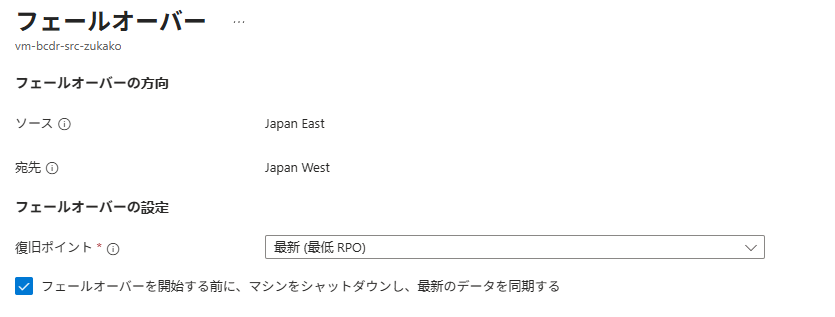
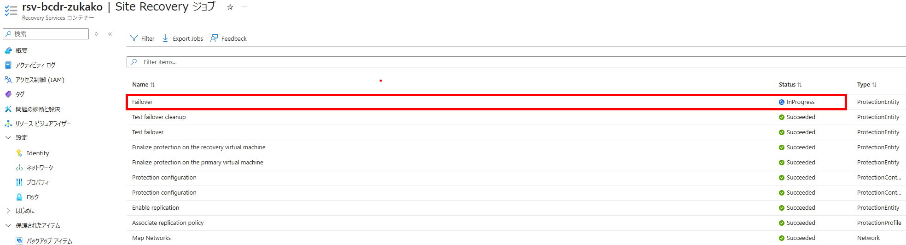
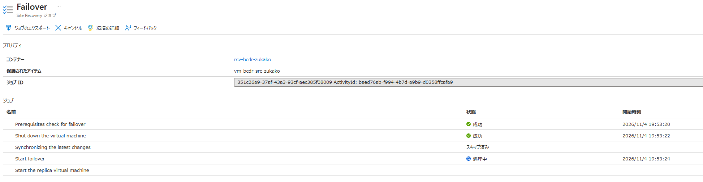
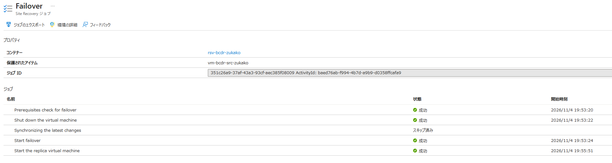
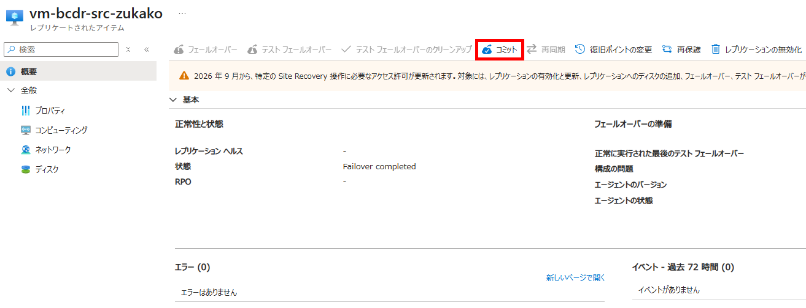
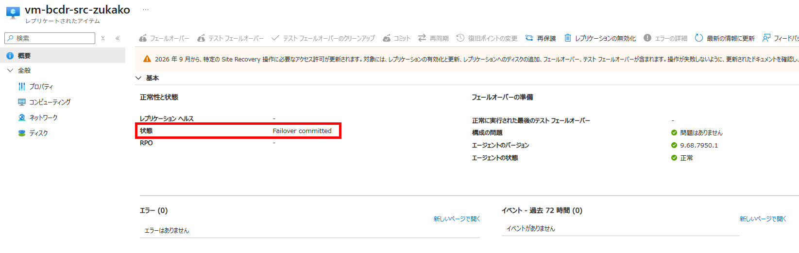

# IaaS 05：実フェールオーバーと HTML 更新

[前へ](./04-test-failover.md) | [ハンズオンの進め方](../README.md) | [次へ](./06-reprotect-to-source.md)

> 現在位置：5 / 8。このページの到達点：元 VM を停止し、Region B で復旧・コミット・HTML 更新が完了する。

[前のページ](./04-test-failover.md)のテストを終了してから進みます。以降は通常復旧先 VNet の VM を使います。元 VM 停止・コミットの影響を確認し、組織で必要な承認があれば取得してください。

## Step 7：元 VM を停止し、Region B へ実フェールオーバーする

### 7.1 実フェールオーバーと復旧確認

> [!WARNING]
> 元 VM を停止するとサービスが停止します。元 VM と復旧 VM の二重稼働を避けるため、停止状態を確認してから切り替えてください。元 VM・ディスク・リソースグループは削除しません。

1. A から B への複製が正常で、HTML 構成後の最新の復旧ポイントがあることを確認します。
2. Portal で **Region A の専用演習 VM** の **停止** を実行し、停止状態になるまで待ちます。操作開始と停止確認の時刻を記録します。元 VM・ディスク・グループは削除しません。

   > [!NOTE]
   > この停止は VM 障害の模擬であり、Region A の管理 API まで停止するリージョン全体の障害を再現するものではありません。

3. コンテナーの **レプリケートされたアイテム** で対象を開き、**フェールオーバー（Failover）** を選択します。今回は **テストフェールオーバー** ではありません。

<p align="center">
  
</p>

4. 複製方向が A から B であることを確認し、**最新（Latest）** を選択します。

   > [!NOTE]
   > Latest は、ASR へ送信済みのデータを処理して復旧ポイントを作成します。未送信データの損失ゼロは保証しません。

5. **フェールオーバーを開始する前にマシンをシャットダウンする** が表示される場合は選択します。

   > [!CAUTION]
   > シャットダウンに失敗しても切り替えが続行される場合があります。手順 2 での元 VM の停止確認を省略しないでください。

<p align="center">
  
</p>

6. 実行時刻を記録し、Site Recovery ジョブで成功・失敗とジョブ ID を確認します。

<p align="center">
  
</p>


<p align="center">
  
</p>


<p align="center">
  
</p>

7. 作成された Region B の復旧 VM が、テスト専用ではなく**通常復旧先 VNet** に接続していることを確認します。
8. 復旧 VM の NIC の主 IP 構成へ、Region B の演習専用 Standard 公開 IPv4 を関連付けます。元 VM の公開 IP は、別リージョンの復旧 VM へ引き継げません。

   > [!NOTE]
   > 実運用では、Traffic Manager、Azure Front Door、クロスリージョン Load Balancer などで、利用者がアクセスする URL を維持した切り替えを設計します。本演習では、復旧先の公開 IP の URL へ手動でアクセスします。

9. 復旧 VM の **接続 → Bastion** から、通常復旧先 VNet の Bastion Developer と `azureuser`・自分で設定した演習専用パスワードで接続します。テスト用 VM のセッションは閉じます。
10. 次のコマンドで Apache の自動起動と、更新前の HTML の内容を確認します。再インストールや HTML 再作成はしません。

```bash
systemctl is-enabled apache2 &&
systemctl is-active apache2 &&
cat /var/www/html/index.html &&
curl --fail --silent --show-error --connect-timeout 5 --max-time 15 http://127.0.0.1/
```

11. 参加者のブラウザーで `http://<Region Bの復旧VMの公開IP>/` を開き、5 秒以上の間隔で 3 回連続して正常表示を確認します。
12. Region A の元 VM は停止したままであることを確認します。元 VM を手動で再起動しません。

**確認結果**：Region B の復旧 VM で、元の HTML マーカーが表示され、Web ページを利用できること。

## Step 8：復旧結果をコミットし、Region B で HTML を更新する

### 8.1 フェールオーバーをコミットする

1. Apache、HTML、利用者経路からの表示、元 VM の停止を再確認します。組織で承認が必要な場合は、コミット前に取得します。

   > [!CAUTION]
   > コミットすると既存の復旧ポイントが削除され、別の復旧ポイントへ変更できなくなります。復旧結果と確認記録（ジョブ結果、復旧ポイントの時刻、HTML マーカーなど）を保存してから実行してください。

2. レプリケートされたアイテムの **コミット（Commit）** を実行します。

<p align="center">
  
</p>

3. コミットジョブの成功と、**Failover committed** に相当する状態を確認します。

<p align="center">
  
</p>


> [!NOTE]
> コミットは再保護ではありません。この時点では、逆方向の複製はまだ開始していません。

### 8.2 復旧先でのアプリの変更

フェールバック後にも変更内容が保持されることを確認するため、フェールオーバー先の Region B で HTML マーカーを更新します。通常復旧先の VM へ Bastion Developer 経由で接続します。

各コマンドを順に実行し、エラーが出た場合は先へ進まず、原因を確認してください。

HTML 内の `apache-html-ready` を `apache-html-updated-in-region-b` へ置き換えます。

```bash
sudo sed -i 's/apache-html-ready/apache-html-updated-in-region-b/' /var/www/html/index.html
```

更新後の内容を表示し、`apache-html-updated-in-region-b` が含まれていることを確認します。

```bash
cat /var/www/html/index.html
```

書き込みを反映します。

```bash
sync
```

HTML 更新後の UTC 時刻を表示します。

```bash
printf 'Write completed at UTC: %s\n' "$(date -u +%Y-%m-%dT%H:%M:%SZ)"
```

1. HTML 更新後の UTC 時刻（`Write completed at UTC`）と更新後のマーカーを VM 外のメモに記録します。
2. ローカル HTTP とブラウザーで `apache-html-updated-in-region-b` が表示されることを確認します。

> [!IMPORTANT]
> フェールバックが完了するまで HTML を変更しません。更新後のマーカーを、戻した先での照合基準にします。

**確認結果**：Region B で更新した HTML が表示され、更新後のマーカーと UTC 時刻を記録できたこと。

> [!NOTE]
> `sync` は OS 内の書き込みを反映しますが、ASR への送信・複製完了を保証しません。

## 次へ進む前の確認

- 元 VM を停止して実フェールオーバーし、B の通常復旧先で元の HTML マーカーの表示を確認した。
- 復旧結果を確認・コミットし、A を停止したまま B を稼働先とした。
- B で HTML を更新し、表示・更新後のマーカー・時刻を VM 外へ記録した。

[前へ](./04-test-failover.md) | [ハンズオンの進め方](../README.md) | [次へ](./06-reprotect-to-source.md)
