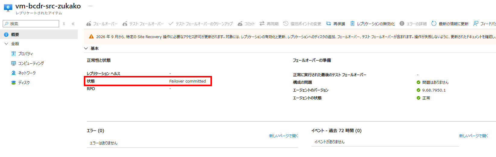
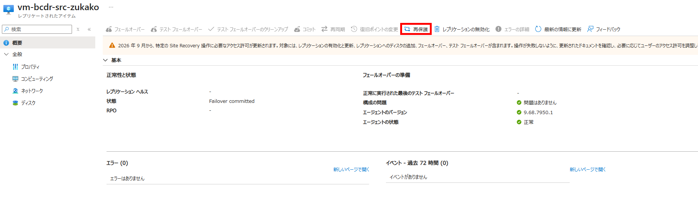
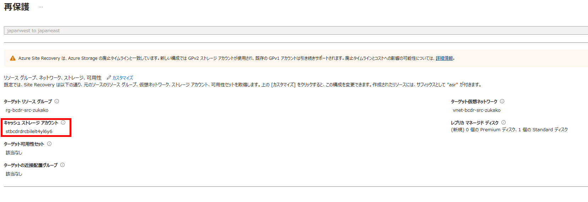
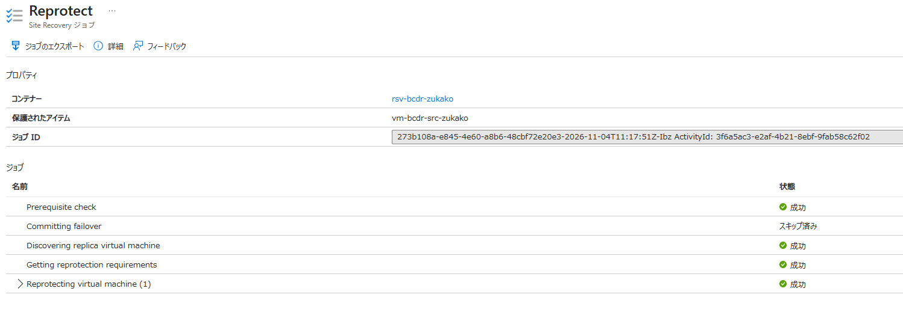

# IaaS 06：逆方向の再保護

[前へ](./05-failover-and-update.md) | [ハンズオンの進め方](../README.md) | [次へ](./07-failback-and-reprotect.md)

> 現在位置：6 / 8。このページの到達点：B から A へ複製し、更新後の復旧ポイントを確認できる。

[前のページ](./05-failover-and-update.md)でコミットと HTML 更新を完了してから進みます。

現在の稼働先は Region B です。再保護で B から A への複製を開始し、フェールバックに備えます。再保護だけでは稼働先は切り替わりません。

## Step 9：Region B から A への再保護を実行する

### 9.1 再保護の前提と影響を確認する

1. レプリケートされたアイテムが **Failover committed** に相当する状態であることを確認します。

  

2. Region B の Web ページが正常で、更新後 HTML のマーカーと時刻を VM 外へ保存していることを確認します。
3. Region A でリソース作成・更新が可能であり、必要な権限、VM サイズのクォータ・容量、元の VNet・グループが利用できることを確認します。
4. Region B から ASR とキャッシュストレージへ送信できることを確認します。[Step 3.1.1](./03-configure-asr.md) で用意した Region B のストレージ（Bicep 出力 `recoveryCacheStorageAccountName`）に、コンテナーのマネージド ID への 2 つのロールが付与されていることも確認します。

> [!CAUTION]
> 再保護では、元のリソースとディスクを複製先として再構成します。単なる複製方向のラベル変更ではありません。

### 9.2 再保護を実行して完了を待つ

開始前に待機上限を設定します。

1. コンテナーの対象アイテムで **再保護（Re-Protect）** を選択します。

  

2. ソースが Region B、ターゲットが Region A であることを確認します。
3. ターゲットが元の専用グループ・元の VNet・`subnet-web` であること、VM サイズとディスク設定を確認します。
4. **カスタマイズ**から、Region B の既存キャッシュストレージ（Bicep 出力 `recoveryCacheStorageAccountName`）を選択します。自動作成候補は使用しません。

  

5. 自動作成・再利用・再構成されるリソース名を確認して、実行します。
6. 実行時刻を記録し、Site Recovery ジョブで再保護の進行と結果を確認します。

  

> [!IMPORTANT]
> ここから再保護・データ同期の完了を待ちます。ディスクの比較・差分同期・復旧ポイントの処理には、環境によって数時間かかる場合があります。
>
> 待ち時間は座学・質疑応答・休憩に充て、**Region B の VM は稼働させたまま**にします。再開後は、ジョブ完了、B から A への複製正常性、HTML 更新後の復旧ポイントを確認してから進みます。待機上限を超えた場合は、作業を停止して原因を調べてください。

7. ジョブ完了に加え、B から A の複製が正常で、復旧ポイントが生成されていることを確認します。
8. 最新の処理済み復旧ポイントの時刻が、B で記録した `Write completed at UTC` より後であることを確認します。タイムゾーンを揃えて比較します。

**確認結果**：再保護と複製が正常で、B で更新した後の復旧ポイントを選択できること。時刻確認だけでは更新内容の保持を確認できないため、次のフェールバック後にマーカーを照合します。

> [!CAUTION]
> ASR は再保護・複製中の VM に Read-only ロックを設定する場合があります。Portal での変更・削除が拒否されても、ロックを手動解除して回避しないでください。このロックは、OS 内からのファイル確認を禁止するものではありません。

## 次へ進む前の確認

- B から A への再保護を実行し、ジョブと複製正常性を確認した。
- B の HTML 更新後の復旧ポイントを確認した。
- 稼働先・複製方向・リソース再構成・ロックの状態を記録した。

[前へ](./05-failover-and-update.md) | [ハンズオンの進め方](../README.md) | [次へ](./07-failback-and-reprotect.md)
