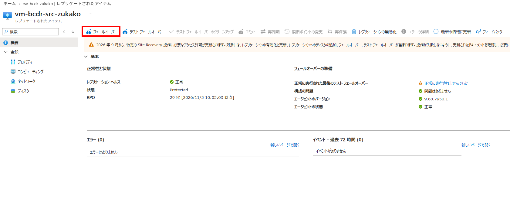
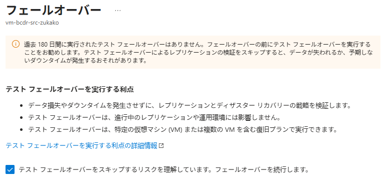
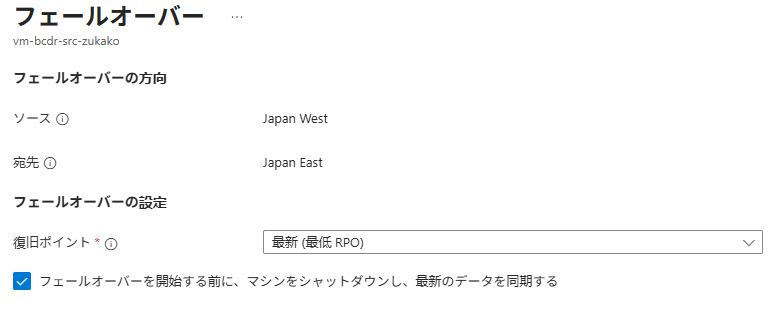
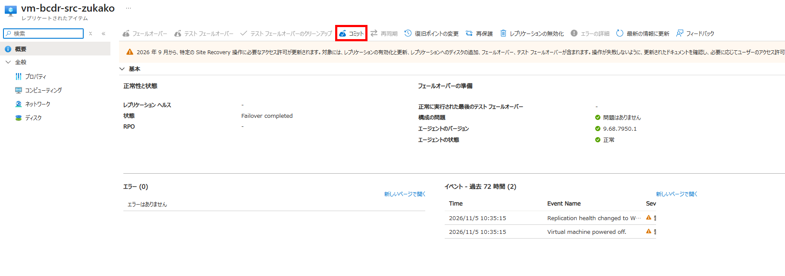
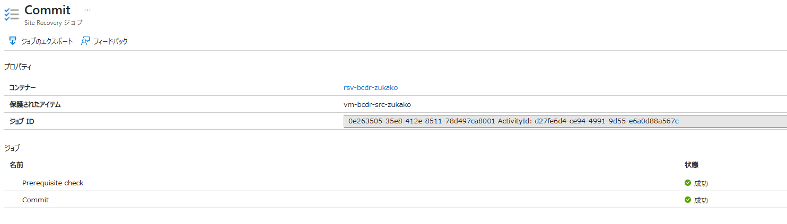
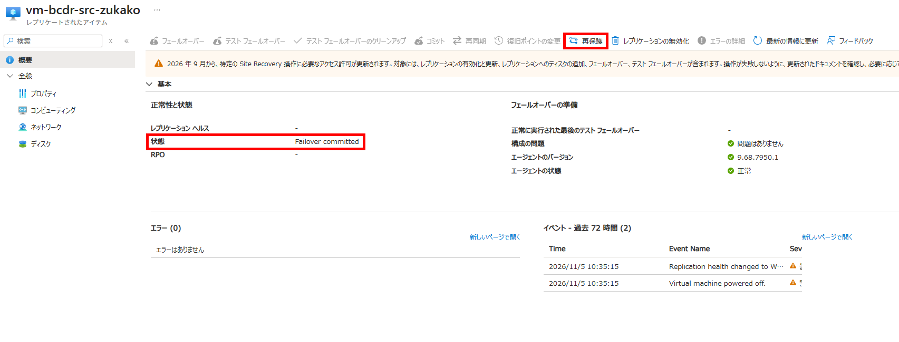
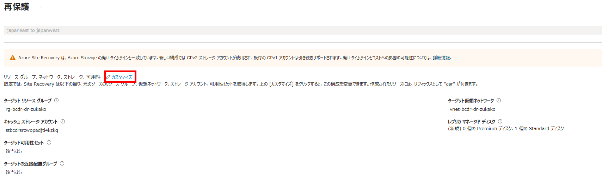

# IaaS 07：フェールバックと再保護

[前へ](./06-reprotect-to-source.md) | [全体・進捗チェック](../../../ハンズオン/01-IaaS-ASRによるDRハンズオン.md) | [次へ](./08-cleanup.md)

> 現在位置：7 / 8。このページの到達点：更新したHTMLを保持してAへ戻り、AからBの保護を再確立できる。

[前のページ](./06-reprotect-to-source.md)でBからAへの再保護と複製が正常であることを確認してから進みます。

## このページの手順

### Step 10：Region BからAへフェールバックする

現在の稼働先はRegion Bです。BからAへの複製を使って稼働先を戻します。**古いRegion AのVMを手動起動せず、ASRからフェールオーバーします。**

> 時間とクォータに余裕があれば、BからAへのテストフェールオーバーを追加できます。Region Aの隔離したテスト用VNetでVM・Web・ネットワークを確認し、テストVMをクリーンアップしてから進みます。AからBへのテストは逆方向の動作確認にはなりません。

#### 10.1 戻す準備を確認し、PortalからRegion BのVMを停止する

1. 対象のレプリケートされたアイテムで、BからAへの再保護が完了し、複製が正常であることを確認します。
2. 最新の処理済み復旧ポイントの時刻が、[BでのHTML更新記録](./05-failover-and-update.md)の`Write completed at UTC`より後であることを確認します。Bの現在のHTMLが記録したマーカー`apache-html-updated-in-region-b`と一致することを確認し、以降は変更しません。
3. Region Aで必要な権限・VMサイズのクォータと容量が確保され、戻す先の元のリソースグループ・VNet・サブネットが利用できることを確認します。
4. Bの停止からAでのWeb確認までサービスが停止することを確認します。組織で承認が必要な場合は取得します。
5. Portalで、**Region Bの現在稼働中の復旧VM**を開き、**停止（Stop）**を選択して確認ダイアログで承認します。Region AのVMと取り違えないよう、リージョンとVM名を確認します。
6. 停止操作の完了を待ち、PortalでVMの状態が**停止済み**または**停止済み（割り当て解除）**であることを確認します。

**Portalの停止がロックによって拒否された場合のみ**、ロックを削除せず、Bの稼働中の復旧VMへBastionで接続して次を実行します。この手順の目的は、Aで稼働を再開する前にBを停止し、両方のVMが同時にサービスを提供する状態を避けることです。

```bash
sync &&
sudo shutdown -h now
```

この代替手順でも、PortalのVM状態とHTTP要求で停止完了を確認します。OS内からの停止では割り当て解除されない場合があり、その場合はVMのコンピューティング課金が継続します。

**確認結果**：Bが停止し、更新後の復旧ポイントと照合用マーカーを確認できること。確認できなければフェールバックを開始せず、原因を調べます。

#### 10.2 Region Aへフェールバックし、Webページと更新内容を確認する

1. Recovery Servicesコンテナーの **レプリケートされたアイテム**から対象を開き、**フェールオーバー（Failover）**を選択します。テストフェールオーバーを実施していない旨の警告・確認が表示された場合は、上記の演習方針と10.1の確認結果を踏まえ、省略して実行することを確認して進みます。


2. ソースがRegion B、ターゲットがRegion Aであることと、戻す先が元のリソースグループ・VNet・サブネットであることを確認します。テスト専用VNetは使用しません。
3. 復旧ポイントは**最新（Latest）**を選択します。これはASRへ送信済みのデータを処理して復旧ポイントを作成する選択肢です。Bの未複製データまで必ず復元できるという意味ではないため、10.1での更新後の復旧ポイント確認が必要です。
4. **開始前にマシンをシャットダウンする**が表示される場合は選択します。この機能はソースの停止を試みますが、停止に失敗してもフェールオーバーが続行されるため、10.1での停止確認を省略しません。

5. 設定を確認して実行し、開始時刻を記録します。**Site Recoveryジョブ**で対象ジョブの成功を確認してから、復帰したAのVMが実行中であることを確認します。
6. AのVM・ディスク・NIC・VNetとTrusted Launch、Secure Boot・vTPMの状態を確認します。元のVM名・NIC・IPが再利用されているか確認します。ディスクは再構成される場合があります。
7. Aの実際のNICの主IP構成と公開IPを確認します。公開IPが未関連付けの場合は、リージョン・SKU・対象NICを確認して、演習専用Standard公開IPv4を関連付けます。元の公開IPが未使用で条件を満たす場合は再利用できます。
8. 元用NSGと、NICにもNSGがある場合の実効規則で、[01：Bicepデプロイ結果の確認](./01-verify-deployment.md)にあるSSH・HTTP規則を確認します。
9. AのVMの **接続 → Bastion**から元VNetのBastion Developer経由で、`azureuser`と演習専用パスワードを使って接続します。

```bash
systemctl is-enabled apache2 &&
systemctl is-active apache2 &&
cat /var/www/html/index.html &&
curl --fail --silent --show-error --connect-timeout 5 --max-time 15 http://127.0.0.1/
```

10. Apacheが有効・稼働中で、HTMLとローカルHTTP応答に**Bで記録したマーカー`apache-html-updated-in-region-b`**が表示されることを確認します。HTMLを書き直したり、Apacheを再インストールしたりせず、複製された内容をそのまま確認します。
11. ブラウザーで`http://<Aの公開IP>/`を開き、更新後マーカーを含むページが5秒以上の間隔で3回連続して正常表示されることを確認します。最初の成功時刻と連続確認完了時刻を記録します。
12. PortalでBのVMが停止したままであることを再確認します。

**確認結果**：AでWebサービスが稼働し、Bで更新したHTMLが保持され、Bは停止していること。初期構築時のHTMLに戻っている場合は成功ではありません。

ジョブ失敗、Web表示の失敗、マーカー不一致、Bの停止未確認のいずれかがあればコミットしません。ジョブ結果・稼働先・確認結果を記録し、Bの再起動や保護無効化を行わず原因を調べます。

##### 補足：元のVM・NIC・IPとディスクはどうなるか

元のリソースを残した場合、フェールバックでは再保護で同期したRegion Bのディスク内容を使います。HTMLだけでなくOS・データディスクが複製対象です。

VM名・NIC・IPの再利用と、ディスクの同一性は分けて確認します。次の表は、元の構成を変更・削除した場合に注意が必要になる例です。今回の演習でこれらの変更を行う必要はありません。

| 対象 | 今回の確認・想定 | 保持されない、または再利用できない主なケース |
| --- | --- | --- |
| VM名・NIC | 元のVM名・NICが使われていることを確認します。 | 元のリソースを削除・再作成した場合や、復旧先の構成を変更した場合。同じ名前でも、再作成されたリソースである可能性があります。 |
| プライベートIP | 元のNICの主IP構成とアドレスを確認します。 | VNet・サブネットを変更した場合や、NICの再作成時に元のアドレスが使用済みの場合。競合時に自動で別のIPへ変更されるとは限りません。 |
| 公開IP | 元のStandard静的公開IPリソースと、NICへの関連付けを確認します。 | 元の公開IPリソースを削除した場合や、別の公開IPへ関連付けを変更した場合。リソースを残していれば、VMの停止・割り当て解除だけでStandard静的公開IPのアドレスは変わりません。 |
| OS・データディスク | Region Bで更新した内容が保持されていることを確認します。 | ASRの再保護で元のディスクが再構成・置換されることがあります。 |

**元のリソースを削除してもASRが自動で代替リソースを作り、必ず復旧できるという意味ではありません。** 構成変更やリソースの欠損によっては、再保護・フェールバックが失敗します。「元のVMを手動起動しない」とは、元のVM名が使われないという意味ではなく、ASRを通さず古いデータのまま起動しないという意味です。

参考：[ASRの再保護時のリソース・ディスク処理](https://learn.microsoft.com/azure/site-recovery/azure-to-azure-how-to-reprotect#reprotect-a-virtual-machine)

#### 10.3 フェールバックの結果をコミットする

1. AのWeb表示、Bのマーカーとの一致、Bの停止を再確認し、時刻と証拠を保存します。必要な組織承認があれば取得します。
2. **コミット後は、このアイテムの既存の復旧ポイントが削除され、復旧ポイントを変更できなくなること**を確認します。
3. 対象のレプリケートされたアイテムで**コミット（Commit）**を選択し、確認ダイアログで承認します。

4. Site Recoveryジョブの成功と、アイテムが**Failover committed**に相当する状態になったことを確認します。

**確認結果**：Aへのフェールバックがコミット済みであること。稼働先はAに戻りましたが、AからBへのDR保護の再確立は次のStepで行います。

### Step 11：Region AからBへの保護を再確立する

1. Aへのフェールバックがコミット済みであること、AのWebが正常であることを確認します。Aの公開IP・NSGなどの接続設定は再保護を開始する前に確定します。
2. **再保護（Re-Protect）** を選び、ソースA、ターゲットB、通常復旧先のグループ・VNet・サブネット・VMサイズを確認します。テスト専用VNetは指定しません。

3. [逆方向の再保護](./06-reprotect-to-source.md)と同様に、キャッシュストレージが稼働先のAに必要なことと、Bの旧復旧VM・ディスクが再構成され得ることを承認します。設定の編集で、Region Aに用意した既存ストレージ（Bicep出力`sourceCacheStorageAccountName`）を選択し、コンテナーのIDへのロール割り当てを確認します。BのVMやディスクを先に手動削除しません。

4. 再保護を実行し、Site Recoveryジョブと複製状態を確認します。
5. 完了後、Aが稼働先で、AからBの複製が正常で、更新後HTMLを含む復旧ポイントがあることを確認します。
6. AのWeb表示とマーカーが変わっていないことを確認し、終了時の保護状態を記録します。Bの旧復旧VMは手動起動しません。

**確認結果**：元の稼働リージョンに戻るだけでなく、AからBへ再び保護できる状態になったこと。再保護が未完了の場合は「Aで稼働再開、DR保護再確立は未完了」と記録し、本ページを完了扱いにしません。

## このページの完了チェック

- [ ] Bを停止してAへフェールバックし、更新後マーカーの一致と利用者経路からの表示を確認した。
- [ ] 戻した結果を確認・コミットした。
- [ ] AからBへ再保護し、複製正常性・復旧ポイントと終了時の稼働先を確認した。

完了したら[全体ページ](../../../ハンズオン/01-IaaS-ASRによるDRハンズオン.md)の対応するチェックを更新します。

[前へ](./06-reprotect-to-source.md) | [全体・進捗チェック](../../../ハンズオン/01-IaaS-ASRによるDRハンズオン.md) | [次へ](./08-cleanup.md)
