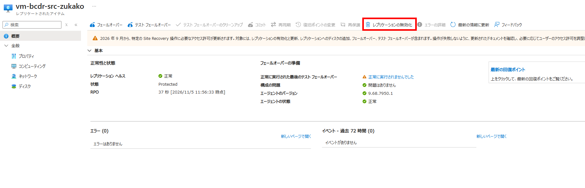
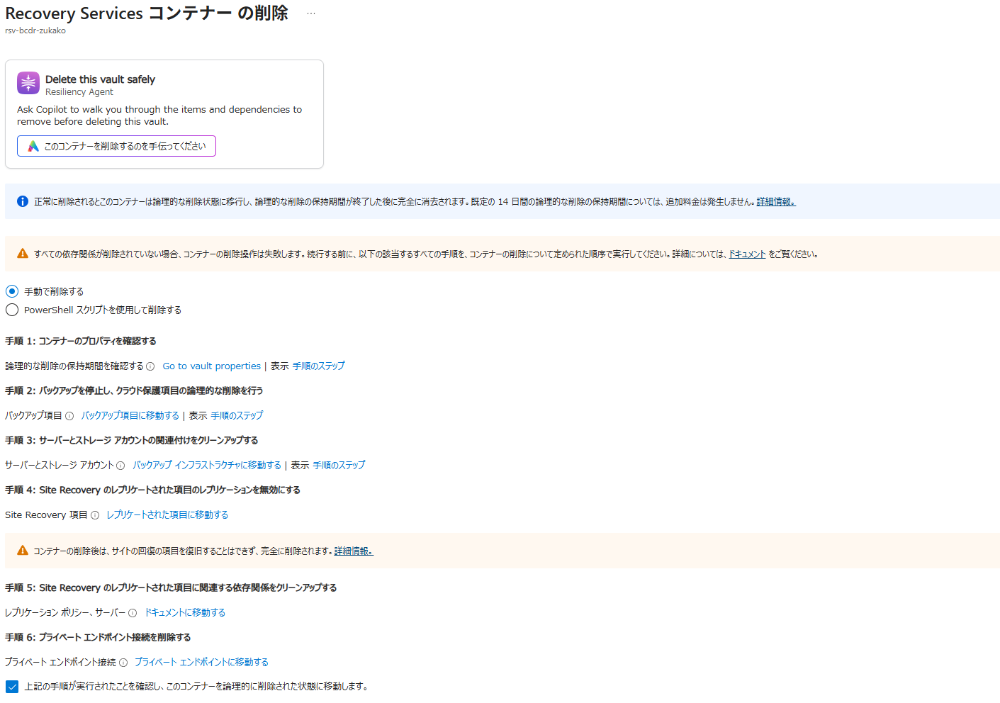
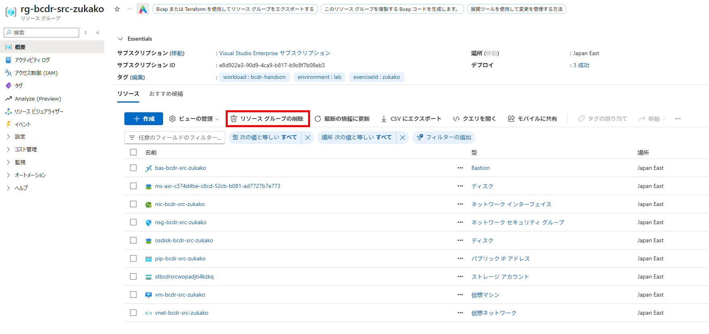

# IaaS 08：クリーンアップ

[前へ](./07-failback-and-reprotect.md) | [ハンズオンの進め方](../README.md) | [補足：トラブルシューティング](./09-troubleshooting.md)

> 現在位置：8 / 8。このページの到達点：往復の切り替え結果を保存し、最終削除または継続利用の扱いを記録できる。

[前のページ](./07-failback-and-reprotect.md)の完了条件を満たしてから進みます。

- **削除する場合**：確認記録（ジョブ結果、復旧ポイントの時刻、HTML マーカーなど）を VM 外へ保存し、Step 12 を実行します。組織で承認が必要な場合は事前に取得します。
- **継続利用する場合**：Region A のページと A から B への複製が正常であること、費用と確認担当を記録します。Region B の旧復旧 VM は起動せず、Step 12 は実行しません。
- **中断する場合**：稼働 VM・複製方向・保護状態を記録し、削除の影響を確認します。

> [!WARNING]
> VM を停止しただけでは、ディスク、公開 IP、ASR などの課金が残る場合があります。継続利用・中断の場合も、残存リソースと費用を確認してください。

## Step 12：演習終了後に専用環境を削除する

> [!CAUTION]
> 削除対象は、自分の演習専用リソースだけです。共有リソースや他の保護対象が含まれる場合は中止してください。
>
> ASR が設定した Read-only ロックがある場合は、ジョブと保護状態を確認します。ロックを強制解除して VM・ディスクを先に削除せず、複製無効化と公式の削除手順に従ってください。

1. 対象が自分の演習 VM だけであることと、現在の複製方向を確認し、コンテナーのレプリケートされたアイテムから **レプリケーションを無効にする（Disable replication）** を実行します。

  

2. ジョブ完了と、対象アイテムが複製対象から除外されたことを確認します。VM などのリソースが残っていないか確認し、以下の削除手順を続けます。
3. Recovery Services コンテナーの削除画面で依存関係を確認します。Site Recovery の登録・関連付けなどが残る場合は、画面の指示と公式の削除手順に従って、演習専用の項目だけを解除します。
4. コンテナーを削除します。共有ポリシーや他の保護対象がある場合は削除を中止します。

  

5. 元・DR・テスト用の 3 つの専用リソースグループを確認し、共有リソースがない場合だけ削除します。

  

6. ASR で自動作成されたリソースが別のグループにある場合は、記録と照合して演習専用のものだけを削除します。次のリソースが残っていないか確認します。
   - ネットワーク：各 VNet の Bastion Developer、テスト用公開 IP
   - VM 関連：ディスク、NIC
   - 複製関連：キャッシュストレージ、Automation アカウント
7. 演習用パスワードは他のシステムでは使用せず、演習環境削除後に廃止します。

**確認結果**：削除する場合は専用リソースの削除が完了していること。継続利用する場合は正常性を確認し、残存リソース・費用・確認担当を記録していること。

## 終了時の確認

- フェールバック後の HTML・稼働 VM・複製方向と確認記録を記録した。
- 専用環境を削除した、または継続利用の費用・担当を記録した。

これで本編は完了です。

[前へ](./07-failback-and-reprotect.md) | [ハンズオンの進め方](../README.md) | [補足：トラブルシューティング](./09-troubleshooting.md)
