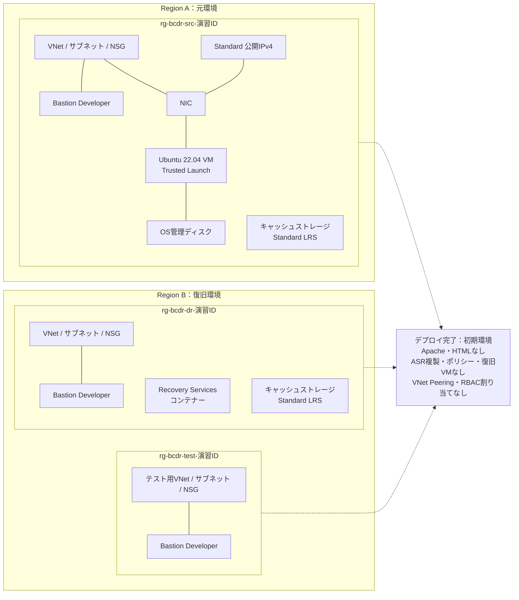

# Bicepによる初期リソースの作成

[事前準備と確認ポイント](./00-prerequisites.md) | [全体・進捗チェック](../../../ハンズオン/01-IaaS-ASRによるDRハンズオン.md) | [次へ：デプロイ結果の確認](../exercises/01-verify-deployment.md)

この手順では、Bicepでハンズオンの初期環境を作成します。まず図で作成範囲を確認し、パラメータファイルの値を設定してデプロイします。既存の手作業環境には展開せず、新しい演習IDを使ってください。

## 作成するリソースと完了後の状態



ASRの複製を有効にする操作は後続手順で行います。ASRのテストVM・復旧VMもこのデプロイでは作成されません。テスト用のリソースグループとネットワークだけを先に用意します。

## 1. Bicep のパラメータ編集

編集するのは[infra/main.bicepparam](./infra/main.bicepparam)です。このファイルを開き、演習IDとリージョンを設定します。`exerciseId`の初期値`WRITE-YOUR-EXCERCISE-ID`はプレースホルダーなので、そのまま使わず、自分用の値に置き換えてください。

```bicep
using './main.bicep'

param exerciseId = 'YOUR-ID'
param sourceLocation = 'japaneast'
param recoveryLocation = 'japanwest'
param adminPassword = readEnvironmentVariable('BCDR_ADMIN_PASSWORD')
```

| パラメーター | ここに設定する値 |
|---|---|
| `exerciseId` | 自分の演習ID。英小文字・数字・ハイフンで1～24文字、先頭と末尾は英数字。3つのリソースグループ名にも使われます。例：`bcdr-lab-01` |
| `sourceLocation` | 元環境のリージョンコード。既定は`japaneast` |
| `recoveryLocation` | 復旧・テスト環境のリージョンコード。既定は`japanwest`。元とは異なるリージョンを指定 |
| `adminPassword` | この行は変更しません。パスワードは次の手順で環境変数に設定します |

リージョンを変える場合は、`sourceLocation`と`recoveryLocation`をペアで変更します。例：`southeastasia`と`eastasia`。両リージョンのVMサイズ・Ubuntuイメージ・ASR・Bastion Developerの対応、クォータ、組織の許可リージョンを事前確認してください。候補は[Azureのペアリージョン](https://learn.microsoft.com/azure/reliability/regions-paired)を参照します。デプロイ履歴の保存先リージョンは、下記コマンドの`--location`で別に指定します。

VMサイズは`Standard_D2s_v5`、Ubuntuイメージバージョンは`latest`が既定値です。これらを変える場合は[infra/main.bicep](./infra/main.bicep)の`vmSize`・`imageVersion`の既定値を編集します。`latest`を使う場合は、初回構築後にOS・カーネルのASR対応を確認してください。反復開催では検証済みバージョンを指定してください。

## 2. サブスクリプションと環境変数を設定する

リポジトリのルートでPowerShellを開き、演習用サブスクリプションを選択します。パスワードは演習専用のものを使い、ファイルやリポジトリには書かないでください。

```powershell
az login --use-device-code
```

1. PowerShellに表示されたURL（通常は`https://microsoft.com/devicelogin`）をブラウザーで開き、表示されたコードを入力します。
2. 演習用サブスクリプションを利用できるアカウントでサインインし、求められた場合は多要素認証を完了します。
3. PowerShellに戻り、テナント・サブスクリプションの選択が表示された場合は演習用のものを選びます。コマンドの完了後、以下を実行します。コードは他の人に共有しないでください。

```powershell
az account set --subscription '<演習用サブスクリプションID>'

$env:BCDR_DEPLOYMENT_LOCATION = 'japaneast'
$env:BCDR_ADMIN_PASSWORD = '<演習専用パスワード>'
```

`BCDR_DEPLOYMENT_LOCATION`には、デプロイ履歴の保存先リージョンコードを設定します。例では`japaneast`を使います。VMやコンテナーの配置先はパラメータファイルの`sourceLocation`・`recoveryLocation`で指定するため、この環境変数を変えてもリソースの配置先は変わりません。

パスワードは英大文字・英小文字・数字・記号を含む12～123文字にします。`main.bicepparam`の`adminPassword`は、この環境変数をBicepのsecure parameterとして読み込みます。

**以降のビルド・what-if・デプロイは、環境変数を設定した同じPowerShellターミナルで実行してください。** ターミナルを開き直した場合は再設定します。

## 3. ビルドして変更内容を確認する

```powershell
az bicep build --file '.\BCDR\handson\iaas\preparation\infra\main.bicep' --stdout | Out-Null

az deployment sub what-if `
  --name bcdr-initial `
  --location $env:BCDR_DEPLOYMENT_LOCATION `
  --template-file '.\BCDR\handson\iaas\preparation\infra\main.bicep' `
  --parameters '.\BCDR\handson\iaas\preparation\infra\main.bicepparam'
```

`--location`には、手順2で設定した環境変数を使います。`what-if`の結果で、演習ID、3つのリソースグループ、作成リソース、Bastion Developer、公開IPを確認します。既存リソースの変更が表示された場合は実行せず、演習IDとサブスクリプションを確認してください。

## 4. デプロイする

リソース作成により費用が発生します。事前準備と組織の承認を済ませ、`what-if`の内容を確認してから実行してください。

```powershell
az deployment sub create `
  --name bcdr-initial `
  --location $env:BCDR_DEPLOYMENT_LOCATION `
  --template-file '.\BCDR\handson\iaas\preparation\infra\main.bicep' `
  --parameters '.\BCDR\handson\iaas\preparation\infra\main.bicepparam' `
  --query properties.outputs --output json
```

デプロイが成功したら、同じPowerShellでパスワードの環境変数を削除します。これは手元の環境変数だけを削除する操作で、VMのログインパスワードは変わりません。

```powershell
Remove-Item Env:BCDR_ADMIN_PASSWORD
Test-Path Env:BCDR_ADMIN_PASSWORD
```

`False`が表示されれば削除済みです。デプロイに失敗した場合はエラーを確認し、再試行しない場合も環境変数を削除してください。削除後に再試行する場合はパスワードを再設定します。

出力された3つのリソースグループ名、元VMのID・公開IP、Bastion ID、サブネットID、Recovery ServicesコンテナーID、両方のキャッシュストレージ名を記録します。`sourcePageUrl`はApache設定後に開くWebページのURL、`sourceVmPortalUrl`は元VMのAzure Portal画面を開くURLです。リソースの詳細確認とBastion接続は、次の[01：デプロイ結果の確認](../exercises/01-verify-deployment.md)で行います。

## 5. 完了状態を確認して次へ進む

- [ ] 元・復旧・テスト用の3つのリソースグループと、図に示したリソースが作成された。
- [ ] デプロイの出力値を記録した。
- [ ] Apache・HTMLはまだなく、ASR複製もまだ有効になっていない。
- [ ] パスワードの環境変数を削除した。

> 注記：
> - ハンズオン専用の構成です。公開IP・HTTP（TCP 80）を使用し、HTTPSは構成しません。本番環境へそのまま展開せず、公開ページには静的な演習データだけを置き、終了後に削除してください。
> - VNet Peering・Azure RBACロール割り当ては作成しません。ASR複製の有効化前に、両方のキャッシュストレージでコンテナーのマネージドIDへ必要なロールを割り当てます（[03：ASRの構成と初期複製](../exercises/03-configure-asr.md)）。

[01：デプロイ結果の確認](../exercises/01-verify-deployment.md)へ進み、リソースの確認とBastion接続を行います。「01」の完了チェックは、そのページの手順を終えてから更新してください。ASR演習開始後は元VM・ディスク・ネットワークが再構成されるため、このBicepを再展開してリセットしないでください。初期環境を作り直す場合は、[クリーンアップ](../exercises/08-cleanup.md)で専用環境を削除し、新しい演習IDで構築します。
