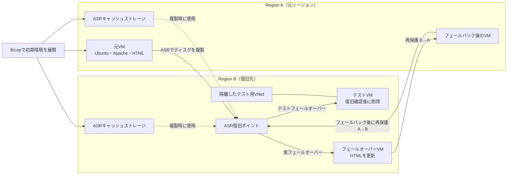

# IaaS：Azure Site RecoveryによるDRハンズオン

参加者が専用のAzure環境を準備し、Ubuntu VMでWebサーバーを構築します。Azure Site Recovery（ASR）で別リージョンへのフェールオーバー、再保護、フェールバックを確認します。初期環境はBicepで作成します。

## 1. 目的とシナリオ

Region AのWebサーバーVMを停止し、ASRでRegion Bへ復旧します。ApacheとHTMLの復旧、再保護、フェールバックまで確認します。

本編では、テスト用VNetで復旧を事前確認した後、**演習用の元VMを停止して実フェールオーバー**します。Region BでHTMLを更新し、再保護・逆方向複製を経てRegion Aへフェールバックし、更新内容を保持して戻れたことを確認します。

これは専用VMの停止による模擬障害です。リージョン全体の障害を起こしたり、本番リソースを操作したりしません。

### 到達目標

- BicepでVM・ネットワークを展開し、Azure PortalでASRのリージョン間複製を構成できる。
- Ubuntuへログインし、Apacheのインストール、自動起動設定、HTML配置を実行できる。
- 複製の正常性、復旧ポイント、復旧先の構成を確認できる。
- テストフェールオーバーでVMとWebページの復旧を確認できる。
- VMの起動完了、Apacheの正常応答、利用者の経路からの表示を区別できる。
- 復旧したHTMLをHTMLマーカーで比較し、確認範囲と限界を説明できる。
- 実フェールオーバーの結果を確認してコミットし、復旧先で運用を継続できる。
- 再保護・逆方向複製・フェールバック・元方向の再保護を実行できる。
- 復旧先で更新したHTMLを保持して戻ることと、テストVMの削除を区別できる。

### 今回の対象範囲

| 対象 | 扱い |
|---|---|
| 初期VM・ネットワークの作成 | Bicepで参加者が構築 |
| ASRの構成 | 参加者がAzure Portalで複製を有効化 |
| Azure VMのリージョン間複製 | 参加者が有効化し、初期複製と正常性を確認 |
| 復旧ポイントからのVM起動 | テストと実フェールオーバーの両方を実行 |
| Ubuntu＋Apache＋静的HTML | 参加者がOS内で構成し、復旧先で確認 |
| DB・投稿フォーム・業務処理 | 対象外。HTMLファイルの保持を確認 |
| 本番経路の切り替え、DNS変更 | 対象外 |
| 実フェールオーバー、コミット、再保護、フェールバック | 本編として実施し、更新したHTMLの保持を確認 |
| リージョン全体の障害、外部DB・認証基盤の復旧 | 対象外 |

## 2. 構成

復旧先でApacheやHTMLを作り直さず、ディスクと自動起動設定の復旧を確認します。接続先はVM名・リージョン・IPで照合します。

## 3. 所要時間

操作・確認の目安は約210分です。VM展開、初期複製、再保護、復旧ポイント生成の待ち時間は別途必要です。参加者は確保できる時間に合わせ、各ジョブの待機上限を開始前に決めてください。

| 所要 | 内容 |
|---|---|
| 35分 | Bicep展開・デプロイ結果確認・Bastion接続 |
| 25分 | Apacheのインストール、HTML配置、表示確認 |
| 20分 | コンテナー作成・ASR有効化 |
| 5分 | 初期複製完了・復旧ポイントの確認（待ち時間は別） |
| 25分 | テストフェールオーバー・復旧確認・テスト終了 |
| 25分 | 元VM停止・実フェールオーバー・コミット・HTML更新 |
| 15分 | Region BからAへの再保護と複製確認（待ち時間は別） |
| 25分 | Region Aへのフェールバック・HTML確認・コミット |
| 15分 | Region AからBへの再保護と複製確認（待ち時間は別） |
| 20分 | 最終クリーンアップと振り返り |

全工程は3時間を超える場合があります。待機上限を超えた場合は未完了として記録し、再保護を飛ばして完了扱いにしません。

## 4. 開始前の確認事項

開催前に[参加者用の事前準備](./IaaS/準備/00-参加者用の事前準備.md)を済ませます。Azure側の詳細確認には[事前準備と確認ポイント](./IaaS/準備/00-事前準備と確認ポイント.md)を使います。

### 4.1 アカウント・許可・端末

Azure環境は事前作成不要です。参加者がサブスクリプション、リージョン、VMサイズ、演習ID、専用パスワードを選び、以下を確認します。

- [ ] 自分が利用できる演習用サブスクリプションを選び、作成・削除・ASR操作に必要な権限を確認した。Site Recovery Contributorだけでは不足する場合がある。
- [ ] Region A・BとVMサイズを選び、両リージョンのASR対応、vCPUクォータ、ポリシーを確認した。クォータは容量を保証しない。
- [ ] 本手順はUbuntu Server 22.04 LTS Gen2のTrusted Launch（Secure Boot・vTPM有効）を想定し、実際のOS・カーネルがASR対応であることを確認する。[Trusted Launch対応条件](https://learn.microsoft.com/ja-jp/azure/site-recovery/concepts-trusted-vm)も確認する。
- [ ] 参加者の端末からAzure Portal・Bastionのブラウザー接続（HTTPS）と、演習ページのHTTP（TCP 80）を利用できる。
- [ ] 演習専用の公開IPとHTTP（80）のAnyからの受信が組織のルールで許可される。公開IPへのSSHは許可しない。
- [ ] 両リージョンでBastion Developerを利用できる。演習専用パスワードを自分で作り、他の環境・アカウントに流用しない。
- [ ] 参加者・グループごとに英数字の演習IDを決め、元・DR・テスト用RGと全リソース名で共通使用する。
- [ ] 元VMからパッケージ配布先とASRが必要とする宛先への送信が許可される。
- [ ] 費用と確保時間を見積もり、実行・中断・削除の判断基準を決める。組織で別途承認が必要な操作は事前に取得する。
- [ ] 元VMの停止、コミット、再保護によるリソース再構成の影響を理解し、必要な証拠をVM外へ保存する。
- [ ] Region BからもASR・キャッシュストレージへの送信通信を利用できる。戻す先のRegion Aの容量・権限も確認する。

公開IPが許可されない場合は本手順を中止します。ポリシーやFirewallを回避せず、利用可能な接続経路が確認できてから再開します。Bastion接続だけではPCからWebページを表示できるとは限りません。

### 4.2 記録する情報

リソース名・IP、HTMLマーカーと更新時刻、ジョブID・状態、現在の稼働リージョンと複製方向をVM外へ記録します。パスワードなどの秘密情報は記録しません。各ジョブの待機上限は開始前に自分で決めます。

## 5. 演習手順

Portalの表記は更新される場合があります。以下の機能名を目印にし、対象リソースと操作の内容を確認して進めます。

`bash`コードは対象のUbuntu VM内で実行します。失敗したらエラーを記録し、原因が分かるまで次へ進みません。

### 進め方と進捗チェック

初期環境は[00：Bicepによる初期リソースの作成](./IaaS/準備/00-Bicepによる初期リソースの作成.md)で展開し、[01：デプロイ結果の確認](./IaaS/演習/01-ネットワークとVMの作成.md)を行ってから02へ進みます。

01〜08を順に進め、完了条件を満たしたページだけチェックします。09はトラブル時に参照します。

待機上限超過やエラー時は未完了のまま停止箇所を記録します。HTMLマーカーと更新時刻はVM外に控えてください。

- [ ] [00：Bicepによる初期リソースの作成](./IaaS/準備/00-Bicepによる初期リソースの作成.md) — 初期環境をデプロイした。
- [ ] [01：Bicepデプロイ結果の確認](./IaaS/演習/01-ネットワークとVMの作成.md) — 専用Ubuntu VMへBastion Developer経由でログインできる。
- [ ] [02：ApacheとHTMLの構成](./IaaS/演習/02-ApacheとHTMLの構成.md) — Webページが表示され、演習用のHTMLマーカーを確認できる。
- [ ] [03：ASRの構成と初期複製](./IaaS/演習/03-ASRの構成と初期複製.md) — 初期複製が完了し、HTML構成後の復旧ポイントを確認できる。
- [ ] [04：テストフェールオーバーと復旧確認](./IaaS/演習/04-テストフェールオーバーと復旧確認.md) — 復旧先で再インストールせずページが表示され、HTMLが一致する。
- [ ] [05：実フェールオーバーとHTML更新](./IaaS/演習/05-実フェールオーバーとHTML更新.md) — 元VMを停止し、Region Bで復旧・コミット・HTML更新が完了する。
- [ ] [06：逆方向の再保護](./IaaS/演習/06-逆方向の再保護.md) — BからAへ複製し、更新後の復旧ポイントを確認できる。
- [ ] [07：フェールバックと再保護](./IaaS/演習/07-フェールバックと再保護.md) — 更新したHTMLを保持してAへ戻り、AからBの保護を再確立できる。
- [ ] [08：クリーンアップ](./IaaS/演習/08-クリーンアップ.md) — 最終削除または継続利用の状態・費用・担当者を記録できる。

[最初のページへ](./IaaS/演習/01-ネットワークとVMの作成.md) | [補足：よくあるハマりどころとトラブルシューティング](./IaaS/演習/09-よくあるハマりどころとトラブルシューティング.md)
