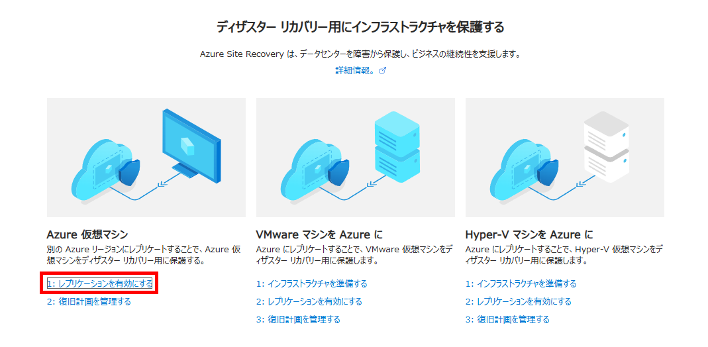
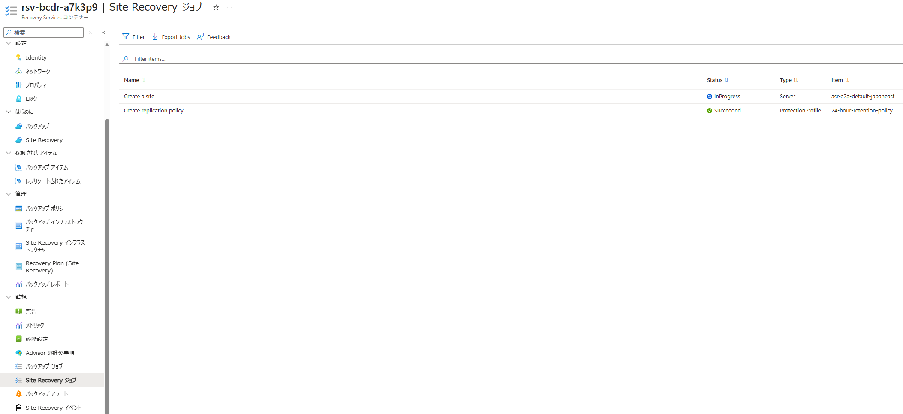

# IaaS 03：ASRの構成と初期複製

[前へ](./02-ApacheとHTMLの構成.md) | [全体・進捗チェック](../01-IaaS-ASRによるDRハンズオン.md) | [次へ](./04-テストフェールオーバーと復旧確認.md)

> 現在位置：3 / 9。このページの到達点：初期複製が完了し、HTML構成後の復旧ポイントを確認できる。

[前のページ](./02-ApacheとHTMLの構成.md)の完了条件を満たしてから進んでください。

時刻・証拠・未取得項目は[観測記録](./09-観測記録と振り返り.md)へ随時記入します。

## このページの手順

### Step 3：PortalでASRを有効化し、初期複製を待つ

#### 3.1 Recovery Servicesコンテナーを作成する

[Bicepで初期リソースを作成](./00-Bicepによる初期リソースの作成.md)した場合、コンテナーは作成済みです。出力されたコンテナーを開き、名前・Region Bを確認して3.2へ進みます。ASRの複製有効化はBicepに含まれません。

1. Portalの **Recovery Servicesコンテナー → 作成** を開きます。BackupコンテナーではなくRecovery Servicesコンテナーを選びます。
2. 演習用サブスクリプション、DR用グループ（`rg-bcdr-dr-<演習ID>`）、名前`rsv-bcdr-<演習ID>`、Region Bを指定します。テスト用グループは`rg-bcdr-test-<演習ID>`です。
3. **確認および作成 → 作成** で展開し、作成されたコンテナーを開きます。元のVMと同じRegion Aには置きません。

#### 3.2 Azure VMのレプリケーションを有効にする

Trusted LaunchのLinux VMは、VM作成画面のSite Recovery同時有効化ではなく、以下のコンテナーからの手順を使います。Ubuntu 22.04と実際のカーネルが[サポート対象](https://learn.microsoft.com/ja-jp/azure/site-recovery/concepts-trusted-vm)であることを確認します。ASRはSecure Boot・vTPM設定を保持しますが、ブート整合性監視の状態は複製しません。

1. コンテナーの **Site Recovery** を開き、**Azure仮想マシン → レプリケーションを有効にする（Enable replication）** を選択します。

2. **ソース** でRegion A、演習用サブスクリプション、元のリソースグループを選択します。ゾーン間DRではなくリージョン間DRを選択します。

3. **仮想マシン** で自分の元VMだけを選択します。

4. **レプリケーション設定** の表示・編集から、次の値を確認します。自動提案されたリージョンやVNetをそのまま採用せず、演習の値に合わせます。

| 項目 | 設定・確認 |
|---|---|
| ターゲットリージョン／グループ | Region B／DR用グループ（`rg-bcdr-dr-<演習ID>`） |
| ターゲットVNet／サブネット | 通常復旧先VNet／`subnet-web`。テスト専用VNetは後のテスト時に指定。テスト用VNetはテスト用RGに分離 |

テストフェールオーバー時はテスト用VNetを選びます。ASRが一時VMや付随リソースをどのRGに作るかは、ASR画面と実リソースの配置を確認してください。Bicepのテスト用RGにはネットワークとBastionを分けてありますが、ASRが作成する復旧VMの配置先をこのテンプレートが指定するものではありません。
| ターゲットVMサイズ | 両リージョンで確認したサイズ |
| 複製対象ディスク | HTMLとApacheがある元のOS管理ディスク |
| キャッシュストレージ | Region Aに作成するASR用ストレージ。演習専用の自動作成を利用し、名前・グループを記録 |
| データ変更率 | 本演習では通常の変更率（Normal Churn） |

5. **管理** で複製ポリシーを確認します。本演習は単一VMのため、複数VMの整合性用グループを新たに構成しません。**拡張機能の設定 → 設定の更新** は **ASRに管理を許可します** を選択し、**Automationアカウント** 欄の新規作成候補を確認して **作成** を押します。これはVM内のMobilityサービス（複製エージェント）の更新を自動化するための設定で、OSやApacheの更新ではありません。作成されたAutomationアカウントの名前・所属グループと、使用する複製ポリシー名を記録します。

6. **確認 → レプリケーションを有効にする** を実行します。
7. コンテナーの **Site Recoveryジョブ** で有効化処理を、**レプリケートされたアイテム** で初期複製の進行状況を確認します。

**確認結果**：自分のVMがレプリケートされたアイテムに登録され、指定したRegion Bへの初期複製が開始すること。Mobilityサービスなど必要な構成はASRの有効化処理で導入されます。

#### 3.3 初期複製完了と構成後の復旧ポイントを確認する

1. 元のHTMLをこれ以上変更しない状態にします。
2. 初期複製が完了し、複製が正常で、選択可能な復旧ポイントがあることを確認します。
3. 最新の処理済み復旧ポイントが[Step 2](./02-ApacheとHTMLの構成.md)の`Write completed at UTC`より後の時刻であることを確認します。画面に表示されるタイムゾーンをUTCと揃えて比較します。
4. 復旧ポイントの種類・時刻と、比較対象のHTMLの演習ID・メッセージを記録します。

**確認結果**：初期複製が完了し、ApacheとHTMLを構成した後の復旧ポイントを選択できること。

時刻の前後関係は選択の前提であり、ファイル保持の証明は[Step 5](./04-テストフェールオーバーと復旧確認.md)の実データ照合で行います。待機上限を超えたら講師へ連絡します。古い復旧ポイントで進めて復旧先へ再インストールすることを、復旧成功の代替にしません。

## このページの完了チェック

- [ ] コンテナーを作成して、対象VMのリージョン間複製を有効化した。
- [ ] 初期複製が完了し、構成後の復旧ポイントと複製正常性を確認した。

完了したら[全体ページ](../01-IaaS-ASRによるDRハンズオン.md)の対応するチェックを更新します。未完了の場合は進捗メモに停止箇所と理由を残してください。

[前へ](./02-ApacheとHTMLの構成.md) | [全体・進捗チェック](../01-IaaS-ASRによるDRハンズオン.md) | [次へ](./04-テストフェールオーバーと復旧確認.md)
