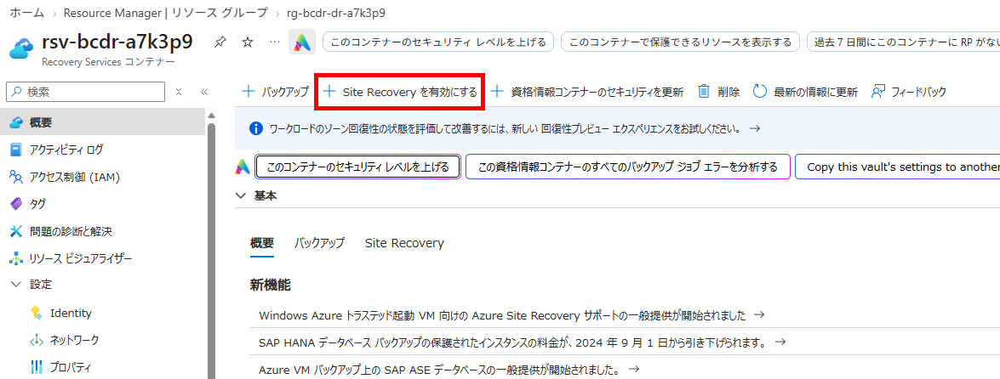
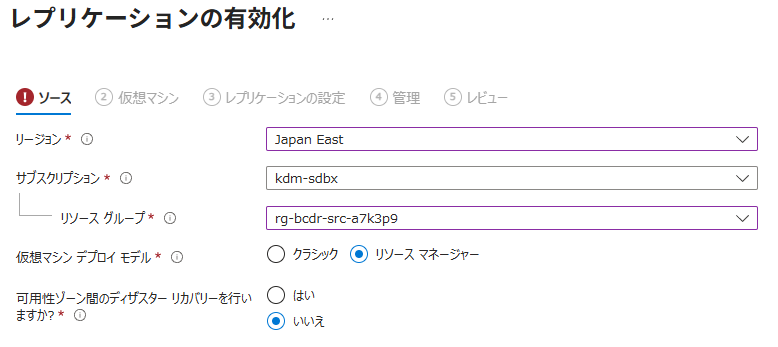
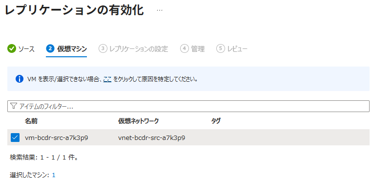
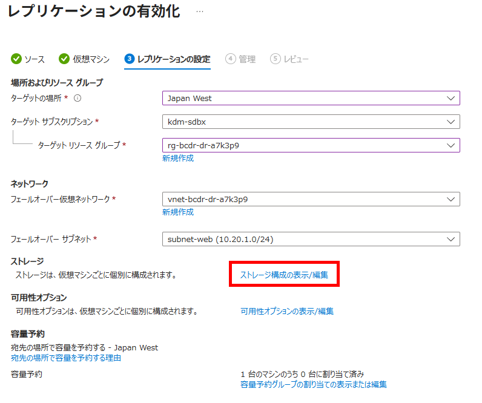
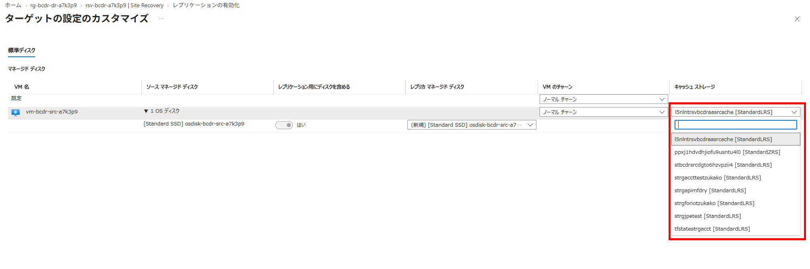
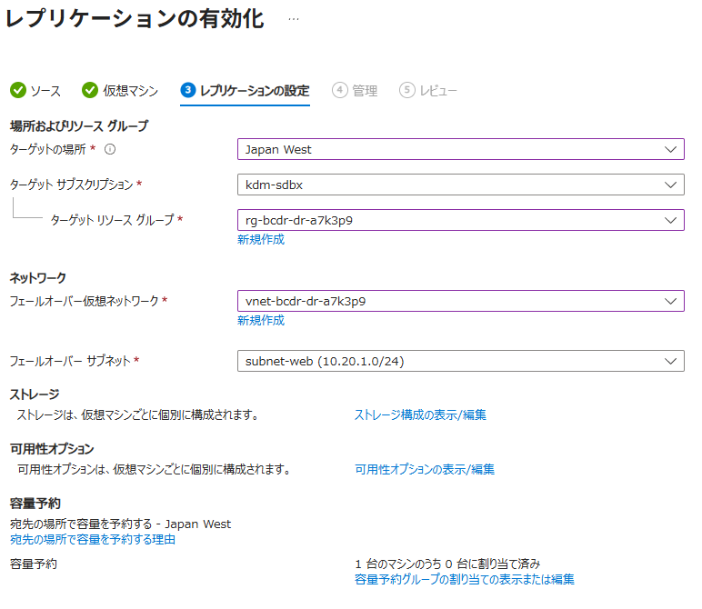
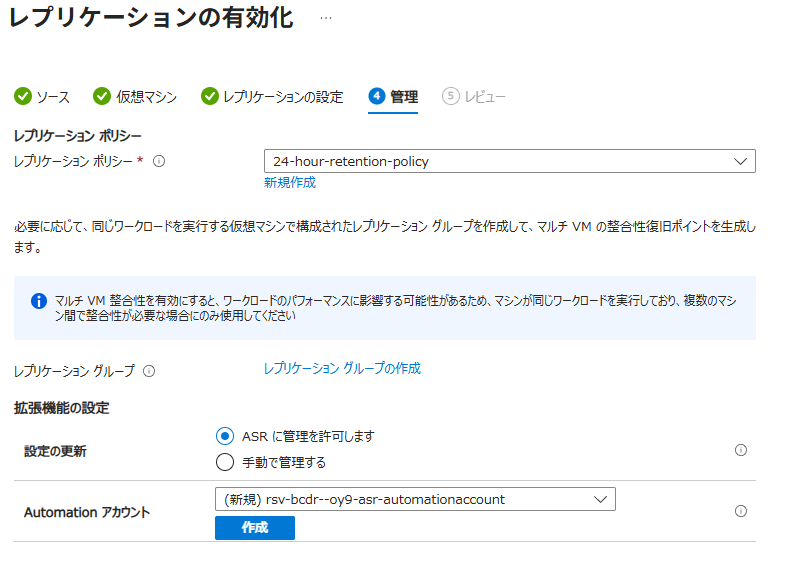
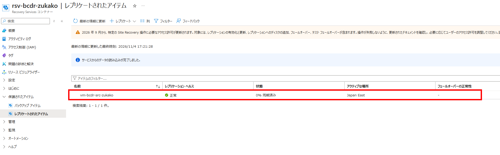
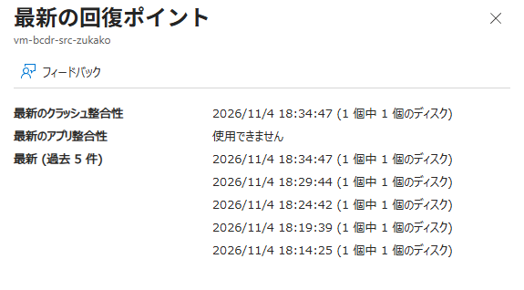

# IaaS 03：ASRの構成と初期複製

[前へ](./02-ApacheとHTMLの構成.md) | [全体・進捗チェック](../01-IaaS-ASRによるDRハンズオン.md) | [次へ](./04-テストフェールオーバーと復旧確認.md)

> 現在位置：3 / 9。このページの到達点：初期複製が完了し、HTML構成後の復旧ポイントを確認できる。

[前のページ](./02-ApacheとHTMLの構成.md)の完了条件を満たしてから進んでください。

時刻・証拠・未取得項目は[観測記録](./09-観測記録と振り返り.md)へ随時記入します。

## このページの手順

### Step 3：PortalでASRを有効化し、初期複製を待つ

#### 3.1 作成済みのRecovery Servicesコンテナーを確認する

[Bicepによる初期リソースの作成](./00-Bicepによる初期リソースの作成.md)を完了していることを前提とします。コンテナー・両リージョンのキャッシュストレージは作成済みですが、アクセス権限の付与とASRの複製有効化はBicepに含まれません。

1. Portalで、Bicep出力`recoveryVaultId`に対応するRecovery Servicesコンテナーを開きます。
2. 名前が`rsv-bcdr-<演習ID>`、所属グループが`rg-bcdr-dr-<演習ID>`、リージョンがRegion Bであることを確認し、次の権限付与へ進みます。

#### 3.1.1 キャッシュストレージとアクセス権限を準備する

キャッシュストレージは、複製元のVMと同じリージョンに必要です。通常のA→B用をRegion Aに、再保護のB→A用をRegion Bに用意します。

**レプリケーションを有効化する前に、両方のストレージへの権限付与を完了してください。** `<演習ID>`は自分の演習IDに置き換えます。ストレージ名は演習IDを含むリソースグループのIDから一意に生成されるため、固定値ではなく、自分のBicep出力で確認します。

| 用途 | ストレージアカウント | リソースグループ | リージョン |
|---|---|---|---|
| A→Bの複製用 | Bicep出力`sourceCacheStorageAccountName` | `rg-bcdr-src-<演習ID>` | Region A（既定：東日本） |
| B→Aの再保護用 | Bicep出力`recoveryCacheStorageAccountName` | `rg-bcdr-dr-<演習ID>` | Region B（既定：西日本） |

1. Bicep出力`sourceCacheStorageAccountName`（Region Aの元RG）と`recoveryCacheStorageAccountName`（Region BのDR用RG）のストレージを確認します。Bicepで**Standard・LRS・StorageV2**、HTTPSのみ・最小TLS 1.2、匿名Blobアクセス・共有キーアクセス無効として作成済みです。
2. Recovery Servicesコンテナーの **ID（Identity）** で、**システム割り当て → 状態：オン** を確認します。Bicepで有効化済みのこのIDを、以降の権限付与先にします。
3. **両方のストレージそれぞれ**の **アクセス制御（IAM）→ 追加 → ロールの割り当ての追加** から、以下の2つのロールをコンテナーのマネージドIDへ付与します。割り当て先は **マネージドID** とし、自分のユーザーやAutomationアカウントのIDを選ばないでください。

   - **ロール** タブで下表のロールを1つ選び、**次へ** を押します。
   - **メンバー** タブで **アクセスの割り当て先：マネージドID → メンバーを選択する** を開きます。
   - 演習用サブスクリプションと、Recovery Servicesコンテナーに対応するマネージドIDの種類を選び、自分の演習IDに対応する`rsv-bcdr-<演習ID>`を選択します。
   - **選択 → レビューと割り当て** で確定します。もう1つのロールについても同じ操作を行い、もう一方のストレージでも繰り返します。

   | ロール | スコープ |
   |---|---|
   | **共同作成者（Contributor）** | 対象のストレージアカウントのみ |
   | **ストレージ BLOB データ共同作成者（Storage Blob Data Contributor）** | 対象のストレージアカウントのみ |

参考：[ASRで使用するストレージへのアクセス権限（Microsoft Learn）](https://learn.microsoft.com/azure/site-recovery/site-recovery-faq#security)

4. **ロールの割り当て** で対象IDに両方のロールが付いていることを確認し、反映に数分待ちます。ストレージ名・リージョン・付与先IDを記録します。参加者にロール割り当て権限がない場合は管理者へ依頼します。「共同作成者」だけではロール割り当てはできません。

#### 3.2 Azure VMのレプリケーションを有効にする

Trusted LaunchのLinux VMは、VM作成画面のSite Recovery同時有効化ではなく、以下のコンテナーからの手順を使います。Ubuntu 22.04と実際のカーネルが[サポート対象](https://learn.microsoft.com/ja-jp/azure/site-recovery/concepts-trusted-vm)であることを確認します。ASRはSecure Boot・vTPM設定を保持しますが、ブート整合性監視の状態は複製しません。

1. コンテナーの **Site Recovery** を開き、**Azure仮想マシン → レプリケーションを有効にする（Enable replication）** を選択します。



2. **ソース** でRegion A、演習用サブスクリプション、元のリソースグループを選択します。ゾーン間DRではなくリージョン間DRを選択します。


3. **仮想マシン** で自分の元VMだけを選択します。


4. **レプリケーション設定** の表示・編集から、次の値を設定します。**キャッシュストレージは自動作成の候補を使わず、3.1.1で権限付与したRegion Aの作成済みストレージへ変更してください。**

   - キャッシュストレージの設定を開き、既存ストレージの選択でキャッシュ用のストレージ (Bicep出力`sourceCacheStorageAccountName`と同じ名前) を選びます。
   
   - 所属グループが`rg-bcdr-src-<演習ID>`、リージョンがRegion Aであることを確認し、変更を保存します。Region Bのストレージ   2は後の再保護で使用するため、ここでは選びません。
   - 自動提案されたターゲットリージョンやVNetも、そのまま採用せず演習の値に合わせます。


| 項目 | 設定・確認 |
|---|---|
| ターゲットリージョン／グループ | Region B／DR用グループ（`rg-bcdr-dr-<演習ID>`） |
| ターゲットVNet／サブネット | 通常復旧先VNet／`subnet-web`。テスト専用VNetは後のテスト時に指定。テスト用VNetはテスト用RGに分離 |

| ターゲットVMサイズ | 両リージョンで確認したサイズ |
| 複製対象ディスク | HTMLとApacheがある元のOS管理ディスク |
| キャッシュストレージ | 3.1.1で権限付与したRegion Aの既存ストレージ（Bicep出力`sourceCacheStorageAccountName`）を選択。自動作成は使わず、名前・グループ・リージョンを確認 |
| データ変更率 | 本演習では通常の変更率（Normal Churn） |

テストフェールオーバー時はテスト用VNetを選びます。ASRが一時VMや付随リソースをどのRGに作るかは、ASR画面と実リソースの配置を確認してください。Bicepのテスト用RGにはネットワークとBastionを分けてありますが、ASRが作成する復旧VMの配置先をこのテンプレートが指定するものではありません。

5. **管理** で複製ポリシーを確認します。本演習は単一VMのため、複数VMの整合性用グループを新たに構成しません。**拡張機能の設定 → 設定の更新** は **ASRに管理を許可します** を選択し、**Automationアカウント** 欄の新規作成候補を確認して **作成** を押します。これはVM内のMobilityサービス（複製エージェント）の更新を自動化するための設定で、OSやApacheの更新ではありません。作成されたAutomationアカウントの名前・所属グループと、使用する複製ポリシー名を記録します。


6. **確認** 画面で、キャッシュストレージがBicep出力`sourceCacheStorageAccountName`と一致していることを確認してから、**レプリケーションを有効にする** を実行します。
7. コンテナーの **Site Recoveryジョブ** で有効化処理を、**レプリケートされたアイテム** で初期複製の進行状況を確認します。


**確認結果**：自分のVMがレプリケートされたアイテムに登録され、指定したRegion Bへの初期複製が開始すること。Mobilityサービスなど必要な構成はASRの有効化処理で導入されます。

#### 3.3 初期複製完了と構成後の復旧ポイントを確認する

> **注意：最初のレプリケーション有効化から初期複製完了までは時間がかかります。所要時間はディスクのデータ量や通信状況によって異なります。有効化ジョブの完了だけでは初期複製は完了していません。複製が正常になり、復旧ポイントが生成されるまで待ってください。**

1. Portalで **Recovery Servicesコンテナー → 保護されたアイテム → レプリケートされたアイテム → 対象VM** を開きます。**概要** で初期複製の完了、レプリケーションの正常性、最新の復旧ポイントの時刻を確認します。選択可能な復旧ポイントを確認する場合は **テストフェールオーバー** の設定画面を開きます。ここでは実行せず、確認後に画面を閉じます。テストの実行は次のStepで行います。

2. 最新の復旧ポイントの時刻が、HTMLファイルを変更した時刻より後であることを確認します。その復旧ポイントを使うと、変更後のHTMLが復旧先に反映されます。

3. 復旧ポイントの確認ができたら、対象VMの画面で、レプリケーションの正常性・RPO（復旧ポイントの遅れ）・エージェントの状態・関連ジョブなど、気になる情報を自由に確認してみてください。この手順での記録は任意です。設定の変更やフェールオーバーの実行は行いません。

**確認結果**：初期複製が完了し、ApacheとHTMLを構成した後の復旧ポイントを選択できること。

この時点では、復旧ポイント内のHTMLそのものは確認できません。実際にページが復旧することは、[次のテストフェールオーバー](./04-テストフェールオーバーと復旧確認.md)で確認します。待機上限を超えたら講師へ連絡します。復旧先でApacheやHTMLを作り直して成功扱いにしません。

##### 参考：Azure CLIで初期複製の進捗を確認する

参加者PCのPowerShellで実行します（Ubuntu VM内ではありません）。Azure CLIで演習用サブスクリプションへログインし、`<演習ID>`を自分のBicepパラメータに合わせて置き換えてください。以下は状態を読み取るだけで、構成を変更しません。

```powershell
$exerciseId = '<演習ID>'
$subscriptionId = az account show --query id -o tsv
if ($LASTEXITCODE -ne 0) { throw 'Subscription lookup failed.' }
$vaultId = "/subscriptions/$subscriptionId/resourceGroups/rg-bcdr-dr-$exerciseId/providers/Microsoft.RecoveryServices/vaults/rsv-bcdr-$exerciseId"
az rest --method get --url "https://management.azure.com$vaultId/replicationProtectedItems?api-version=2024-04-01" --query 'value[].{VM:properties.friendlyName,State:properties.protectionState,Health:properties.replicationHealth,ProgressPercent:properties.providerSpecificDetails.monitoringPercentageCompletion}' -o table
if ($LASTEXITCODE -ne 0) { throw 'Replication status lookup failed.' }
```

- `State`：`InitialReplicationInProgress`は初期複製中です。
- `ProgressPercent`：初期複製の進捗率です。**復旧ポイント生成そのものの進捗率ではありません。** 表示の更新に間隔があるため、しばらく同じ値になる場合があります。
- `Health`：`Normal`は正常性の表示であり、初期複製完了を意味しません。

進捗を再確認するときは、最後の`az rest`コマンドを再実行します。初期複製完了後は、この節のPortal手順で最新の復旧ポイントの時刻を確認してください。一覧が空の場合は、まだ保護対象VMが登録されていない可能性があるため、Site Recoveryジョブの状態を確認します。

## このページの完了チェック

- [ ] Bicepで作成済みのコンテナーを確認し、対象VMのリージョン間複製を有効化した。
- [ ] 両リージョンのキャッシュストレージにコンテナーのIDへのロールを付与し、複製元と同じリージョンのストレージを選択した。
- [ ] 初期複製が完了し、構成後の復旧ポイントと複製正常性を確認した。

完了したら[全体ページ](../01-IaaS-ASRによるDRハンズオン.md)の対応するチェックを更新します。未完了の場合は進捗メモに停止箇所と理由を残してください。

[前へ](./02-ApacheとHTMLの構成.md) | [全体・進捗チェック](../01-IaaS-ASRによるDRハンズオン.md) | [次へ](./04-テストフェールオーバーと復旧確認.md)
