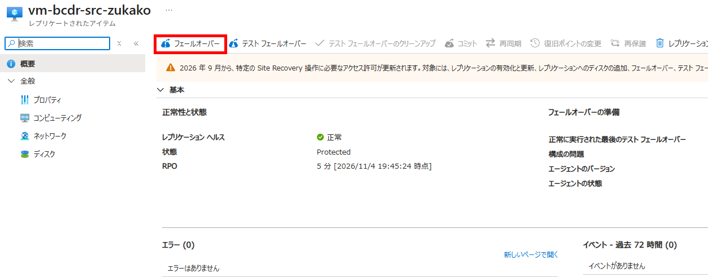
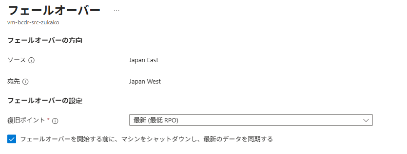
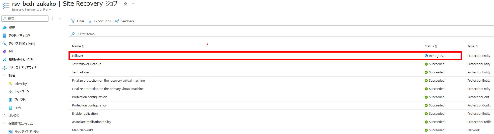
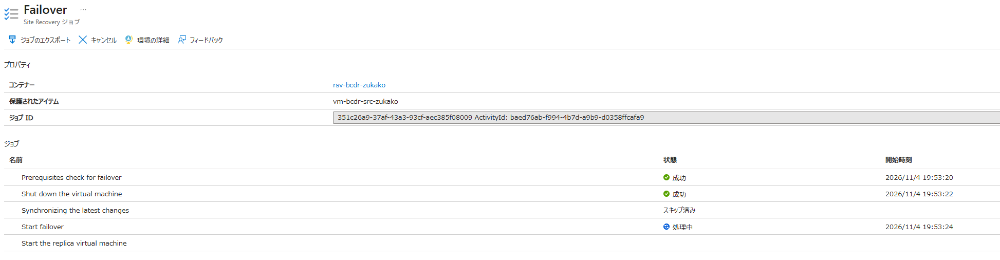
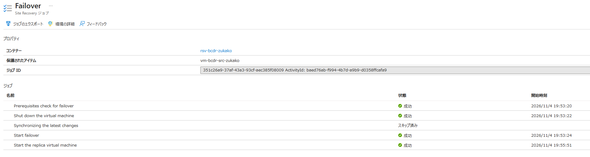
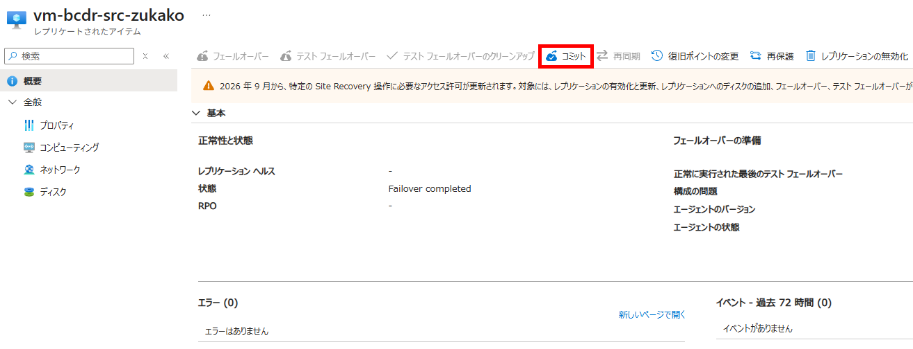
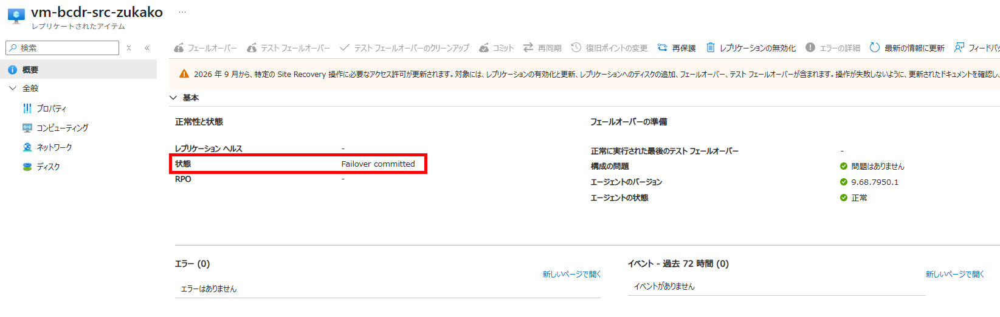

# IaaS 05：実フェールオーバーとHTML更新

[前へ](./04-テストフェールオーバーと復旧確認.md) | [全体・進捗チェック](../01-IaaS-ASRによるDRハンズオン.md) | [次へ](./06-逆方向の再保護.md)

> 現在位置：5 / 9。このページの到達点：元VMを停止し、Region Bで復旧・コミット・HTML更新が完了する。

[前のページ](./04-テストフェールオーバーと復旧確認.md)でテストを終了してから進みます。ここからはテスト用VMではなく、通常復旧先VNetのVMを稼働先にします。元VM停止とコミットの影響について承認を得てください。

時刻・証拠・未取得項目は[観測記録](./09-観測記録と振り返り.md)へ記入します。

## このページの手順

### Step 7：元VMを停止し、Region Bへ実フェールオーバーする

#### 7.1 切り替え前の確認と元VMの停止

1. 元のWebページのHTMLマーカーが変更されていないことを確認し、VM外へ記録します。
2. AからBへの複製正常性、HTML構成後の復旧ポイント、ターゲットの通常復旧先VNet・サブネット・VMサイズを確認します。
3. 通常復旧先NSGが通常復旧先VNetの`subnet-web`に関連付いており、[Step 1.3](./01-ネットワークとVMの作成.md)と同じBastion経由のSSH許可・その他SSH拒否・HTTP（80）のAny許可があることを確認します。
4. 元のページURL、停止対象VM、復旧後の確認方法を承認者と確認します。以後、元のHTMLを書き換えません。
5. Portalで**Region Aの専用演習VM**の **停止** を実行し、停止状態になるまで待ちます。操作開始と停止確認の時刻を記録します。

**確認結果**：元VMが停止していること。元VM・ディスク・グループは削除しません。

これはVM停止であり、Region Aの管理APIまで停止するリージョン障害の完全再現ではありません。

#### 7.2 実フェールオーバーと復旧確認

1. コンテナーの **レプリケートされたアイテム** で対象を開き、**フェールオーバー（Failover）** を選択します。今回は **テストフェールオーバー** ではありません。

2. 複製方向がAからBであることを確認し、**最新（Latest）** を選択します。これはASRへ送信済みのデータを処理して復旧ポイントを生成する方式で、未送信データの損失ゼロを保証するものではありません。
3. **フェールオーバーを開始する前にマシンをシャットダウンする** が表示される場合は選択します。ただし、シャットダウン失敗時も切り替えが続行され得るため、先に行った元VMの停止確認を省略しません。

4. 実行時刻を記録し、Site Recoveryジョブで成功・失敗とジョブIDを確認します。



5. 作成されたRegion Bの復旧VMが、テスト専用ではなく**通常復旧先VNet**に接続していることを確認します。Trusted Launch、Secure Boot・vTPMの有効状態も照合します。
6. 復旧VMのNICの主IP構成へRegion Bの演習専用Standard公開IPv4を関連付けます。[テスト時の接続設定](./04-テストフェールオーバーと復旧確認.md)と同じ操作ですが、今回の復旧VMと通常復旧先NSGを使用します。
7. 実際の公開IP、NIC、VNet、NSGを記録します。復旧VMの **接続 → Bastion** から、通常復旧先VNetのBastion Developer、`azureuser`と講師から受け取った演習用パスワードで接続します。テスト用VMのセッションは閉じます。
8. 次のコマンドでApacheの自動起動と、更新前のHTMLの内容を確認します。再インストールやHTML再作成はしません。

```bash
systemctl is-enabled apache2 &&
systemctl is-active apache2 &&
cat /var/www/html/index.html &&
curl --fail --silent --show-error --connect-timeout 5 --max-time 15 http://127.0.0.1/
```

9. 参加者のブラウザーで`http://<Region Bの復旧VMの公開IP>/`を開き、5秒以上の間隔で3回連続して正常表示を確認します。最初の成功と連続確認完了の時刻を記録します。
10. Region Aの元VMは停止したままであることを確認します。元VMを手動で再起動しません。

**確認結果**：Region Bの実際の復旧VMで、元のHTMLマーカーが表示され、Webページを利用できること。本編の入口変更はURLの手動切り替えであり、DNSやFront Doorの切り替えは行いません。

ジョブ失敗、HTMLの内容不一致、両系稼働の場合はコミットせず、証拠と現在の稼働状態を保存して講師へ連絡します。元VMを無条件に起動して切り戻しません。

### Step 8：復旧結果をコミットし、Region BでHTMLを更新する

#### 8.1 フェールオーバーをコミットする

1. Apache、HTMLの一致、利用者経路からの表示、元VM停止を承認者と確認します。
2. レプリケートされたアイテムの **コミット（Commit）** を実行します。

3. コミットジョブの成功と、**Failover committed**に相当する状態を確認します。


**コミットすると既存の復旧ポイントが削除され、別の復旧ポイントへの変更ができなくなります。** 証拠を保存し、復旧結果を確認してから実行します。コミットは再保護ではなく、この時点では逆方向の複製はまだ開始していません。

#### 8.2 更新したHTMLを戻すための基準を作る

Region Bの**通常復旧先VM**へBastion Developer経由で講師から受け取った演習用パスワードを使って接続します。テスト用VMや元VMでは実行しません。以下を1つずつ実行してください。

HTML内の`apache-html-ready`を`apache-html-updated-in-region-b`へ置き換えます。

```bash
sudo sed -i 's/apache-html-ready/apache-html-updated-in-region-b/' /var/www/html/index.html
```

エラーがないことを確認してから、更新後の内容を表示します。`apache-html-updated-in-region-b`が含まれていることを確認してください。

```bash
cat /var/www/html/index.html
```

書き込みを反映します。エラーが出た場合は先へ進まず、原因を確認してください。

```bash
sync
```

書き込み完了時刻を表示します。

```bash
printf 'Write completed at UTC: %s\n' "$(date -u +%Y-%m-%dT%H:%M:%SZ)"
```

1. `Write completed at UTC`と更新後のマーカーをVM外へ記録します。
2. ローカルHTTPとブラウザーで`apache-html-updated-in-region-b`が表示されることを確認します。
3. 以後、フェールバック完了まではHTMLを変更しません。この更新後のマーカーを、戻した先の照合基準にします。

**確認結果**：Bで更新したHTMLが表示され、フェールバックで保持を検証する基準が記録できたこと。`sync`はASRへの送信・複製完了を意味しません。

## このページの完了チェック

- [ ] 元VMを停止して実フェールオーバーし、Bの通常復旧先で元のHTMLマーカーの表示を確認した。
- [ ] 復旧結果を承認・コミットし、Aを停止したままBを稼働先とした。
- [ ] BでHTMLを更新し、表示・更新後のマーカー・時刻をVM外へ記録した。

完了したら[全体ページ](../01-IaaS-ASRによるDRハンズオン.md)の対応するチェックを更新します。

[前へ](./04-テストフェールオーバーと復旧確認.md) | [全体・進捗チェック](../01-IaaS-ASRによるDRハンズオン.md) | [次へ](./06-逆方向の再保護.md)
