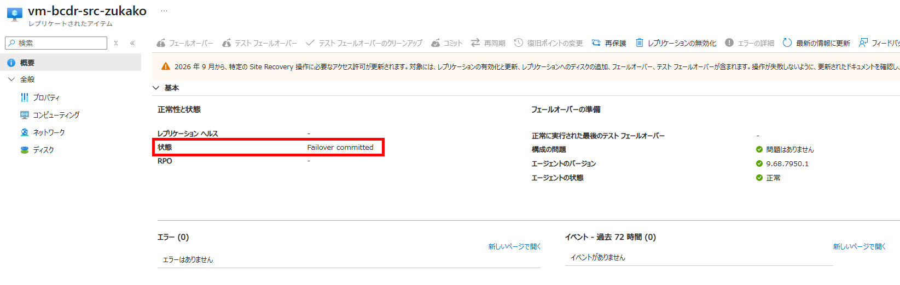
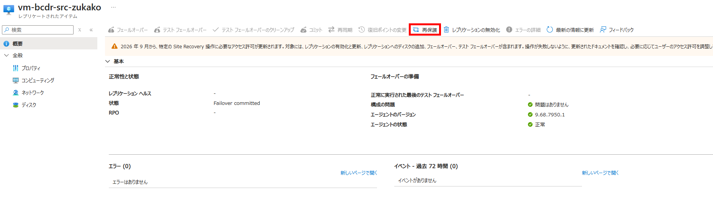
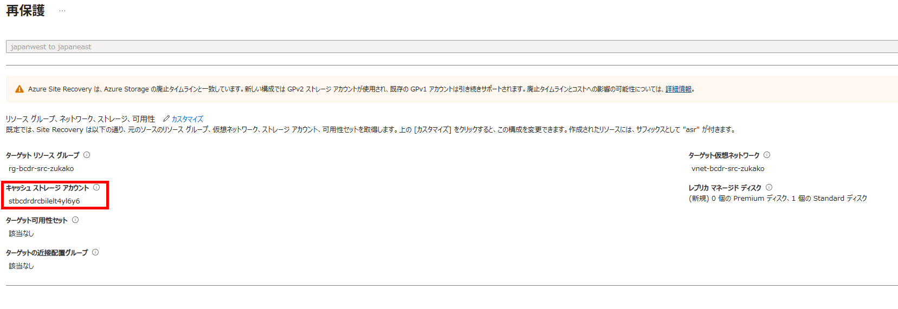
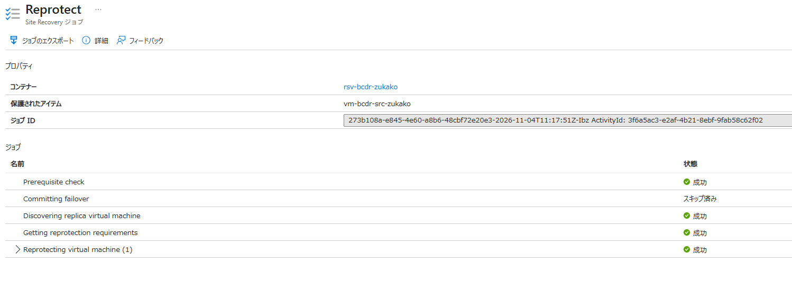

# IaaS 06：逆方向の再保護

[前へ](./05-実フェールオーバーとHTML更新.md) | [全体・進捗チェック](../01-IaaS-ASRによるDRハンズオン.md) | [次へ](./07-フェールバックと再保護.md)

> 現在位置：6 / 8。このページの到達点：BからAへ複製し、更新後の復旧ポイントを確認できる。

[前のページ](./05-実フェールオーバーとHTML更新.md)でコミットとHTML更新を完了してから進みます。現在の稼働先はRegion Bです。

**フェールオーバー後は、西日本（JPW）が新しいプライマリとなりますが、まだそこから別のリージョンへ複製するDR保護はありません。再保護では、以前のプライマリである東日本（JPE）を新たなフェールオーバー先として、西日本→東日本の複製を開始します。** これにより、東日本へフェールバックするためのデータを準備します。再保護だけでは稼働先は切り替わりません。

メモは手元のノートなどへ自由に取ってください。困ったときは[トラブルシューティング](./09-よくあるハマりどころとトラブルシューティング.md)を参照します。

## このページの手順

### Step 9：Region BからAへの再保護を実行する

#### 9.1 再保護の前提と影響を確認する

1. レプリケートされたアイテムが**Failover committed**に相当する状態であることを確認します。

2. Region BのWebページが正常で、更新後HTMLのマーカーと時刻をVM外へ保存していることを確認します。
3. Region Aでリソース作成・更新が可能であり、必要な権限、VMサイズのクォータ・容量、元のVNet・グループが利用できることを確認します。
4. Region BからASRとキャッシュストレージへ送信できることを確認します。[Step 3.1.1](./03-ASRの構成と初期複製.md)で用意したRegion Bのストレージ（Bicep出力`recoveryCacheStorageAccountName`）に、コンテナーのマネージドIDへの2つのロールが付与されていることも確認します。
5. 元VM・ディスク・リソースグループを手動削除しません。再保護で既存の元VMやディスクが再構成・削除され得るため、必要な証拠を保存して承認を得ます。

**再保護は単なる複製方向のラベル変更ではありません。** 元のリソースとディスクを複製先として再構成する操作です。専用環境以外へ適用しません。

#### 9.2 再保護を実行して完了を待つ

> **注意：再保護も、Region B（西日本）からRegion A（東日本）へのデータ同期が必要なため、完了まで時間がかかります。所要時間はデータ量や通信状況によって異なります。再保護ジョブの完了に加え、複製が正常になり、更新後の復旧ポイントが生成されるまで待ってからフェールバックへ進んでください。**

1. コンテナーの対象アイテムで **再保護（Re-Protect）** を選択します。

2. ソースがRegion B、ターゲットがRegion Aであることを確認します。
3. ターゲットが元の専用グループ・元のVNet・`subnet-web`であること、VMサイズとディスク設定を確認します。キャッシュストレージは稼働先のRegion Bに必要です。設定の編集で、用意したRegion Bの既存ストレージ（Bicep出力`recoveryCacheStorageAccountName`）を選択します。自動作成候補が表示された場合も、そのまま実行せず選択先を確認します。

4. 自動作成・再利用・再構成されるリソース名を確認します。
5. 実行時刻を記録し、Site Recoveryジョブで再保護の進行と結果を確認します。

6. ジョブ完了に加え、BからAの複製が正常で、復旧ポイントが生成されていることを確認します。
7. 最新の処理済み復旧ポイントの時刻が、Bで記録した`Write completed at UTC`より後であることを確認します。タイムゾーンを揃えて比較します。

**確認結果**：再保護と複製が正常で、Bで更新した後の復旧ポイントを選択できること。時刻確認だけでは更新内容の保持を確認できないため、次のフェールバック後にマーカーを照合します。

ASRは再保護・複製中のVMにRead-onlyロックを設定する場合があります。Portalの変更・削除が拒否されてもロックを解除して回避しません。ロックはOS内からのファイル確認を禁止するものではありません。

再保護と復旧ポイントの生成が完了するまで、西日本のVMを稼働させたまま待ちます。

## このページの完了チェック

- [ ] BからAへの再保護を承認・実行し、ジョブと複製正常性を確認した。
- [ ] BのHTML更新後の復旧ポイントを確認した。
- [ ] 稼働先・複製方向・リソース再構成・ロックの状態を記録した。

完了したら[全体ページ](../01-IaaS-ASRによるDRハンズオン.md)の対応するチェックを更新します。

[前へ](./05-実フェールオーバーとHTML更新.md) | [全体・進捗チェック](../01-IaaS-ASRによるDRハンズオン.md) | [次へ](./07-フェールバックと再保護.md)
