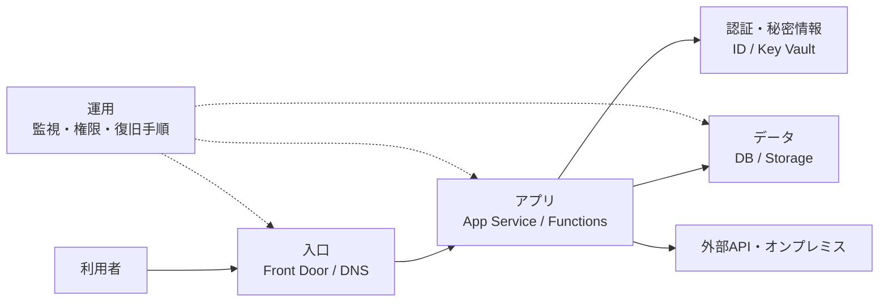

# 3. Azureサービス別のDR設計

## この章のゴールと進め方

**アプリ、データ、ネットワーク、認証、運用の復旧条件を一体として整理すること**がゴールです。アジェンダの25分では設計の横断ポイントとFront Door／App Service／データの関係を中心に説明し、VM、AKS、各DBの詳細は補足として読みます。

サービスの機能はSKU、リージョン、API、構成によって異なります。本章は方式選定の材料であり、本番環境の設定手順や対応条件の確定ではありません。

## 3.1 まず依存関係を描く

アプリを別リージョンへ移しても、DBや認証、オンプレミス接続が障害リージョンにしかなければ業務を再開できません。依存先ごとに「復旧先」「利用開始条件」「確認方法」を記録します。

## 3.2 ネットワーク／エントリーポイント

| サービス・要素 | 役割 | DRでの注意点 |
|---|---|---|
| Azure Front Door | グローバルなHTTP／HTTPS入口。オリジンの正常性に応じて転送 | アプリへの転送とデータの役割変更は別。Standard／Premiumを前提にする |
| Traffic Manager | DNS応答で接続先を選択 | 接続をプロキシしない。TTL、DNSキャッシュ、クライアント再接続を考慮 |
| Application Gateway | リージョン内のHTTP／HTTPS入口・負荷分散 | 単一配置でリージョン間DRは完成しない。必要に応じ各リージョンに配置 |
| DNS・証明書 | 名前解決とTLS接続 | 切り替え先の名前、証明書、更新経路、キャッシュを確認 |
| Private Link・プライベートDNS | サービスへのプライベート接続 | 復旧先の接続・承認・名前解決・経路を事前に検証 |

Front Door PremiumのPrivate Linkオリジン接続と、アプリからDBへ接続するPrivate Endpointは別の経路です。一方を設定しても、もう一方が使えるとは限りません。

自動切り替えは迅速ですが、正常性判定が誤っていると切り替え先も使えません。手動切り替えでは、判断と承認、設定反映の時間をRTOに含めます。

## 3.3 コンピュート

| 対象 | 主な方式 | 切り替え前に揃えるもの |
|---|---|---|
| App Service | リージョンごとにアプリとプランを配置 | 同じリリース、構成、認証、依存先、待機系容量 |
| Azure Functions | リージョンごとにFunction Appと必要な依存基盤を配置 | ホスティングプランの条件、Storage、トリガー、重複処理防止 |
| VM | Azure Site Recoveryやバックアップ・再構築を検討 | 対応OS・ディスク・構成、複製状態、復旧先ネットワーク、起動順序 |
| AKS | 別リージョンに独立クラスターを用意する方式など | イメージ、マニフェスト、設定、Ingress、永続データ、容量 |

App Serviceのデプロイスロットは別リージョンの待機環境ではありません。ゾーン冗長もリージョン内の機能なので、リージョン間DRとは分けて設計します。

Functionsのタイマーやキュー処理を両リージョンで動かす場合、同じ処理を重複実行する可能性があります。どちらが処理するか、排他、再試行、冪等性を設計します。Webアクセスの切り替えだけではバックグラウンド処理の所有者は変わりません。

Azure Site RecoveryはVMの複製と復旧を支援しますが、業務アプリの依存関係、データ整合性、入口の変更、業務確認は別途必要です。

### 共通の再現性

- IaCで基盤構成を管理し、復旧先へ展開できることをテストする。
- 同じアプリ／コンテナーイメージを利用できるようにする。
- 設定差分を管理し、リージョン固有の接続先を区別する。
- 復旧先の容量とクォータを確認し、必要なら事前確保する。
- セッションやファイルなどの状態を、各インスタンスのローカルだけに置かない。

## 3.4 データ：切り替え先で読み書きできるか

| サービス | 主な選択肢 | 重要な確認 |
|---|---|---|
| Azure SQL Database | Failover Group、アクティブgeoレプリケーション、バックアップ復元 | 非同期複製の遅延、計画／強制フェールオーバー、書き込み接続先 |
| Azure Cosmos DB | マルチリージョン、読み取り／書き込みリージョンの構成 | API・整合性レベル・書き込み方式、SDK、競合解決、バックアップ |
| Azure Storage | ZRS、GZRS、RA-GZRSなど | ゾーン保護と地理複製、セカンダリの読み取りと書き込みの違い |
| Azure Database for PostgreSQL Flexible Server | クロスリージョン読み取りレプリカ、利用可能なバックアップ復元方式 | 非同期複製の遅延、昇格、書き込み先、再同期 |

### Azure SQL Database

Failover Groupは、複数DBの複製と役割切り替えを管理し、読み書き用リスナーを提供します。アプリは接続先の設計に加え、切断時の再接続と再試行を実装します。

リージョン間複製は非同期です。計画フェールオーバーと、障害時の強制フェールオーバーではデータ損失の条件が異なります。誰が実行するか、どの条件で損失を許容するかを合意します。Microsoft管理の切り替えポリシーを選んでも、任意のアプリ障害に対する即時切り替えを保証するわけではありません。

### Azure Cosmos DB

マルチリージョン構成でも、単一書き込みと複数書き込みでは役割切り替えと競合の考え方が異なります。採用APIと構成に対応する整合性、SDKの接続先選択、フェールオーバー設定を確認します。

「複数リージョンだからRPOゼロ」と一律に判断しません。必要な整合性と書き込み確定の条件から、公式仕様と試験結果で評価します。

### Azure Storage

| 冗長方式 | プライマリの保護 | 別リージョン複製 | 通常時のセカンダリ利用 |
|---|---|---|---|
| ZRS | 複数ゾーンへ同期複製 | なし | なし |
| GZRS | 複数ゾーンへ同期複製 | 非同期 | フェールオーバー前は直接利用できない |
| RA-GZRS | GZRSと同様 | 非同期 | 対応するサービスで読み取り可能。書き込みは不可 |

地理複製先はストレージアカウントのリージョンに応じて決まります。任意のアプリ復旧先へ複製されるとは限りません。対応するアカウント種別、サービス、リージョンも確認します。例えばAzure FilesはRA-GZRSのセカンダリ読み取りを利用できません。

プライマリが利用不能な状態での非計画フェールオーバーでは、未複製データを失う可能性があります。利用可能なLast Sync Timeなどを確認して判断します。RA-GZRSの読み取り先へアプリを向けるだけでは書き込みを再開できません。

### PostgreSQL Flexible Server

読み取りレプリカは非同期であり、作成しただけで障害時に自動的な書き込み先になるわけではありません。昇格の方式、計画／強制の条件、接続先やVirtual Endpointの動作、旧Primaryの扱いを確認します。

昇格後のフェールバックでは、元の複製関係がそのまま戻ると仮定せず、再構成・同期の手順を検証します。

## 3.5 認証・秘密情報・監視・運用

- **シークレットと証明書**：復旧先から参照できるか、更新手順やキーへの依存も確認する。秘密値をIaCや資料へ直接記載しない。
- **Managed IdentityとRBAC**：別リソースのIDは同一とは限らない。復旧先IDへの権限、スコープ、アプリ内の設定を確認する。
- **通信経路**：VNet統合、Private Endpoint、DNS、Firewall、オンプレミス接続を復旧先から検証する。
- **監視とアラート**：両リージョンと利用者視点を観測し、障害中でも通知・記録を確認できるようにする。
- **運用手順**：DR宣言、承認、実行、業務確認、通知、フェールバックの担当者を定義する。

秘密情報や権限を「複製する」とは、単純に同じ値・IDをコピーすることではありません。復旧先で必要なものを安全に利用可能にし、不要な権限を増やさないことが目的です。

## 理解確認

1. Secondary App Serviceが起動していても、注文登録が失敗する原因を3つ挙げる。
2. RA-GZRSのセカンダリへ接続すれば、新規ファイルの書き込みも再開できるか。
3. Front Doorの切り替えで、Functionsのキュー処理の担当リージョンも自動変更されるか。

**確認の観点**：DBの役割・認証権限・通信経路など／セカンダリは読み取り用／トリガーと処理所有者を別途設計する。

## 参考資料

- [Microsoft Learn：Front Doorのオリジンルーティング](https://learn.microsoft.com/ja-jp/azure/frontdoor/routing-methods)
- [Microsoft Learn：Traffic Managerの概要](https://learn.microsoft.com/ja-jp/azure/traffic-manager/traffic-manager-overview)
- [Microsoft Learn：Front DoorのPrivate Link](https://learn.microsoft.com/ja-jp/azure/frontdoor/private-link)
- [Microsoft Learn：App Serviceの信頼性](https://learn.microsoft.com/ja-jp/azure/reliability/reliability-app-service)
- [Microsoft Learn：Azure Functionsの信頼性](https://learn.microsoft.com/ja-jp/azure/reliability/reliability-functions)
- [Microsoft Learn：Azure Site Recoveryの概要](https://learn.microsoft.com/ja-jp/azure/site-recovery/site-recovery-overview)
- [Microsoft Learn：AKSの事業継続と災害復旧](https://learn.microsoft.com/ja-jp/azure/aks/operator-best-practices-multi-region)
- [Microsoft Learn：SQL DatabaseのFailover Group](https://learn.microsoft.com/ja-jp/azure/azure-sql/database/failover-group-sql-db?view=azuresql)
- [Microsoft Learn：Cosmos DBの高可用性](https://learn.microsoft.com/ja-jp/azure/cosmos-db/high-availability)
- [Microsoft Learn：Azure Storageの冗長性](https://learn.microsoft.com/ja-jp/azure/storage/common/storage-redundancy)
- [Microsoft Learn：PostgreSQL Flexible Serverの読み取りレプリカ](https://learn.microsoft.com/ja-jp/azure/postgresql/flexible-server/concepts-read-replicas)

[前章](../02-RTO-RPOとDRパターン/02-RTO-RPOとDRパターン.md) | [全体のゴール](../00-BCDR座学のゴール.md) | [次章：マルチリージョン構成と切り替え](../04-マルチリージョン構成と切り替え/04-マルチリージョン構成と切り替え.md)
