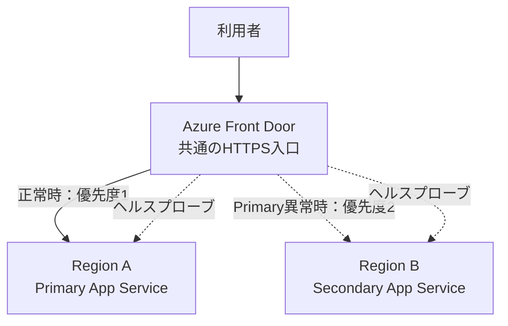

# 4. マルチリージョン構成と切り替えデモの見方

## この章のゴール

**正常時・障害時・復旧後の通信先を予測し、デモの観測結果と照合すること**がゴールです。アジェンダのデモ15分に対応します。

## 4.1 共通の構成例



実線・点線は説明用です。Front Doorは待機中のSecondaryにもプローブを送ります。通常の利用者リクエストと、正常性判定用のリクエストを区別します。

両アプリは、リージョン名を返す簡易Webアプリとします。Front Door経由で見えるリージョン名から、どちらのオリジンが応答したか確認します。

## 4.2 期待する3つの状態

| 状態 | Primary | Secondary | 新規リクエストの期待先 |
|---|---|---|---|
| 正常時 | 正常、優先度1、Enabled | 正常、優先度2、Enabled | Primary |
| Primary障害時 | プローブで異常と判定 | 正常、優先度2、Enabled | Secondary |
| Primary復旧後 | 再び正常、優先度1、Enabled | 正常、優先度2、Enabled | 通常の選択条件ではPrimaryが再び選ばれる |

優先度は小さい値が優先です。復旧したPrimaryを有効なままにすると、自動でPrimaryへ戻り得ます。セッションアフィニティやキャッシュなどにより、すべての利用者が同じ瞬間に同じ画面を見られるとは限りません。

**アプリの自動復帰と、業務としてのフェールバック承認は別です。** データを含む本番構成では、復旧したPrimaryが書き込み可能な正しいDBへ接続できるまで、トラフィックを戻さない制御が必要です。

## 4.3 デモで見る順序

1. PrimaryとSecondaryへ直接アクセスし、両方が応答することを確認する。
2. 両方の`/health`が正常であることを確認する。
3. Front Door経由でPrimaryのリージョン名が返ることを確認する。
4. 講師がPrimaryに安全な障害を注入し、時刻を記録する。
5. Primaryへの直接アクセス、プローブの状態、Front Door経由の応答を比較する。
6. Secondaryの応答を確認し、最初の成功と継続的な成功を分けて記録する。
7. Primaryを復旧し、正常性判定の回復と応答先の変化を確認する。

デモではキャッシュとセッションアフィニティの影響を避けた条件を用います。具体的なプローブ設定と観測方法は[第5章](../05-Front-Doorフェールオーバーの仕組み/05-Front-Doorフェールオーバーの仕組み.md)で説明します。

## 4.4 デモが証明すること・しないこと

| 確認できること | このデモだけでは確認できないこと |
|---|---|
| オリジンの異常に応じた通信先の変更 | Azureリージョン全体が停止した場合の全依存先の動作 |
| サンプルWebアプリの応答再開 | 本番負荷でのSecondaryの処理能力 |
| 観測条件下での切り替え所要時間 | 別利用者・別エッジを含む一律の切り替え時間 |
| Primary復旧後の応答先の変化 | DBの昇格、データ損失、書き込み整合性 |

アプリ停止は、リージョン障害そのものを再現するものではありません。「Primaryオリジンが使えない」という一部の条件を模擬します。

データストアを持たないため、このデモからRPOは実測できません。切り替え時間はWeb経路に関する観測値であり、業務全体のRTO達成を証明しません。

## 4.5 本番構成へ広げるときの確認

```text
入口の切り替え
  + アプリの起動と容量
  + DBの役割・接続先
  + 認証・シークレット
  + Private Endpoint / DNS / オンプレミス接続
  + バックグラウンド処理の所有者
  + 利用者視点での業務確認
  = 業務再開の判断材料
```

復旧先リージョンは、サービスの提供状況、データ所在地、レイテンシ、障害の独立性、容量、コストから選定します。「別リージョンに置いた」という事実だけで独立性を判断せず、共通のID、デプロイ、外部APIなども確認します。

## 理解確認

1. Secondaryが直接応答していても、Front Doorから応答しない場合、どの経路を調べるか。
2. Primaryの画面が再表示されたとき、DBのフェールバックも完了したと言えるか。
3. アプリ停止によるデモで、リージョン全体の障害を検証済みと言えるか。

**確認の観点**：Front Doorのルート、オリジン設定、正常性判定、到達性／データの確認は別／一部条件の模擬にとどまる。

## 参考資料

- [Microsoft Learn：Front Doorの概要](https://learn.microsoft.com/ja-jp/azure/frontdoor/front-door-overview)
- [Microsoft Learn：Front Doorのオリジンルーティング](https://learn.microsoft.com/ja-jp/azure/frontdoor/routing-methods)
- [Microsoft Learn：災害復旧のためのアーキテクチャ戦略](https://learn.microsoft.com/ja-jp/azure/well-architected/reliability/disaster-recovery)

[前章](../03-Azureサービス別のDR設計/03-Azureサービス別のDR設計.md) | [全体のゴール](../00-BCDR座学のゴール.md) | [次章：Front Doorフェールオーバーの仕組み](../05-Front-Doorフェールオーバーの仕組み/05-Front-Doorフェールオーバーの仕組み.md)
