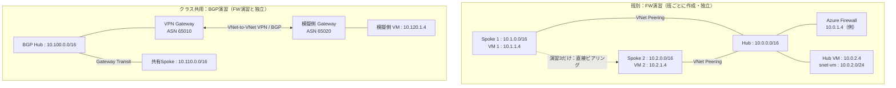

# NWハンズオンの進め方（叩き台）

## 1. 位置付けと到達目標

[座学のゴール](../座学/00-NW座学のゴール.md)に沿って、**予測 → 設定 → 観測 → 説明**を繰り返します。Azure Portalを主に使用し、構築の速さではなく、往路・復路と観測結果を説明できることを完了条件にします。

本資料は演習設計と操作手順の初稿です。班別環境の[事前デプロイ手順](./00-事前環境のデプロイ.md)と[初期構築用Bicep](./bicep/README.md)を用意しています。画面キャプチャ、実機での所要時間・表示結果の検証は今後の作業です。Azureリソースをこの資料作成時に展開したものではありません。

リソースの作成・変更・削除を行う手順には、**作業前と作業後の構成図**を示します。図ではリソースの存在だけでなく、ピアリングやルートによる通信経路の変化も確認してください。確認のみの手順と、講師が操作する共有BGP環境は、その旨を図・手順に明記します。

| 含める内容 | 対応する座学 | 演習で残す証拠 |
|---|---|---|
| Hub-Spokeの構成 | 第2章：ピアリング、Hub-Spoke | ピアリング設定、構成図 |
| HubのFWでの折り返し | 第2章：集中ルーティング | 往復UDR、Next hop、FWログ |
| UDRの有無による経路差 | 第1章：ルート選択、第4章：よくある失敗 | 変更前後の有効なルートと疎通結果 |
| BGPによる経路広報（広告） | 第1章：BGP、第2章：ゲートウェイ共有 | BGPピア、広告・学習経路、Spokeへの伝播 |
| 疎通と見えている経路の確認 | 第3章：診断機能 | ping、Next hop、NSG評価（TCP試験は任意） |
| AIによる調査支援 | 第0章：ストレッチゴール | AIの仮説と、人が検証した証拠 |

「FWでの折り返し」は、Spoke 1 → HubのAzure Firewall → Spoke 2と、その復路を指します。インターネット向け通信や、同一サブネット内のヘアピン通信は今回の対象外です。

基本の疎通試験は**ping（ICMP）**とし、VM上のHTTPサーバー起動は不要です。NSG・OSファイアウォール・Azure Firewallで演習VM間のICMPを許可します。TCP 8080は、講師が待ち受けサービスと許可規則を事前準備した場合だけの任意課題です。ping成功はTCPアプリケーションの正常性を保証しません。

## 2. 時間配分と読み順

全体は座学60分、休憩10分、ハンズオン120分の**計3時間10分**です。以下は事前展開済み環境でのハンズオン内の目安で、演習1～4と障害解析を含みます。全体の時刻は[アジェンダ](../azure-routing-workshop-agenda.md)を参照してください。

**授業前の作業**：[事前環境のデプロイ](./00-事前環境のデプロイ.md)は講師または環境構築担当者が別枠で実施します。受講者が環境構築も行う場合は事前課題とし、当日の120分にFirewallの展開待ちを含めません。読み順は「事前デプロイ（構築担当者）→本書の開始チェック→演習1～4→障害解析」です。

| 枠 | 内容 | 目安 | 手順 |
|---|---|---:|---|
| ハンズオン | 環境・試験条件の確認 | 10分 | 本書 |
| ハンズオン | 演習1：Hub-Spokeのピアリング、UDRなしの観測 | 20分 | [基本演習](./01-Hub-SpokeとUDR.md) |
| ハンズオン | 演習2：往復UDRとFW折り返し | 20分 | [基本演習](./01-Hub-SpokeとUDR.md) |
| ハンズオン | 演習3：直接ピアリングとUDRの比較 | 15分 | [基本演習](./01-Hub-SpokeとUDR.md) |
| ハンズオン | 演習4：BGP広告・学習と経路伝播 | 25分 | [BGP演習](./02-BGPによる経路広報と確認.md) |
| ハンズオン | 結果整理、基準構成への復元 | 5分 | 各演習の記録表 |
| ハンズオン | 障害解析、修正、再試験 | 20分 | [障害解析・AI活用](./03-障害解析とAI活用.md) |
| ハンズオン | 振り返り、成果物と後片付けの確認 | 5分 | 本書 |

BGPは必須の学習項目です。時間が不足する場合は、BGPの事前観測を講師デモに切り替え、受講者は広告元・学習先・Spokeの3地点の結果を記録します。AI活用は障害解析20分のうち最大5分の任意課題とし、AIを利用しない場合も原因の切り分けと復元まで行います。演習時間は実機で予行し、反映待ちが収まらない場合は直接ピアリング比較の段階を講師デモへ切り替えてBGPと障害解析の時間を確保します。

## 3. 演習環境を分ける理由

FW経由の経路制御は**班別の独立環境**で操作します。VPN GatewayのBGP確認は、デプロイ時間・費用と班間の変更競合を避けるため**クラス共用の独立環境**で行います。BGP環境にはFirewallを配置せず、班別FW環境ともピアリングしません。受講者は共用環境を原則読み取り専用で観測し、経路伝達の切替は講師が実施します。

どちらの環境も演習専用とし、既存ネットワークへ接続しません。IPアドレス範囲は環境間で重複しないように割り当てます。下表は例で、実環境に合わせて講師が確定します。

2つの枠は**別環境であり、相互接続しません**。班別環境のSpoke間通信だけがFirewall経由です。BGP環境はクラス全体でVPN Gatewayを2台だけ使い、FWは置きません。線は接続関係であり、実パケットの経路ではありません。BGP環境ではピア状態・広告／学習経路・共有Spokeの有効なルートを観測します。

### 3.1 班別：Hub-SpokeとFirewall

| リソース | 名前の例 | アドレス／初期状態 |
|---|---|---|
| 班別リソースグループ | `rg-nw-<班番号>` | 班ごとに独立 |
| Hub VNet | `vnet-hub` | `10.0.0.0/16` |
| FW専用サブネット | `AzureFirewallSubnet` | `10.0.1.0/24` |
| Hub VM用サブネット / VM / NIC | `snet-vm` / `vm-hub` / `nic-hub` | `10.0.2.0/24` / `10.0.2.4` |
| Spoke 1 / VM用サブネット | `vnet-spoke1` / `snet-vm` | `10.1.0.0/16` / `10.1.1.0/24` |
| Spoke 2 / VM用サブネット | `vnet-spoke2` / `snet-vm` | `10.2.0.0/16` / `10.2.1.0/24` |
| VM / NIC | `vm-spoke1` / `nic-spoke1`、`vm-spoke2` / `nic-spoke2` | `.4`を想定。実IPを確認 |
| 管理接続 | `bas-hub`、`bas-spoke1`、`bas-spoke2` | 各VNetにBastion Developer。VMの公開IPなし、Ubuntuのユーザー名／パスワードで接続 |
| Spoke用ルートテーブル | `rt-spoke1`、`rt-spoke2` | 演習2で作成。ゲートウェイルート伝達は有効 |

FWの`10.0.1.4`は例です。**実際に割り当てられたFWプライベートIPを全UDR・記録表へ反映**してください。

Hub VMはピアリングの疎通確認用です。演習1では各SpokeからHub VMへのping成功と、別Spokeへのping失敗を比較します。FWの代わりに中継するVMではなく、IP転送も有効にしません。BicepはHub・SpokeのVNet、VM、NSG、Bastion、FWとログを事前作成し、ピアリング・ルートテーブル・UDRは作成しません。

### 3.2 クラス共用：GatewayとBGP（講師管理）

| リソース | 名前の例 | アドレス／初期状態 |
|---|---|---|
| BGP Hub VNet | `vnet-bgp-hub` | `10.100.0.0/16` |
| BGP Hub GatewaySubnet | `GatewaySubnet` | `10.100.255.0/27` |
| BGP Hub VPN Gateway | `vgw-bgp-hub` | BGP有効、ASN `65010` |
| 共有Spoke VNet / VM用サブネット | `vnet-bgp-spoke` / `snet-vm` | `10.110.0.0/16` / `10.110.1.0/24` |
| 共有Spoke VM / NIC | `vm-bgp-spoke` / `nic-bgp-spoke` | `10.110.1.4`を想定。ping試験用 |
| 共有Spoke用ルートテーブル | `rt-bgp-spoke` | `snet-vm`へ関連付け。初期状態はゲートウェイルート伝達有効 |
| 模擬オンプレミスVNet / GatewaySubnet | `vnet-bgp-sim` / `GatewaySubnet` | `10.120.0.0/16` / `10.120.255.0/27` |
| 模擬側VM用サブネット / VM | `snet-vm` / `vm-bgp-sim` | `10.120.1.0/24` / `10.120.1.4` |
| 模擬側VPN Gateway | `vgw-bgp-sim` | BGP有効、ASN `65020` |
| VPN接続 | `conn-bgp-hub-to-sim`、`conn-bgp-sim-to-hub` | 双方向のVNet-to-VNet、BGP有効 |

Hub、共有Spoke、模擬側VNetのピアリング・Gateway Transitは講師が事前構築します。VPN GatewayのBGPピアIPは、実際のGateway設定画面から取得してください。共用環境にFirewallを置かず、班別の`10.0.0.0/16` Hubとは接続しません。上記の共有Spoke／IP範囲は教材案のため、**実機予行で重複とルート広告を検証後に確定**します。

## 4. 講師の事前準備

### 構築と動作確認

- [ ] 班別環境とクラス共用BGP環境のサブスクリプション／リソースグループ、利用リージョン、予算、責任者、削除期限を決める。
- [ ] 班ごとに独立したHub・Spoke×2、VM×3、Azure Firewall、Firewall Policy、診断先のLog Analyticsを[Bicep](./bicep/README.md)で事前展開する。
- [ ] FWはAzure Firewall Standardを基準とし、VMベースのNVAは別教材扱いとする。NVAのOS設定をFWへ流用しない。
- [ ] 班別SpokeのVMでpingコマンドが利用できることと、OSがICMP Echo Requestへ応答できることを確認する。HTTP試験サービスは必須にしない。
- [ ] 班別Spoke間のICMPを両方向に許可するNSG・OSファイアウォール規則を用意する。送信元・宛先を演習VMに限定し、インターネット全体からの受信は許可しない。
- [ ] FWのNetwork ruleでVM 1・VM 2間のICMPを両方向に許可する。プロトコル`ICMP`、宛先ポート欄は`*`とし、プライベート宛て通信をSNATしない基準構成とする。
- [ ] 任意のTCP試験を実施する場合だけ、TCP 8080のHTTP試験サービスとNSG・OS・FWのTCP許可を事前準備し、ローカル応答とVM間疎通を確認する。
- [ ] FWの診断設定をリソース固有テーブルへ送信し、`AZFWNetworkRule`に試験通信が記録されることを確認する。
- [ ] クラス共用BGP環境にVPN Gateway 2台だけを事前展開する。班ごとにGatewayを作らせず、BGP確認環境にFirewallを配置しない。
- [ ] 共有BGP Hub・Spoke・模擬側VNet、ピアリング、Gateway Transit、双方向VNet-to-VNet接続、BGP、必要なルートテーブルを構築する。
- [ ] BGP環境の共有Spoke VMと模擬側VMでICMPを許可し、BGPで学習した経路がNICに適用された状態で両方向のpingが成立することを予行する。NSG・OSファイアウォールの受信元は演習VMに限定する。
- [ ] BGP広告・学習の実際の表示を取得し、Hub／Spoke／模擬側の各プレフィックスと期待値を確定する。表示上の経路の由来も記録する。
- [ ] BGP環境は受講者に読み取り権限だけを付与し、Gateway、ピアリング、共有ルートテーブルの変更は講師に限定する。
- [ ] 経路伝達を切り替えるデモは一度に一箇所だけ実施し、前後のGateway広告・学習、Spokeの有効なルート、Next hop、疎通を記録する。期待値は実機予行で確認し、確認できない場合は切替を行わず画面記録で比較する。
- [ ] Network Watcherを各対象リージョンで利用可能にし、Next hop・NSG diagnosticsで必要な権限を確認する。Connection troubleshootのTCP試験・IP flow verifyは任意課題とし、実施する場合は権限とエージェントなどの条件も確認する。
- [ ] 班別VM操作用に各VNetのBastion Developerを利用する。対応リージョン、Ubuntuのユーザー名／パスワード認証、UDR変更後も管理接続と診断機能が使えることを予行する。Developerはピアリング先への接続に使わない。
- [ ] 外部パッケージ取得が必要なら、承認済みの明示的送信方式を用意する。授業中のインストールや暗黙の既定送信アクセスに依存しない。
- [ ] [クラス共用BGP演習の事前構築](./02-BGPによる経路広報と確認.md#2-講師の事前構築と共有ルール)を完了し、広告・学習・疎通の基準値を保存する。

### 演習開始状態への戻し

- [ ] Hub・Spoke間とSpoke間のピアリングを未作成にする。既存環境を使う場合は、講師が演習1の作成操作を確認操作へ読み替える。
- [ ] SpokeのVM用サブネットにUDRを適用しない。
- [ ] 班別環境にVPN Gatewayを作成せず、クラス共用BGP環境とは接続しない。
- [ ] クラス共用BGP環境は講師が開始状態へ戻す。受講者の操作は読み取り専用とし、共有資源の変更を受講者へ割り当てない。
- [ ] 演習1～3の開始状態でSpoke間宛てのNext hopが`None`であることを予行する。他経路があれば取り除くのではなく、講師が構成差を調査する。
- [ ] 設定変更の反映待ちを含めて120分の枠を実測する。超過時は直接ピアリング比較を講師デモへ切り替え、BGP確認・障害解析・復元時間を確保する。

VPN Gatewayはクラス共用BGP環境に2台だけ事前展開し、BGP対応のRoute-based SKUを使用します。Basicは使いません。FWは班別環境ごとに必要ですが、BGP環境とは独立させます。Gateway／FWはいずれも時間と費用がかかるため当日作成せず、BGPの共有資源は講師のみ変更します。

## 5. 受講者の開始チェック

1. 対象サブスクリプション・リソースグループ・班を確認する。
2. 班別VM、NIC、サブネット、FWの実IPを班の構成表へ転記する。BGP共有環境のGateway／VMは別の構成表として扱う。
3. 班別環境のVNet／ルート変更権限、VMへの管理アクセス、Network Watcher実行権限、ログ参照権限を確認する。Contributorだけで全ログを参照できるとは限らない。
4. 班別VMのpingコマンド、実IP、ICMPのNSG・OS許可設定を確認する。Spoke間疎通は演習1の開始時点では失敗が期待値。
5. BGP環境は読み取り専用で利用できることと、講師が切替操作を担当することを確認する。
6. 記録する時刻のタイムゾーンを揃え、班別環境の変更前設定を保存する。
7. [演習1](./01-Hub-SpokeとUDR.md)へ進む。

### 演習開始時の確認ポイント

| 対象 | 確認すること | 期待値 |
|---|---|---|
| 班別環境 | 受講者が変更できるリソースグループ | 自班の環境だけ |
| 班別VM | pingの利用可否、実IP、ICMPのNSG・OS設定 | コマンド利用可、演習VM間のICMPを許可。HTTPサーバー不要 |
| 班別Firewall | プロビジョニング状態と実プライベートIP | 正常。割当IPを班の記録表に記入 |
| BGP共有環境 | Gateway・ピアリング・共有Spokeへの権限 | 読み取りのみ。変更権限なし |
| 環境分離 | 班別VNetから共有BGP VNetへの接続 | ピアリングなし |
| 記録条件 | 観測時刻のタイムゾーン | 班内で統一 |

## 6. 終了時

- 班別環境の一時的な直接ピアリング、既定UDR、障害注入を戻し、FW経由通信を再確認する。
- クラス共用BGP環境は講師が基準状態へ戻し、ピア状態、広告・学習経路、共有Spokeの到達性を確認する。
- 自分の演習専用リソースと共有リソースを区別し、削除対象は講師が確認する。
- 専用環境は承認済みの手順で削除する。VM停止だけではFW・VPN Gatewayなどの課金は止まらない。
- リソースグループ、共有の診断先、関連する公開IPやBastionなどに意図しない残存課金がないか確認する。
- 実測結果と構成図を保存する。画面やログに含まれる情報は組織の取り扱い方針に従う。
