# NWハンズオンの進め方

## 1. 位置付けと到達目標

[座学のゴール](../座学/00-NW座学のゴール.md)に沿って、**予測 → 設定 → 観測 → 説明**を繰り返します。Azure Portalを主に使用し、構築の速さではなく、往路・復路と観測結果を説明できることを完了条件にします。

展開済み環境を使用する場合は、本書の開始チェックから進めてください。自分でFW演習環境を構築する場合は、先に[事前デプロイ手順](./Lab_01/00-事前環境のデプロイ.md)を実施します。[演習01用Bicep](./Lab_01/bicep/README.md)が作成する初期環境と、[演習03用Bicep](./Lab_03/bicep/README.md)が適用する障害解析用構成を区別してください。

リソースの作成・変更・削除を行う手順には、**作業前と作業後の構成図**を示します。図ではリソースの存在だけでなく、ピアリングやルートによる通信経路の変化も確認してください。BGP環境は講師デモ専用です。受講者は設定を変更せず、講師の操作と観測結果を確認します。

| 含める内容 | 対応する座学 | 演習で残す証拠 |
|---|---|---|
| Hub-Spokeの構成 | 第2章：ピアリング、Hub-Spoke | ピアリング設定、構成図 |
| HubのFWでの折り返し | 第2章：集中ルーティング | 往復UDR、Next hop、FWログ |
| UDRの有無による経路差 | 第1章：ルート選択、第4章：よくある失敗 | 変更前後の有効なルートと疎通結果 |
| BGPによる経路広告と学習 | 第1章：BGP、第2章：ゲートウェイ共有 | 講師デモでBGPピア、広告・学習経路、Spokeへの伝播を観測 |
| 疎通と見えている経路の確認 | 第3章：診断機能 | 基本演習はping、障害解析はHTTPS。Next hop、NSG評価と照合 |
| AIによる調査支援 | 第0章：ストレッチゴール | AIの仮説と、人が検証した証拠 |

「FWでの折り返し」は、Spoke 1 → HubのAzure Firewall → Spoke 2と、その復路を指します。基本演習ではインターネット向け通信や同一サブネット内のヘアピン通信は扱いません。障害解析では別途用意された構成を使い、FW経由で指定の外部HTTPSサイトへ接続できない問題を調査します。

基本の疎通試験は**ping（ICMP）**とし、VM上のHTTPサーバー起動は不要です。NSG・OSファイアウォール・Azure Firewallで演習VM間のICMPを許可します。TCP 8080は、講師が待ち受けサービスと許可規則を事前準備した場合だけの任意課題です。ping成功はTCPアプリケーションの正常性を保証しません。

障害解析では、VM内の`curl`による指定URLへのHTTPS（TCP 443）接続と、隣のSpoke VMへのpingの両方が失敗する状況を調べます。DNS、外向き経路、Spoke間の往復経路、NSG、実通信を別々に確認してください。FWログは任意とし、取得や表示待ちは障害解析の完了条件に含めません。

## 2. 時間配分と読み順

全体は座学60分、休憩10分、ハンズオン130分の**計3時間20分**です。以下は事前展開済み環境でのハンズオン内の目安で、演習1～3、BGPデモ、障害解析を含みます。全体の時刻は[アジェンダ](../azure-routing-workshop-agenda.md)を参照してください。

**授業前の作業**：[FW演習環境](./Lab_01/00-事前環境のデプロイ.md)と[BGPデモ環境](./Lab_02/bicep/README.md)は講師または環境構築担当者が別枠で展開します。受講者が環境構築も行う場合は事前課題とし、当日の130分にFirewallやVPN Gatewayの展開待ちを含めません。読み順は「事前デプロイ（構築担当者）→本書の開始チェック→演習1～3→BGPデモ→障害解析」です。

| 枠 | 内容 | 目安 | 手順 |
|---|---|---:|---|
| ハンズオン | 環境・試験条件の確認 | 10分 | 本書 |
| ハンズオン | 演習1：Hub-Spokeのピアリング、UDRなしの観測 | 20分 | [基本演習](./Lab_01/01-Hub-SpokeとUDR.md) |
| ハンズオン | 演習2：往復UDRとFW折り返し | 20分 | [基本演習](./Lab_01/01-Hub-SpokeとUDR.md) |
| ハンズオン | 演習3：直接ピアリングとUDRの比較 | 15分 | [基本演習](./Lab_01/01-Hub-SpokeとUDR.md) |
| ハンズオン | BGPの広告・学習とSpokeへの経路伝播 | 15分 | [BGPデモ](./Lab_02/02-BGPによる経路広報と確認.md) |
| ハンズオン | 結果整理、基準構成への復元 | 5分 | 各演習の記録表 |
| ハンズオン | 障害解析、修正、再試験 | 40分 | [障害解析・AI活用](./Lab_03/03-障害解析とAI活用.md) |
| ハンズオン | 振り返り、成果物と後片付けの確認 | 5分 | 本書 |

BGPは必須の学習項目ですが、受講者が設定を操作する演習ではなく講師デモで扱います。受講者は広告元・学習先・Spokeの3地点で経路を観測し、BGPの広告・学習とNICへの経路適用を区別して記録します。BGPデモで確保していた時間の一部を障害解析へ移し、障害解析を40分にします。AI活用は最大5分の任意課題とし、AIを利用しない場合も原因の切り分けと復元まで行います。

## 3. 演習環境を分ける理由

FW経由の経路制御は**参加者ごとの独立環境**で操作します。各参加者が自分のHub・Azure Firewall・Spoke 2つを使って、ピアリング、往復UDR、直接経路との比較、障害解析まで実施します。BGP環境は**講師デモ専用**とし、Hub・デモ用Spoke・模擬オンプレミスVNetを一つの専用RGへ展開します。Firewall演習用VNetは接続しません。VPN Gatewayや経路伝達の設定変更は講師が管理し、受講者は読み取り専用で観測します。

すべて演習専用とし、参加者のFirewall演習環境同士は接続しません。BGPデモ環境は独立した専用RGに展開します。下表の名前・アドレスは例です。デモ用のアドレス範囲と組織ネットワークが重複しないことを講師が確認してください。

```mermaid
flowchart TB
    S1["Spoke 1 : 10.1.0.0/16<br/>VM 1 : 10.1.1.4"]
    S2["Spoke 2 : 10.2.0.0/16<br/>VM 2 : 10.2.1.4"]
    subgraph TEAM["参加者ごと：FW演習（専用環境）"]
        S1["Spoke 1 : 10.1.0.0/16<br/>VM 1 : 10.1.1.4"]
        S2["Spoke 2 : 10.2.0.0/16<br/>VM 2 : 10.2.1.4"]
        FWH["Hub : 10.0.0.0/16"]
        FW["Azure Firewall<br/>10.0.1.4（例）"]
        HVM["Hub VM : 10.0.2.4<br/>snet-vm : 10.0.2.0/24"]
        S1 ---|"VNet Peering"| FWH
        S2 ---|"VNet Peering"| FWH
        FWH --- FW
        FWH --- HVM
    end
    subgraph CLASS["講師デモ専用：BGP環境（FW演習と独立）"]
        SH["BGP Hub : 10.100.0.0/16"]
        SGW["VPN Gateway<br/>ASN 65010"]
        SS["デモ用BGP Spoke<br/>10.200.0.0/16"]
        SVM["デモ用Spoke VM"]
        OGW["模擬側 Gateway<br/>ASN 65020"]
        VM3["模擬側 VM : 10.120.1.4"]
        SH --- SGW
        SH <-->|"VNet Peering / Gateway Transit"| SS
        SS --- SVM
        SGW <-->|"VNet-to-VNet VPN / BGP"| OGW
        OGW --- VM3
    end
    S1 -.->|"演習3だけ：直接ピアリング"| S2
```

Firewall演習用VNetとBGPデモ用VNetは接続しません。BGPデモ用Spokeはデモ環境のHubとピアリングし、模擬オンプレミスVNetとは2台のVPN Gateway間のVNet-to-VNet VPNで接続します。線は接続関係であり、実パケットの経路ではありません。BGPデモではGatewayのピア・広告／学習経路と、デモ用Spokeの有効ルート・疎通を講師が観測します。

### 3.1 参加者ごと：Hub-SpokeとFirewall

| リソース | 名前の例 | アドレス／初期状態 |
|---|---|---|
| 専用リソースグループ | `rg-nw-<参加者ID>` | 参加者ごとに1つ。操作・削除対象を分離 |
| Hub VNet | `vnet-hub` | `10.0.0.0/16` |
| FW専用サブネット | `AzureFirewallSubnet` | `10.0.1.0/24` |
| Hub VM用サブネット / VM / NIC | `snet-vm` / `vm-hub` / `nic-hub` | `10.0.2.0/24` / `10.0.2.4` |
| Spoke 1 / VM用サブネット | `vnet-spoke1` / `snet-vm` | `10.1.0.0/16` / `10.1.1.0/24` |
| Spoke 2 / VM用サブネット | `vnet-spoke2` / `snet-vm` | `10.2.0.0/16` / `10.2.1.0/24` |
| VM / NIC | `vm-spoke1` / `nic-spoke1`、`vm-spoke2` / `nic-spoke2` | `.4`を想定。実IPを確認 |
| 管理接続 | `bas-hub`、`bas-spoke1`、`bas-spoke2` | 各VNetにBastion Developer。VMの公開IPなし、Ubuntuのユーザー名／パスワードで接続 |
| Spoke用ルートテーブル | `rt-spoke1`、`rt-spoke2` | 演習2で各自作成。ゲートウェイルート伝達は有効 |

FWの`10.0.1.4`は例です。**実際に割り当てられたFWプライベートIPを全UDR・記録表へ反映**してください。

Hub VMはピアリングの疎通確認用です。演習1では各SpokeからHub VMへのping成功と、別Spokeへのping失敗を比較します。FWの代わりに中継するVMではなく、IP転送も有効にしません。BicepはHub・SpokeのVNet、VM、NSG、Bastion、FWとログを事前作成し、ピアリング・ルートテーブル・UDRは作成しません。

### 3.2 講師デモ専用：BGP Hub、Spoke、模擬オンプレミス

| リソース | 名前の例 | アドレス／初期状態 |
|---|---|---|
| BGP Hub VNet / GatewaySubnet | `vnet-bgp-demo-hub` / `GatewaySubnet` | `10.100.0.0/16` / `10.100.255.0/27` |
| Hub VPN Gateway / 公開IP | `vgw-bgp-demo-hub` / Standard・静的 | BGP有効、ASN `65010` |
| デモ用Spoke VNet / VM用サブネット | `vnet-bgp-demo-spoke` / `snet-vm` | `10.200.0.0/16` / `10.200.1.0/24` |
| デモ用Spoke VM / ルートテーブル | `vm-bgp-demo-spoke` / `rt-bgp-demo-spoke` | `10.200.1.4` / ゲートウェイルート伝達有効 |
| デモ用Spokeの管理接続 | `bas-bgp-demo-spoke` | Bastion Developer。VMに公開IPなし |
| 模擬オンプレミスVNet / GatewaySubnet | `vnet-bgp-demo-onprem` / `GatewaySubnet` | `10.120.0.0/16` / `10.120.255.0/27` |
| 模擬側VM用サブネット / VM | `snet-vm` / `vm-bgp-demo-onprem` | `10.120.1.0/24` / `10.120.1.4` |
| 模擬側VMの管理接続 | `bas-bgp-demo-onprem` | Bastion Developer。VMに公開IPなし |
| 模擬側VPN Gateway / 公開IP | `vgw-bgp-demo-onprem` / Standard・静的 | BGP有効、ASN `65020` |
| VPN接続 | `conn-bgp-demo-hub-to-onprem`、`conn-bgp-demo-onprem-to-hub` | 双方向のVNet-to-VNet、両方でBGP有効 |
| Spoke–Hubピアリング | `hub-to-bgp-demo-spoke`、`bgp-demo-spoke-to-hub` | Hub側Gateway Transit、Spoke側Remote Gateway |

BGPデモ環境は専用リソースグループへ講師が事前展開し、講師が設定・切り替えを管理します。受講者はPortalの読み取り権限で観測します。デモ用Spokeと模擬オンプレミスVNetのアドレス範囲が重複しないこと、Firewall演習用VNetと接続していないことを確認してください。構成ファイルとデプロイ手順は[BGPデモ用Bicep](./Lab_02/bicep/README.md)を参照します。VPN GatewayのBGPピアIPはデプロイ完了後に実際の設定画面から取得します。Hubおよび模擬側VNetにはFirewallを配置していません。

## 4. 作業前の確認

### 環境とアクセス

- [ ] 自分専用のFW演習用RG、利用リージョン、削除期限を確認した。
- [ ] 自分のHub・Spoke×2、VM×3、Azure Firewall、Firewall Policy、Log AnalyticsをPortalで参照できる。
- [ ] 自分のFW環境のVNet・ルート・NSGを変更できる。BGPデモ環境は参照のみとし、変更権限がない。
- [ ] 各VMへ承認済みの管理接続でアクセスでき、pingコマンドを利用できる。Bastion Developerは接続先VMと同じVNetのものを使う。
- [ ] Network WatcherのNext hop・NSG diagnosticsを実行できる。FWの診断設定と`AZFWNetworkRule`へのログ参照権限を確認した。

### 演習開始時の設定

- [ ] FW演習環境のHub・Spoke間とSpoke間のピアリング、ルートテーブル・UDRは未作成である。
- [ ] 各VMのNSG・OSとFW Policyで、演習VM間のICMPが許可されている。インターネット全体への受信許可は追加しない。
- [ ] FW演習のSpoke間宛てNext hopは`None`で、pingは失敗する。
- [ ] BGPデモ用環境は専用RGに展開済みで、FW演習用VNetとは接続していない。
- [ ] デモ用Spokeのルートテーブルでゲートウェイルート伝達が有効である。

配布された開始状態と異なる場合は、既存設定を削除せず講師へ確認してください。TCP 8080の任意試験は、待ち受けサービスとNSG・OS・FWの許可が準備されている場合だけ実施します。授業中のパッケージインストールや暗黙の既定送信アクセスには依存しません。

## 5. 開始チェック

1. 対象サブスクリプションと自分専用のリソースグループを確認する。
2. 自分のVM、NIC、サブネット、FWの実IPを構成表へ転記する。
3. Firewall演習のVNet／ルート変更権限とVMアクセス、Network Watcher実行権限を確認する。BGPデモ環境は読み取りのみ。
4. 自分のVMのpingコマンド、実IP、ICMPのNSG・OS許可設定を確認する。Firewall演習のSpoke間疎通は開始時点では失敗が期待値。
5. BGPデモ環境が利用可能で、受講者が参照権限のみを持つことを確認する。デプロイやBGP設定の変更は講師が行う。
6. 記録する時刻のタイムゾーンを揃え、自分の環境の変更前設定を保存する。
7. [演習1](./Lab_01/01-Hub-SpokeとUDR.md)へ進む。

### 演習開始時の確認ポイント

| 対象 | 確認すること | 期待値 |
|---|---|---|
| 参加者環境 | 受講者が変更できるリソースグループ | 自分専用の環境だけ |
| 参加者VM | pingの利用可否、実IP、ICMPのNSG・OS設定 | コマンド利用可、演習VM間のICMPを許可。HTTPサーバー不要 |
| 参加者Firewall | プロビジョニング状態と実プライベートIP | 正常。割当IPを自分の記録表に記入 |
| BGPデモ環境 | デモ用RG、Hub・模擬側Gateway、接続 | 展開済み。BGPピアが確立 |
| BGPデモSpoke | Hubとのpeering、関連付くルートテーブル | `Connected`。Gateway route propagation有効 |
| 環境分離 | Firewall演習VNetとBGPデモ | 相互にピアリングなし |
| 記録条件 | 観測時刻のタイムゾーン | 参加者ごとに記録 |

## 6. 終了時

- 自分の環境の一時的な直接ピアリング、既定UDR、障害注入を戻し、FW経由通信を再確認する。
- 自分のFirewall演習環境の一時設定を復元し、自分の専用RGだけを講師確認のうえ削除する。
- BGPデモ環境の復元と削除は講師が行う。受講者はデモ用RG、Spoke、Gateway、VPN接続を変更・削除しない。
- 展開開始から削除完了まで約4時間以内を目安にし、終了後すぐ削除する。VM停止だけではFW等の課金は止まらない。
- リソースグループ、共有の診断先、関連する公開IPやBastionなどに意図しない残存課金がないか確認する。
- 実測結果と構成図を保存する。画面やログに含まれる情報は組織の取り扱い方針に従う。
