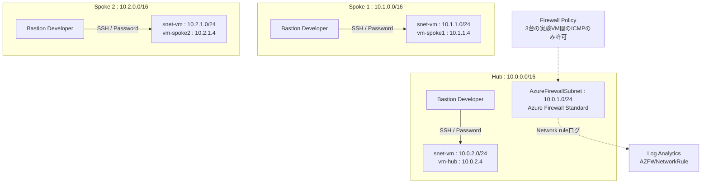

# 事前準備：Bicepによる班別環境のデプロイ

[ハンズオンの進め方](./00-NWハンズオンの進め方.md)に対応する事前作業です。**講師または環境構築担当者が授業前に実施し、ハンズオン120分には含めません。** 受講者は展開済み環境の開始チェックから進めます。

本書では初期構成の確認、Azureへのログイン、Bicepによるデプロイ、VMへの接続と開始状態の確認までを行います。デプロイするコードの一覧は[Bicepフォルダー](./bicep/README.md)を参照してください。

Hub、Spoke×2、Azure Firewall Standard、各VNetのUbuntu VM（計3台）、Bastion Developer（計3つ）を作成します。講師が事前展開するためのテンプレートです。BGP共用環境は含みません。

**初期状態ではピアリング・ルートテーブル・UDRを作成しません。** 演習1でピアリングを、演習2で往復UDRを作成します。HTTPサーバーは不要で、基本試験はpingです。

## 作成前

演習専用の空のリソースグループを用意します。既存環境と名前が衝突するリソースグループには展開しないでください。

## 作成後

図の枠はVNetです。相互に接続する線がないのは、ピアリングが未作成であるためです。Bastion Developerは各VNetのVMへの管理接続であり、VNet間を中継しません。



| 項目 | 初期設定 |
|---|---|
| VM | Ubuntu Server 24.04 LTS、`Standard_B2s`、固定プライベートIP、Trusted Launch |
| 認証 | ユーザー名／パスワード。パスワードはデプロイ時に環境変数で渡す |
| VM・Bastionの公開IP | 作成しない。FWにだけStandard公開IPを1つ作成 |
| Bastion | 各VNetにDeveloper。AzureBastionSubnet不要、ブラウザー接続のみ、各Bastionは同時に1接続 |
| NSG | 3台のVMのIPからのICMPと、VNet／AzureプラットフォームからのSSHを許可。その他の受信は拒否 |
| Firewall | Standard＋Policy。演習VMのIP間のICMPのみ許可。RFC1918宛てはSNATしない |
| ログ | Network ruleをリソース固有テーブルへ送信。Log AnalyticsはEntra認証のみ、保持30日 |
| 外向き接続 | VMサブネットの既定送信アクセスを無効化。NAT Gateway・インターネット宛てUDRは作成しない |

Log Analyticsの取り込み・クエリエンドポイントは公開エンドポイントです（匿名アクセスは不可）。受講者のPortalからのログ参照用に残し、Private Linkはこの演習の対象外とします。

## ファイル

- [main.bicep](./bicep/main.bicep)：3つのネットワーク、FW、Policy、ログの組み立て
- [modules/lab-network.bicep](./bicep/modules/lab-network.bicep)：VNet、NSG、NIC、VM、Bastion Developer
- [main.bicepparam](./bicep/main.bicepparam)：リージョン、管理ユーザー名、VMサイズ、パスワード環境変数

## 事前確認

- Azure CLI、Bicep CLI、Azureへのログインと対象サブスクリプションを確認する。
- `Microsoft.Network`、`Microsoft.Compute`、`Microsoft.OperationalInsights`、`Microsoft.Insights`のリソースプロバイダーを利用可能にする。
- 既定リージョンは`japaneast`。Bastion Developerの[対応リージョン](https://learn.microsoft.com/en-us/azure/bastion/bastion-sku-comparison#regional-availability)、Firewall Standard、VM SKUとvCPUクォータ、Trusted Launch対応を展開前に確認する。未対応リージョンへ変更しても有料Bastionへ自動切替しない。
- Ubuntuイメージ`Canonical:ubuntu-24_04-lts:server:latest`の利用可否を確認する。パッケージ取得やHTTPサーバー起動を必要とするVM拡張機能は含めない。
- 演習専用の強いパスワードを使用し、他環境の資格情報を使い回さない。パスワード認証は研修向けの明示的な選択であり、本番向けの推奨設定ではない。
- 展開する操作者にはRGのリソース作成権限が必要。受講者には班別のネットワーク変更権限、Bastion接続に必要なVM/NIC/Bastionの参照権限、経路診断の実行権限、Log Analyticsのログ参照権限を別途付与する。テンプレートはRBACを変更しない。

## Bicepでのデプロイ手順（PowerShell）

以下は講師が事前に実施する手順です。PowerShellの**同じターミナル**で上から順に実行します。`rg-nw-01`は班ごとの**新しい専用RG名**へ変更してください。リソースの作成は課金を開始するため、実行前に費用と削除期限を確認してください。

### 1. Azureへログインし、対象サブスクリプションを選ぶ

```powershell
az login
if ($LASTEXITCODE -ne 0) { throw 'Azure login failed.' }

az account list --output table
$subscriptionId = Read-Host 'Target subscription ID'
az account set --subscription $subscriptionId
if ($LASTEXITCODE -ne 0) { throw 'Subscription selection failed.' }

az account show --query '{Subscription:name,Id:id,Tenant:tenantId}' --output table
if ($LASTEXITCODE -ne 0) { throw 'Subscription lookup failed.' }
```

**確認ポイント**：表示されたサブスクリプションIDとテナントが、演習用として承認された対象と一致していることを確認します。別テナントへログインする場合は`az login --tenant <テナントID>`を使用します。

### 2. Bicepフォルダーへ移動し、設定値を確認する

VS Codeでこのリポジトリを開き、リポジトリルートのターミナルから実行します。

```powershell
Set-Location -LiteralPath '.\Network\ハンズオン\bicep'
az version
az bicep version
if ($LASTEXITCODE -ne 0) { throw 'Bicep CLI is unavailable. Run az bicep install, then retry.' }
```

[main.bicepparam](./bicep/main.bicepparam)を開き、次の値を確認・必要に応じて変更します。

| パラメーター | 既定値 | 確認すること |
|---|---|---|
| `location` | `japaneast` | Bastion Developer、FW、VMサイズを利用可能なリージョン |
| `adminUsername` | `azureuser` | 3台のUbuntuへ接続する管理ユーザー名 |
| `vmSize` | `Standard_B2s` | 対象リージョンで利用可能で、3台分のクォータがあるサイズ |
| `adminPassword` | 環境変数から取得 | ファイルへ実パスワードを書かない。手順4で入力 |

**確認ポイント**：`main.bicep`と`main.bicepparam`が現在のフォルダーにあり、Bicep CLIのバージョンが表示されること。リージョンを変更した場合は、以下の`$location`も同じ値にします。

### 3. ビルドし、演習専用リソースグループを用意する

ビルドはローカルでの構文・型検証です。Azureの権限、ポリシー、SKU可用性まで保証するものではありません。

```powershell
az bicep build --file .\main.bicep --stdout | Out-Null
if ($LASTEXITCODE -ne 0) { throw 'Bicep build failed.' }

$rg = 'rg-nw-01'
$location = 'japaneast'
$deploymentName = 'nw-initial'

foreach ($provider in @('Microsoft.Network', 'Microsoft.Compute', 'Microsoft.OperationalInsights', 'Microsoft.Insights')) {
    az provider show --namespace $provider --query '{Provider:namespace,State:registrationState}' --output table
    if ($LASTEXITCODE -ne 0) { throw "Provider lookup failed: $provider" }
}
```

**確認ポイント**：ビルドにエラーがなく、全プロバイダーが`Registered`であること。未登録の場合は、権限を持つ管理者が`az provider register --namespace <プロバイダー名> --wait`で登録してから続けます。

```powershell
$rgExists = az group exists --name $rg
if ($LASTEXITCODE -ne 0) { throw 'Resource group lookup failed.' }
if ($rgExists -eq 'true') { throw 'Resource group already exists. Choose a new lab-only name or have the instructor review it.' }

az group create --name $rg --location $location
if ($LASTEXITCODE -ne 0) { throw 'Resource group creation failed.' }
```

既存RGへの誤展開を避けるため、この例では同名RGが存在したら停止します。再開する場合は、講師が専用RG内のリソースを確認し、手順4から進めてよいか判断してください。

### 4. パスワード入力、Azure側検証、差分確認、デプロイ

次のブロックはまとめて実行します。パスワードは3台共通の演習専用値です。12～72文字とし、AzureのLinux VMパスワード要件（大文字・小文字・数字・記号のうち3種類以上など）を満たす値を入力します。

```powershell
$password = Read-Host 'Ubuntu lab password (12-72 characters)' -AsSecureString
$env:NW_LAB_ADMIN_PASSWORD = [System.Net.NetworkCredential]::new('', $password).Password
try {
    az deployment group validate --name $deploymentName --resource-group $rg --parameters .\main.bicepparam
    if ($LASTEXITCODE -ne 0) { throw 'Deployment validation failed.' }

    az deployment group what-if --resource-group $rg --parameters .\main.bicepparam
    if ($LASTEXITCODE -ne 0) { throw 'What-if failed.' }

    $confirm = Read-Host 'Review what-if and costs. Type DEPLOY to create the lab'
    if ($confirm -ceq 'DEPLOY') {
        az deployment group create --name $deploymentName --resource-group $rg --mode Incremental --parameters .\main.bicepparam
        if ($LASTEXITCODE -ne 0) { throw 'Deployment failed.' }
    } else {
        Write-Host 'Deployment skipped.'
    }
} finally {
    Remove-Item Env:\NW_LAB_ADMIN_PASSWORD
    $password.Dispose()
}
```

パスワードはソース・パラメーターファイル・出力に保存しません。環境変数には実行中だけ平文が入るため、ログ出力やデバッグトレースを有効にしないでください。`main.bicepparam`のユーザー名を変更する場合は、Linuxの管理ユーザー名の制約も確認します。

**確認ポイント**：

- `validate`が成功すること。失敗した場合は権限・ポリシー・SKU・入力値を確認し、作成へ進まない。
- `what-if`の作成先が自班のRGで、既存リソースの予期しない変更・削除がないこと。差分を確認後、`DEPLOY`と入力して初めて作成を実行する。
- `main.bicepparam`の`using`でテンプレートを指定しているため、これらのコマンドには`--template-file`やJSON向けの`@`を付けない。
- Firewallの展開には時間がかかるため、授業開始前に完了させる。コマンドが実行中の間は、同じデプロイを並行して再実行しない。
- キャンセル・失敗しても、一部リソースが作成済みなら課金は発生し得る。環境変数の削除はAzureリソースを削除する操作ではない。

### 5. 完了状態と出力値を取得する

```powershell
az deployment group show --resource-group $rg --name $deploymentName --query properties.provisioningState --output tsv
if ($LASTEXITCODE -ne 0) { throw 'Deployment status lookup failed.' }

az deployment group show --resource-group $rg --name $deploymentName --query properties.outputs --output json
if ($LASTEXITCODE -ne 0) { throw 'Deployment outputs lookup failed.' }

az resource list --resource-group $rg --query '[].{Name:name,Type:type,Location:location}' --output table
if ($LASTEXITCODE -ne 0) { throw 'Resource inventory lookup failed.' }
```

**確認ポイント**：状態が`Succeeded`であること。出力`vmInventory`に3台があり、`firewallPrivateIp`が取得できること。VM・Bastionが各3つ、VNetが3つ、Firewall・Policy・公開IP・Log Analyticsが各1つあり、ピアリング・UDR・VPN Gatewayがないことを確認します。

失敗した場合は、Azure Portalの対象RG→「デプロイ」→`nw-initial`→操作の詳細、または次のコマンドで原因を確認します。出力に含まれる環境情報は組織の取り扱いルールに従ってください。

```powershell
az deployment operation group list --resource-group $rg --name $deploymentName --query "[?properties.provisioningState=='Failed'].{Resource:properties.targetResource.resourceName,Error:properties.statusMessage}" --output json
if ($LASTEXITCODE -ne 0) { throw 'Deployment error lookup failed.' }
```

`Succeeded`はリソース作成の完了であり、Bastion接続・ping・ログの正常性の証明ではありません。次の初期状態の確認を完了してから、[ハンズオンの進め方](./00-NWハンズオンの進め方.md#5-受講者の開始チェック)の開始チェックへ進みます。

## デプロイ後の確認ポイント

1. 出力`vmInventory`で3台のVM・NIC・VNet・Bastionと、構成図の固定IPが一致することを確認する。`firewallPrivateIp`は実際の割当値をUDR演習へ転記する。
2. VMの「接続」→「Bastion」で、ユーザー名／パスワードを入力し、**そのVMと同じVNetの**Developerへ接続する。Developerはピアリング先のVMに接続できないため、HubのBastionへ集約しない。
3. 各VMで`hostname`、`ip -4 address`、`command -v ping`を確認する。Ubuntu標準イメージのICMP応答を利用し、カスタムイメージを使う場合はOSファイアウォール・ICMP応答設定を確認する。
4. 初期状態ではVM間のpingが応答せず、相手宛てNext hopが`None`であることを確認する。成功した場合は既存ピアリング・経路の混在を調査する。
5. NSGのSSH許可範囲と実際のDeveloper接続を実機で予行する。接続できない場合もインターネット全体へSSHを開放せず、Bastionの状態・リージョン・資格情報・NSG・OSを切り分ける。

### 講師の予行と演習開始状態への復元

初期デプロイとは別に、講師は[演習1・2](./01-Hub-SpokeとUDR.md)を通して動作を確認します。

1. 演習1でHubとのピアリングを作った後、各Spokeから`10.0.2.4`へのpingは成功し、相手Spoke宛てpingは失敗することを比較する。Hubから両Spokeへのpingも成功する。
2. 演習2の往復UDR適用後にSpoke間pingが成功し、`AZFWNetworkRule`にICMPの`Allow`が記録されることを確認する。初期状態ではSpoke間通信がFWへ到達しないため、対象ログがないのは異常ではない。
3. 予行が終わったら、[演習開始状態への戻し](./00-NWハンズオンの進め方.md#演習開始状態への戻し)に従い、ピアリングを削除し、Spokeサブネットからルートテーブルを外す。予行で作成した演習用ルートとルートテーブルも、他の関連付けがないことを確認して削除し、演習2で新規作成できる状態に戻す。
4. VNet間の経路がなく、VM間のpingが応答しないことと、各VNetのBastion接続が維持されていることを再確認する。Bicepの再実行をリセットの代わりに使わない。

### 事前作業の完了条件

- [ ] 専用RGのデプロイが`Succeeded`になっている。
- [ ] 3台のVMへ各VNetのBastion Developerから接続できる。
- [ ] VMの固定IPとFWの実プライベートIPを記録した。パスワードは記録資料へ残していない。
- [ ] ピアリング・ルートテーブル・UDRが未作成で、VNet間のpingは応答しない。
- [ ] 講師の予行を行った場合は、開始状態へ復元済みである。
- [ ] 受講者の権限、費用、削除期限と担当者を確認した。

完了後は[ハンズオンの進め方](./00-NWハンズオンの進め方.md)の開始チェックを経て、[Hub-SpokeとUDR](./01-Hub-SpokeとUDR.md)へ進みます。共用BGP環境の準備は[別手順](./02-BGPによる経路広報と確認.md#2-講師の事前構築と共有ルール)です。

## 再展開・後片付け

- このBicepは**初期構築用**であり、演習後のリセットツールではない。増分デプロイで再実行しても演習で追加したピアリングやUDRの削除は保証しない。また、VNet/NSG/Policyのプロパティを再適用すると演習の変更を上書きする場合がある。
- 演習中は再デプロイせず、手順書の切り戻しで復元する。完全な初期化は、専用RGの削除を講師が確認してから再作成する。
- Firewall、VM、ディスク、公開IP、ログは課金対象。Bastion Developerが無料でも環境全体は無料ではない。VM停止だけではFirewall等の課金は止まらない。
- 削除時はAzure Portalで対象の演習専用RGと全リソースを確認し、承認後に削除する。共有BGP環境・他班のRGを削除しない。RG外に残した診断先や関連リソースも確認する。

このテンプレートのローカルビルドはAzureへのデプロイ・疎通確認を代替しません。SKU・RBAC・Bastion接続・ping・ログ反映は講師の実機予行で確定してください。
