# 基本演習：Hub-SpokeとUDRによる経路制御

[進め方・前提](./00-NWハンズオンの進め方.md)を確認してから開始します。

## 1. 共通の試験方法

基本の疎通確認はVM 1 `10.1.1.4`とVM 2 `10.2.1.4`の**ping（ICMP Echo）**です。HTTPサーバーなどの待ち受けサービスは不要です。NSG・OSファイアウォール・Azure Firewallで、演習VM間のICMPを両方向に許可しておきます。ICMPにはTCP/UDPのようなポート番号はありません。

各変更の前後で、次のセットを**両VMで**実施します。復路の経路確認と、相手から開始するping試験は別々に記録します。

| 確認 | 操作 | 記録 |
|---|---|---|
| 有効なルート | 対象VMのNIC →「有効なルート」 | 宛先を含むプレフィックス、由来、状態、次ホップ種類・IP |
| Next hop | Network Watcher → Next hop。対象VM・NIC、送信元IP、相手IPを指定 | 宛先ごとの実際の次ホップ |
| ping（ICMP） | VM内から相手のプライベートIPへ4回送信 | 応答数、損失率、試験時刻 |
| NSG diagnostics | 必要に応じて対象VM/NIC、方向、両端IP、プロトコルICMPを指定 | 許可／拒否、該当規則 |
| FWログ | 試験時刻、両VMのIP、プロトコルICMPで検索 | Action、規則、記録有無 |

Linux VM内の試験例です。Cloud Shellから実行しても送信元VMの試験にはならないため、必ず対象VM内で実行します。

```bash
# VM 1内
ping -c 4 -W 2 10.2.1.4

# VM 2内
ping -c 4 -W 2 10.1.1.4
```

Windows VMでは`ping -n 4 -w 2000 10.2.1.4`を使用し、逆方向も宛先IPを変えて実行します。安定後に4回とも応答することを正常時の目安とし、損失があれば同じ条件で再試験・調査します。pingの成功だけではFW経由やTCPアプリケーションの到達性を証明できないため、有効なルート・Next hop・FWログと照合します。traceroute／tracertでもAzureの中継点がすべて見えるとは限りません。

**任意のTCP試験**：講師が事前にTCP 8080のHTTPサービスとNSG・OS・FWのTCP許可を用意した場合だけ実施します。Linuxでは`curl --noproxy '*' --connect-timeout 5 --max-time 10 -v http://10.2.1.4:8080/`、Windowsでは`Test-NetConnection -ComputerName 10.2.1.4 -Port 8080`を使い、逆方向も確認します。Connection troubleshootのTCP 8080診断とIP flow verifyは、この任意課題で扱います。IP flow verifyはTCP/UDP専用で、ICMPの確認には使いません。TCPを実施しなくても基本演習は完了できます。

必要ならAzure CLIでも取得できます。次はPowerShellでの例で、実リソース名へ置き換えます。どちらも参照・診断操作です。

```powershell
$rg = "rg-nw-<班番号>"
az network nic show-effective-route-table --resource-group $rg --name nic-spoke1 --output json
az network watcher show-next-hop --resource-group $rg --vm vm-spoke1 --nic nic-spoke1 --source-ip 10.1.1.4 --dest-ip 10.2.1.4 --output json
```

AzureのUI／APIでは、ピアリングの次ホップが`VNetPeering`、`VnetPeering`などと表記される場合があります。以下の表は意味としての種類を示します。有効なルートの由来も`Default`、`User`、`VirtualNetworkGateway`など、実際の表示をそのまま残します。

## 2. 演習1：Hub-Spokeを構成し、UDRなしの状態を見る

### 予測

Hubと各Spokeを接続するだけで、VM 1からVM 2へ届くでしょうか。FWを配置しただけで、通信はFWを通るでしょうか。

### 作業前後の構成

この段階ではVNetピアリングを作成します。作業前は各VNetが独立し、作業後は各SpokeがHubとピアリングします。Spoke間の直接ピアリングとUDRは、作業後もありません。

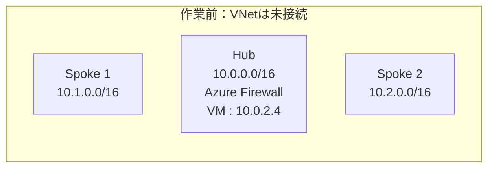

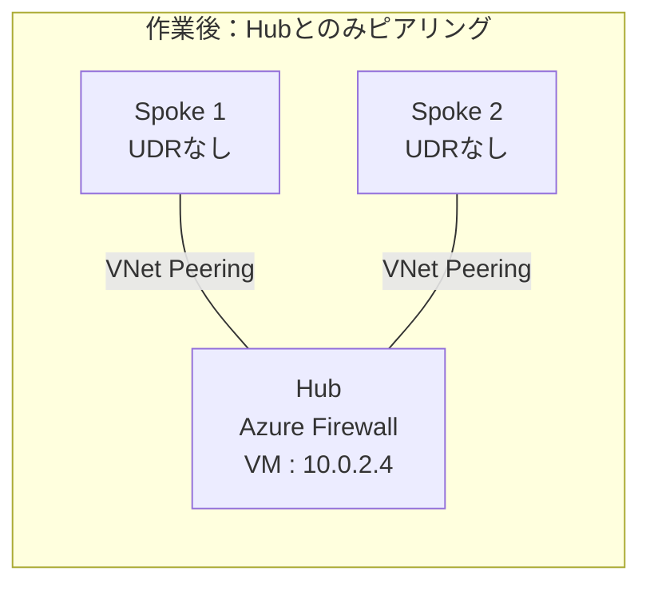

### 操作

1. Hub、Spoke 1、Spoke 2のアドレス範囲に重複がないことを確認する。
2. PortalでHubとSpoke 1、HubとSpoke 2の相互ピアリングを作る。相手側も同時作成する場合、同じ接続を重複して作らない。
3. 各方向のVNetアクセスを許可する。
4. 各SpokeがHubからの転送トラフィックを受信できる設定を有効にする。APIでは各Spoke側ピアリングの`allowForwardedTraffic`に対応する。Hub側も転送受信を許可した基準構成に揃える。
5. Gateway Transit／Use Remote Gatewaysはまだ有効にしない。Spoke間の直接ピアリングも作らない。
6. 各方向の状態が`Connected`になることを確認する。
7. 両SpokeのVM用サブネットにUDRが適用されていないことを確認し、共通の試験を行う。
8. 各Spoke VMからHub VM `10.0.2.4`へpingを実行し、Hub VMから各Spoke VMへも確認する。Hubとの直接ピアリングによる成功と、Spoke間の失敗を比較する。

### この段階の確認ポイント

| 確認対象 | 確認すること | 期待値／記録 |
|---|---|---|
| ピアリング | Hub↔Spoke 1、Hub↔Spoke 2の両方向の接続状態 | 全ピアリングが`Connected` |
| Hub宛て経路 | Spoke 1 NICから`10.0.0.0/16`へのNext hop | ピアリング先Hub。実際の表示値を記録 |
| Hub VMへの疎通 | 両Spoke VMから`10.0.2.4`、Hub VMから両Spoke VMへping | 各方向とも安定後に4回応答。Hub VMはFW中継の証拠ではなく、直接ピアリングの確認先 |
| Spoke 2宛て経路 | Spoke 1 NICで`10.2.1.4`をNext hop診断 | 直接ピアリングもUDRもないため、到達可能な次ホップがない |
| 逆方向経路 | Spoke 2 NICから`10.1.1.4`をNext hop診断 | 同様に到達可能な次ホップがない |
| 疎通 | 両VMから相手へping | 応答なしが期待値。成功した場合は既存経路・ピアリングを調査 |

### 期待結果と完了条件

- ピアリング先のHub `10.0.0.0/16`へのルートは見える。
- Hub VMへのpingは両Spokeから成功し、Hub VMから両Spokeへのpingも成功する。Hubに届くことと、別Spokeへ中継できることは異なる。
- 相手Spoke宛てには転送経路がなく、基準構成では`10.0.0.0/8 -> None`に一致する。Spoke間のpingは応答しない。
- FWを配置していても、FWへの経路がないので自動中継されない。

**Spoke間の疎通失敗が正常な期待結果です。** 成功した場合は先に進まず、直接ピアリング、既存UDR、ゲートウェイ経路などの構成差を確認します。転送許可を有効にしたこと自体は、経路作成の証明ではありません。

## 3. 演習2：HubのFWで折り返す

### 作業前後の構成

作業前は演習1の状態で、Hub-Spokeのピアリングはありますが、Spoke間の転送経路はありません。作業後は各VMサブネットに相手Spoke宛てのUDRを関連付け、往復ともAzure Firewallを次ホップにします。

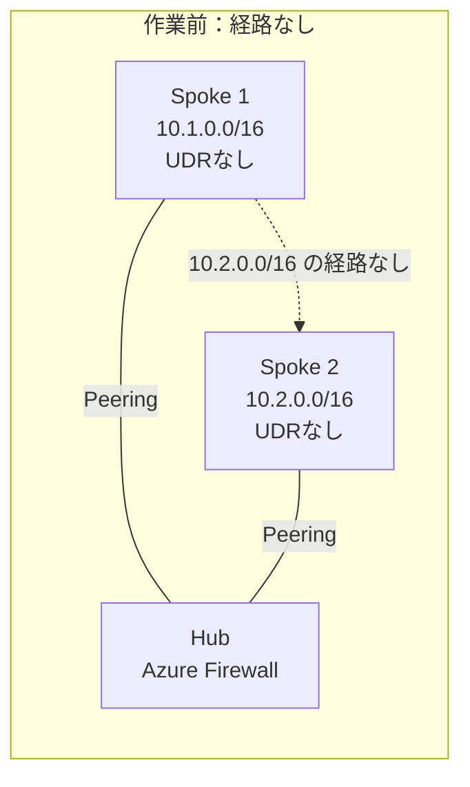

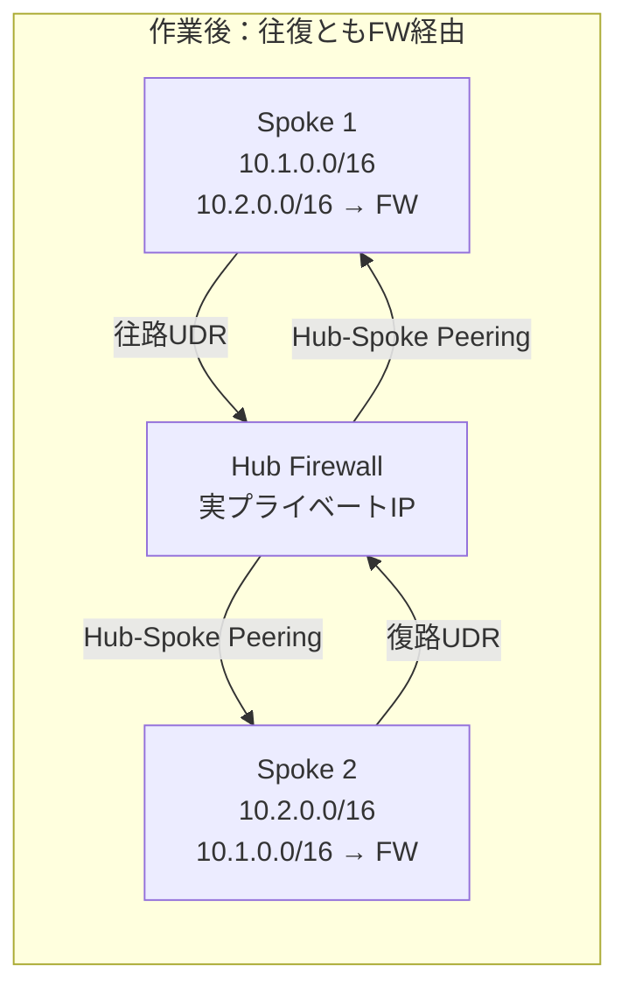

### 設計値

| ルートテーブル | 関連付ける送信元サブネット | ルート名 | 宛先 | 次ホップ |
|---|---|---|---|---|
| `rt-spoke1` | Spoke 1の`snet-vm` | `to-spoke2-via-fw` | `10.2.0.0/16` | `VirtualAppliance` / FWの実IP |
| `rt-spoke2` | Spoke 2の`snet-vm` | `to-spoke1-via-fw` | `10.1.0.0/16` | `VirtualAppliance` / FWの実IP |

### 操作

1. FWのプライベートIP、正常なプロビジョニング状態、Firewall Policyを確認する。
2. VM間のICMPを両方向に許可するNetwork ruleと、診断設定を確認する。プロトコルは`ICMP`、宛先ポートの入力欄がある場合は`*`とし、送信元・宛先IPを演習VMに限定する。
3. 上表の2つのルートテーブルを作成し、ゲートウェイルート伝達を有効にする。
4. `to-spoke2-via-fw`をSpoke 1の`snet-vm`へ関連付け、`to-spoke1-via-fw`をSpoke 2の`snet-vm`へ関連付ける。
5. それぞれのUDRの宛先プレフィックス、次ホップの種類`Virtual appliance`、次ホップIP（FW実IP）を保存してから作成する。
6. 両サブネットに意図したルートテーブルが関連付いたことを確認し、NICの有効なルートとNext hopを両方向で確認する。
7. 反映を待ち、共通の試験を両VMで行う。
8. FWログを検索し、試験した送信元・宛先・プロトコルICMP・時刻が一致する`Allow`を確認する。ICMPではポート番号を照合しない。

### この段階の確認ポイント

| 確認対象 | 確認すること | 期待値／記録 |
|---|---|---|
| Spoke 1の関連付け | `snet-vm`の関連付け先ルートテーブル | `rt-spoke1` |
| Spoke 2の関連付け | `snet-vm`の関連付け先ルートテーブル | `rt-spoke2` |
| 往路UDR | `10.2.0.0/16`の設定内容 | 次ホップ`Virtual appliance`、FW実IP |
| 復路UDR | `10.1.0.0/16`の設定内容 | 次ホップ`Virtual appliance`、FW実IP |
| 有効なルート／Next hop | VM 1→VM 2、VM 2→VM 1 | 両方向とも相手側`/16`がUDR由来で、Next hopがFW実IP |
| ping試験 | 両VMから相手IPへ4回送信 | 安定後に両方向とも4回応答 |
| FWログ | それぞれの試験時刻、両端IP、ICMP、Action | 対象FWで規則名と`Allow`を確認 |

この表の期待値が揃わない場合、次の比較演習へ進まず、不一致の項目から切り分けます。

`AzureFirewallSubnet`や`GatewaySubnet`にSpoke用ルートテーブルを関連付けません。Azure Firewallに、VMベースNVA向けのNIC／OSのIP転送設定は行いません。

### 期待結果と完了条件

```text
往路：VM 1 (10.1.1.4) -> FW (実IP) -> VM 2 (10.2.1.4)
復路：VM 2 (10.2.1.4) -> FW (実IP) -> VM 1 (10.1.1.4)
```

- 両VMで、相手Spokeの`/16`に対するUDRが有効。
- 両VMのNext hopが`VirtualAppliance`で、IPがFWの実IPと一致。
- 両VMから相手IPへのpingで、安定後にそれぞれ4回の応答を取得。
- FWの対象ログを確認し、経路の予測・Azureの適用結果・実通信が整合。

FWから各Spokeへの転送はHubのピアリング経路を使います。送信元VMのNext hopが正しいだけでは、その先の転送と疎通まで成功した証明にはなりません。

### FWログの検索例

Log Analyticsの対象ワークスペースで、実際の試験時刻に時間範囲を設定します。リソース固有テーブルの`AZFWNetworkRule`が前提です。

```kusto
AZFWNetworkRule
| where TimeGenerated > ago(15m)
| where SourceIp in ("10.1.1.4", "10.2.1.4")
| where DestinationIp in ("10.1.1.4", "10.2.1.4")
| where Protocol =~ "ICMP"
| project TimeGenerated, SourceIp, DestinationIp, Protocol, Action, RuleCollection, Rule
| order by TimeGenerated desc
```

複数班が同じワークスペースを使う場合は、Portalのリソーススコープなどで自班のFWに限定します。受講者の実IPが例と異なる場合は検索条件を実値へ置き換えます。テーブルがない場合は診断設定と送信先を確認し、旧形式の`AzureDiagnostics`へ同じクエリを実行しないでください。ログがないだけで未到達と断定せず、取り込み遅延や検索条件も確認します。

ICMPではポート条件で絞りません。任意のTCP試験のログを見る場合だけ、プロトコル条件を`Protocol =~ "TCP" and DestinationPort == 8080`へ変更します。

## 4. 演習3：直接ピアリングとUDRを比較する

演習2の状態を保存してから実施します。**直接ピアリングは比較のためだけの一時設定**です。`0.0.0.0/0`も一時的に使うため、管理・診断通信への影響を確認済みの演習専用環境に限定します。

### 操作と期待値

各段階で必ず両側の設定を揃え、反映後に有効なルート、両方向Next hop、ping試験を記録します。

次の図は、演習2のFW経由を基準に、C～Fの変更による経路の違いを示します。破線は構成変更によって選択されなくなった経路です。

#### C：直接ピアリングを作成し、具体的UDRを削除

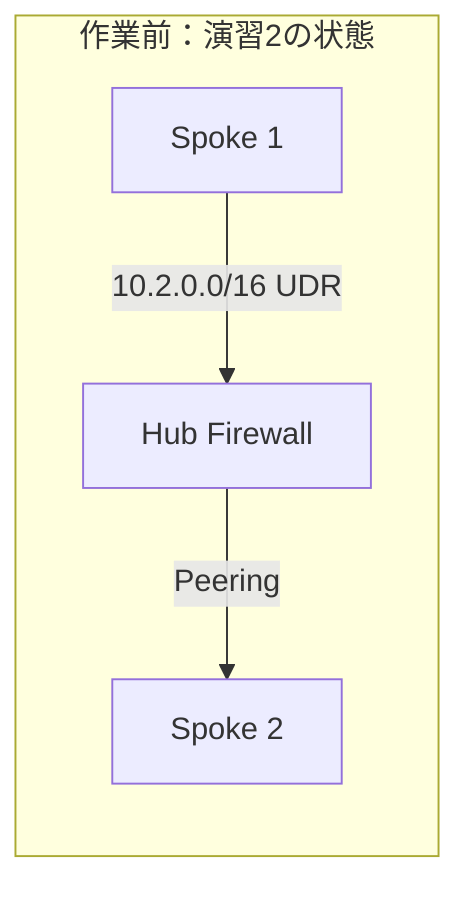

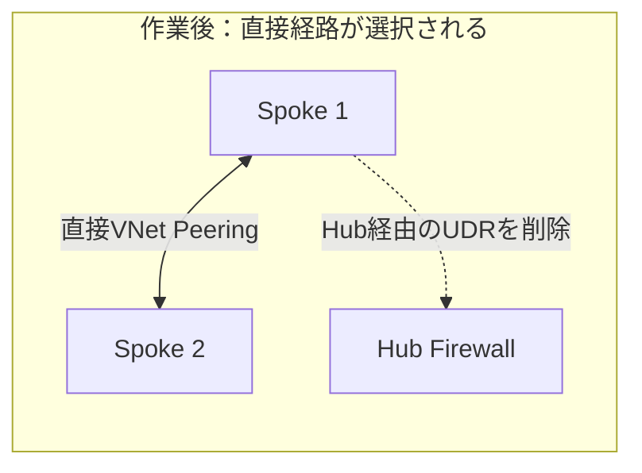

#### D：既定ルートUDRを追加

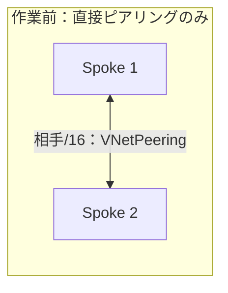

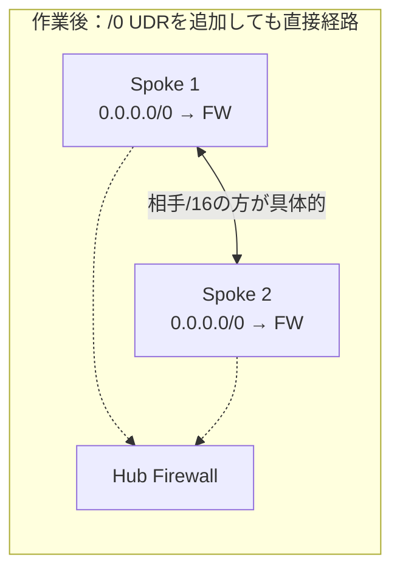

#### E：相手Spoke向けの具体的UDRを追加

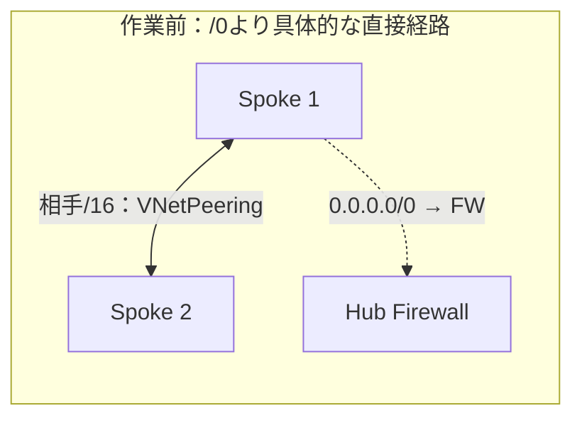

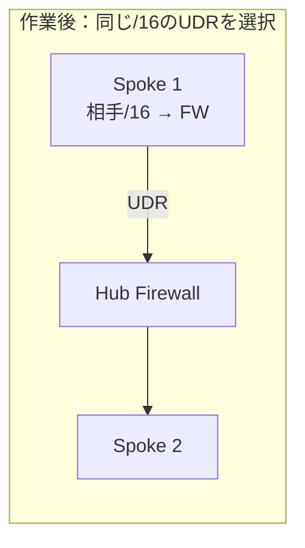

#### F：一時設定を削除し、演習2の基準へ復元

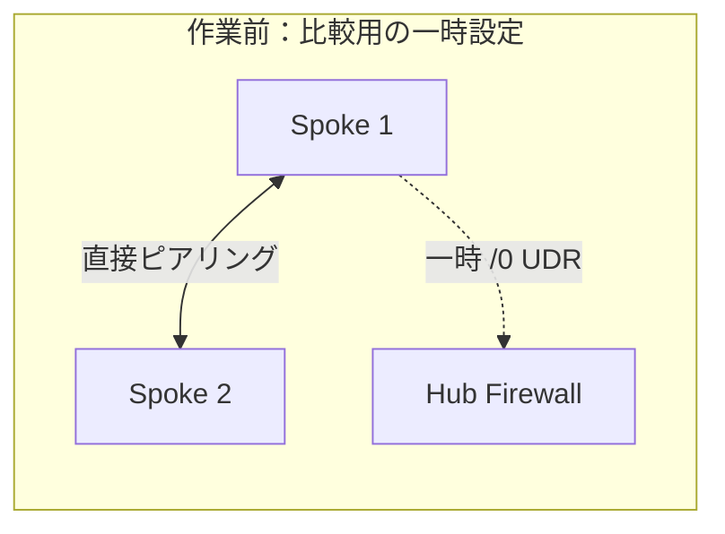

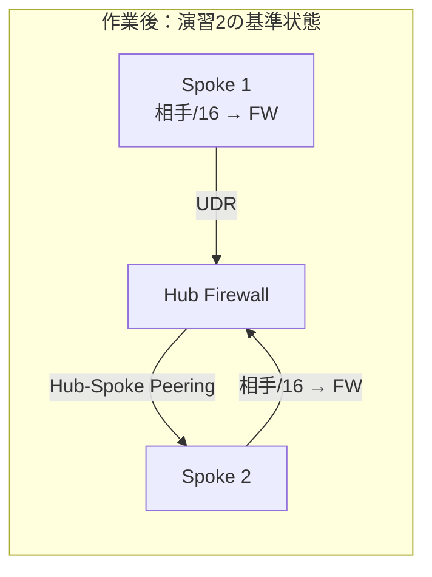

| 段階 | 変更する内容 | 相手VM宛ての期待Next hop | ping |
|---|---|---|---|
| A：演習1 | Hubとのピアリングだけ。UDRなし | `None` | 失敗 |
| B：演習2 | 相手Spokeの`/16`をFWへ送る往復UDR | `VirtualAppliance` / FW実IP | 成功 |
| C：直接経路 | Spoke間の相互ピアリングを作成し、両RTの相手Spoke向け`/16`UDRを削除 | `VNetPeering` | 成功 |
| D：既定UDRだけ | 両RTに`0.0.0.0/0 -> VirtualAppliance / FW実IP`を追加 | `VNetPeering` | 成功 |
| E：具体的UDRも追加 | 両RTに演習2の相手Spoke向け`/16`UDRを再追加 | `VirtualAppliance` / FW実IP | 成功 |
| F：基準へ復元 | 両RTの一時`/0`UDRと、Spoke間の両方向ピアリングを削除 | `VirtualAppliance` / FW実IP | 成功 |

### 各段階で照合するポイント

| 段階 | 有効なルート／Next hopで確認すること | ping・FWログで確認すること |
|---|---|---|
| C：直接経路 | 両方向の宛先`/16`がピアリング経路となり、Next hopは`VNetPeering`相当 | ping成功。FW経由を示すログがないことも参考情報として記録 |
| D：既定UDR | `/0`のUDRより具体的な宛先`/16`のピアリング経路が選択される | ping成功。選択経路とFWログの組み合わせで直接経路を判断 |
| E：具体的UDR | 同一宛先`/16`でUDRが選ばれ、Next hopはFW実IP | ping成功。対象FWで`Allow`ログを確認 |
| F：基準へ復元 | 直接ピアリングと一時`/0`はなく、相手宛てUDRが有効 | 両方向でping成功し、FW経由を確認 |

Cでは、ルートテーブル自体とサブネット関連付けは残し、相手Spoke向けUDRだけを削除します。Cの直接ピアリングでゲートウェイ共有は設定しません。

### 説明すること

1. Aの失敗とCの成功は、同じ「UDRなし」でも何が違うか。
2. Dで`/0`UDRがあるのにFWを通らないのはなぜか。
3. Eで同じ`/16`のピアリング経路よりUDRが優先されることを、どの表示で確認したか。
4. ping成功だけでは、直接経路とFW経由を区別できないのはなぜか。

### 結果記録表

次は**記入用**であり、実測済みの結果ではありません。プレフィックスと由来は有効なルートから、Next hopは診断結果から記入します。

| 段階／時刻 | 送信元→宛先 | 選択プレフィックス・由来 | Next hop種類・IP | ping応答数・損失率 | FWログ・考察 |
|---|---|---|---|---|---|
| A | VM 1 → VM 2 | | | | |
| A | VM 2 → VM 1 | | | | |
| B | VM 1 → VM 2 | | | | |
| B | VM 2 → VM 1 | | | | |
| C | VM 1 → VM 2／逆向き | | | | |
| D | VM 1 → VM 2／逆向き | | | | |
| E | VM 1 → VM 2／逆向き | | | | |
| F | VM 1 → VM 2／逆向き | | | | |

C以降の「逆向き」も省略せず、同じセル内に分けて記録します。既存ログを新しい試験の証拠にしないよう、各段階の時刻を残してください。

## 5. 次の演習へのチェック

- [ ] Spoke間の直接ピアリングが両方向ともなくなった。
- [ ] 一時的な`0.0.0.0/0`UDRが両RTからなくなった。
- [ ] 相手Spoke宛て`/16`UDRとサブネット関連付けは両側に残っている。
- [ ] 両方向のFW経由通信が成功した。
- [ ] BGP共有環境のVPN Gateway、ピアリング、ルートテーブルには変更を加えていない。
- [ ] 設計値・設定値・観測結果を記録した。

[BGPによる経路広報と確認](./02-BGPによる経路広報と確認.md)へ進みます。

## 参考資料

- [Azureのルート選択](https://learn.microsoft.com/ja-jp/azure/virtual-network/virtual-networks-udr-overview#how-azure-selects-routes-for-traffic-routing)
- [有効なルートによる診断](https://learn.microsoft.com/ja-jp/azure/virtual-network/diagnose-network-routing-problem)
- [Next hop](https://learn.microsoft.com/ja-jp/azure/network-watcher/network-watcher-next-hop-overview)
- [Connection troubleshoot](https://learn.microsoft.com/ja-jp/azure/network-watcher/connection-troubleshoot-overview)
- [NSG diagnostics（ICMPのNSG評価）](https://learn.microsoft.com/en-us/azure/network-watcher/nsg-diagnostics-overview)
- [Azure Firewallの監視データ](https://learn.microsoft.com/ja-jp/azure/firewall/monitor-firewall-reference)
