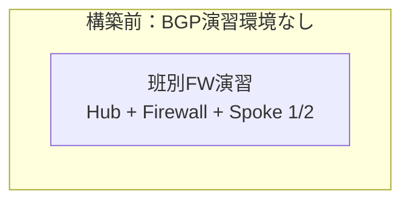
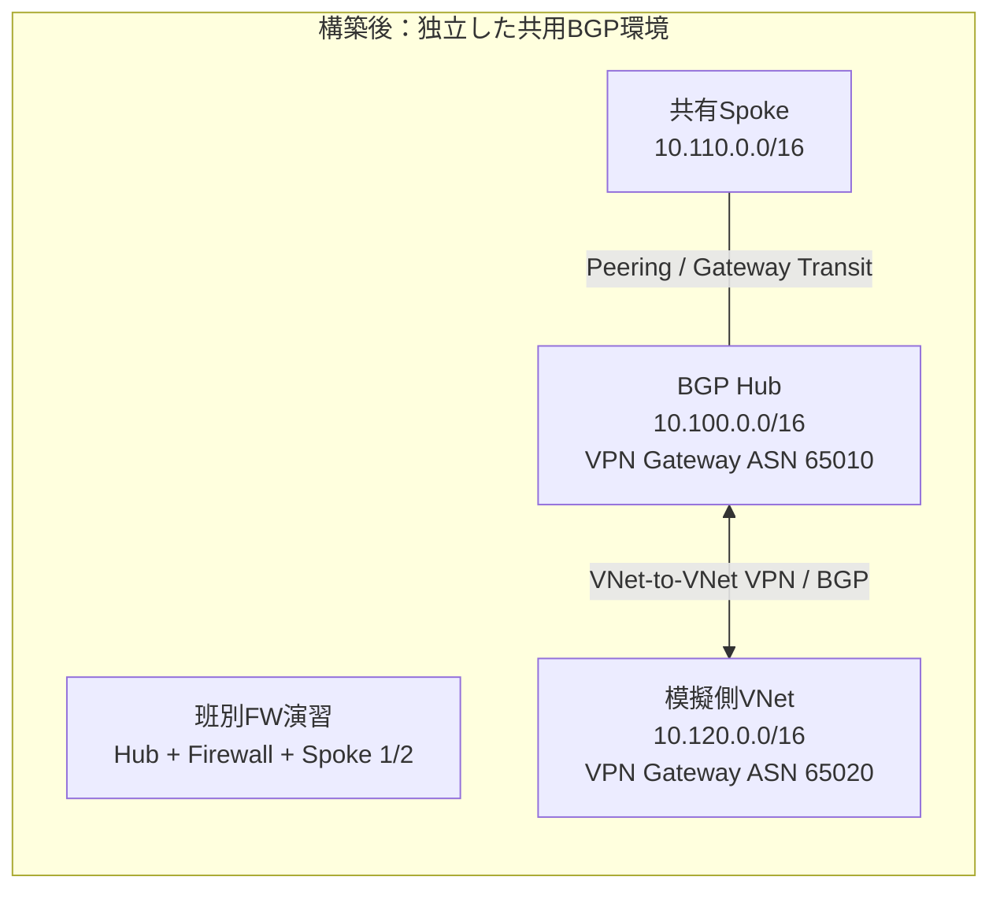
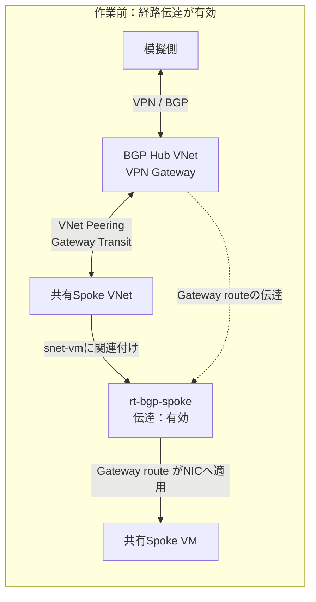
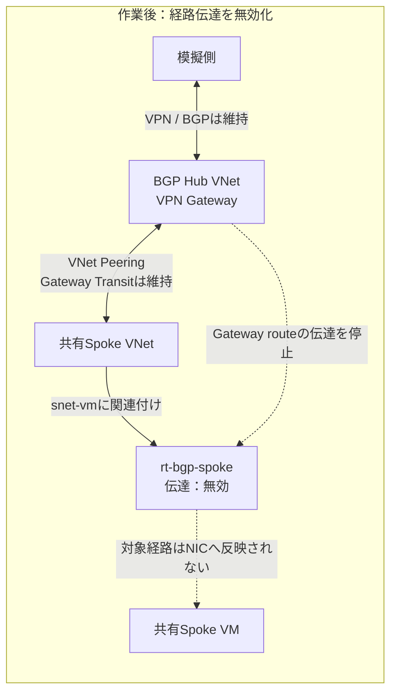

# 演習4：BGPによる経路広報と確認

## 1. ゴールと演習環境

BGPピアで交換された経路と、その経路がSpokeのVMへ適用されることを分けて確認します。**VPN Gatewayはクラス共用の2台だけ**です。Gateway・ピアリング・共有ルートテーブルは講師が管理し、受講者は読み取り専用で観測します。受講者が各自Gatewayをデプロイすることはなく、班別Firewallの設定・演習にも共用Gatewayを接続しません。

```text
【班別・Firewall演習】班ごとに独立。VPN Gatewayなし
Spoke 1 ── Hub + Azure Firewall ── Spoke 2

【クラス共用・BGP演習】Firewall演習とは独立。Gateway 2台を共用
共有Spoke (10.110.0.0/16)
          │ VNet Peering / Gateway Transit
BGP Hub (10.100.0.0/16) ── VPN Gateway (ASN 65010)
                                  ║ VNet-to-VNet VPN / BGP
模擬オンプレミス (10.120.0.0/16) ── VPN Gateway (ASN 65020)
```

模擬側はAzure VNetですが、オンプレミスの役割を担います。実際のオンプレミスVPN装置やExpressRouteの構築演習ではありません。Azure Firewall自身がBGPを話す構成でも、Route Serverを利用する構成でもありません。共有BGP環境にはFirewallを配置せず、班別環境のFirewallも共有しません。

BGP環境のHub・共有Spoke・模擬側は、班別環境とは別のVNet／リソースグループで構築します。班別VNetとのピアリングやアドレス範囲の重複は作りません。この演習ではBGP経路を観測し、共有Spokeから模擬側への到達性を確認します。VPN Gatewayへ向かう経路ができても、Firewall検査が追加されるわけではありません。

| リソース | アドレス例 | 確認対象 |
|---|---|---|
| BGP Hub VNet / GatewaySubnet | `10.100.0.0/16` / `10.100.255.0/27` | Hub Gateway、ASN `65010` |
| 共有Spoke VNet / VM用サブネット | `10.110.0.0/16` / `10.110.1.0/24` | Hubとピアリング、Gateway Transitを利用 |
| 共有Spoke VM | `10.110.1.4` | ping試験用 |
| 共有Spoke用ルートテーブル | `rt-bgp-spoke` | 共有Spokeサブネットに関連付け。基準は経路伝達有効 |
| 模擬オンプレミスVNet / GatewaySubnet | `10.120.0.0/16` / `10.120.255.0/27` | 模擬側Gateway、ASN `65020` |
| 模擬側VM用サブネット / VM | `10.120.1.0/24` / `10.120.1.4` | pingの試験宛先 |
| VNet-to-VNet VPN接続 | 双方向接続リソース | 両接続ともBGP有効 |

IP・ピアIP・経路広告は例示だけで確定しません。講師が実機で取得した値を配布用の構成表へ記入してください。

## 2. 講師の事前構築と共有ルール

次は講師が事前に実施する内容です。授業中にVPN Gatewayの作成完了を待つ構成にはしません。

### 構築前後の構成

講師の事前構築では、BGP確認用の独立したVNet・Gateway・VPN接続・共有Spokeを用意します。班別Firewall環境との接続は作りません。





1. **クラス共用のBGP環境だけ**を対象に、Hub、共有Spoke、模擬側のVNetと`GatewaySubnet`を用意する。班別Firewall環境とはピアリングしない。構成は[共用環境の構成表](./00-NWハンズオンの進め方.md#32-クラス共用gatewayとbgp講師管理)を参照する。
2. 両側にBGP対応のRoute-based VPN Gatewayを事前展開する。Basic SKUを使わず、リージョンで利用可能な対応SKUを確認する。
3. HubはASN `65010`、模擬側は`65020`とし、両GatewayのBGPを有効にする。
4. Hub→模擬側、模擬側→Hubの**両方向のVNet-to-VNet接続リソース**を作成し、双方の接続でBGPを有効にする。
5. 共有キーは承認済みの方法で設定する。資料や受講者の記録にキーを残さない。
6. 両Gatewayの実際のBGPピアIPを取得する。これはVMのIPやGatewayの公開IPではない。
7. VPN接続とBGPピアの確立、双方の広告・学習経路を確認する。
8. Hubと共有SpokeのピアリングでGateway Transit／Use Remote Gatewaysを設定し、`rt-bgp-spoke`を共有SpokeのVMサブネットに関連付ける。基準状態ではゲートウェイルート伝達を有効にする。
9. 広告・学習ルート、両側VMの有効なルート・Next hop、双方向のpingを実機で予行し、**画面に表示された正確な経路と由来**を記録する。NSG・OSで演習VM間のICMPを許可する。
10. 経路伝達の変更を講師だけが行う場合は、`rt-bgp-spoke`の伝達設定を切り替え、前後のピア状態・Gateway経路・VMの有効なルート・疎通を予行し、UI反映時間も記録する。
11. BGP Gateway・VPN接続・共有Spokeが授業開始時に正常であることを確認する。意図的に経路伝達を切り替える場合の開始値と復元手順も保存する。

Hubと模擬側は**直接VNetピアリングをせず**、VNet-to-VNet VPN接続を使用します。模擬側プレフィックスはHub・共有Spokeと重複させず、`0.0.0.0/0`も広告しません。`GatewaySubnet`に演習用UDRを関連付けないでください。

広告経路が表示されることと、アプリケーションの疎通は別々に検証します。**有効ルートのNext hopがGatewayというだけで、BGPで学習した経路の証拠としない**でください。GatewayのBGP広告／学習画面とNICの有効なルートを突き合わせます。実機で期待プレフィックスや切替結果を確認できなかった場合、その値を正解として教えず、観測できた表示を教材に記録して演習目標を調整してください。

### 受講者と講師の操作範囲

| 操作 | 受講者 | 講師 |
|---|---|---|
| BGPピア状態・広告／学習ルート・有効なルートの参照 | 実施 | 支援 |
| ping試験と結果記録 | 実施 | 支援 |
| VPN Gateway・VPN接続・共有ピアリングの作成／変更 | 行わない | 管理 |
| 共用ルートテーブル・経路伝達の切替 | 行わない | 説明・実演 |
| 基準構成への復元 | 状態を確認 | 実施・最終確認 |

## 3. 手順A：BGPピアと広告・学習経路を見る

講師から指定された**クラス共用BGP環境**へ切り替えます。Portalの両VPN Gatewayの「BGPピア」から確認します。メニュー名はUIによって異なる場合があります。両Gatewayのピア状態、対象ピア、広告・学習ルートを表示／ダウンロードし、次の証拠を保存します。共用資源の設定は変更しません。

| 観測点 | 確認対象 | 期待する内容 |
|---|---|---|
| Hub Gateway | BGP設定とピア状態 | ASN 65010、相手ASN 65020、確立状態 |
| 模擬側Gateway | BGP設定とピア状態 | ASN 65020、相手ASN 65010、確立状態 |
| 模擬側 → Hub | 模擬側の広告、Hubの学習 | 講師の事前実測表にある模擬側プレフィックス |
| Hub → 模擬側 | Hubの広告、模擬側の学習 | 講師の事前実測表にあるHub・共有Spokeのプレフィックス |

ルート表示の方向を必ず記録します。「Hubの広告」はHubが相手に知らせる情報であり、「Hubの学習」は相手から受け取った情報です。BGPが確立していても、期待プレフィックスが見えるとは限りません。

### この段階の確認ポイント

- [ ] Hubと模擬側の両BGPピアが`Connected`／確立状態になっている。
- [ ] Hubが模擬側プレフィックスを学習している。学習一覧の値を記録した。
- [ ] 模擬側がHubから広告されたプレフィックスを学習している。共有Spokeが含まれるかは事前実測と照合した。
- [ ] 広告と学習を別々に記録し、画面名・方向・時刻を残した。

広告・学習一覧にルートがなければ、別画面の有効ルートで代用せず、対象Gateway、ピアIP、接続状態を講師と確認します。

## 4. 手順B：共有Spokeに適用された経路と疎通を見る

1. 共有SpokeのVM NICから模擬側VMのIPへの有効なルートとNext hopを確認する。
2. 模擬側VMのNICから共有Spoke VMのIPへの有効なルートとNext hopを確認する。
3. Hub・共有Spoke・模擬側の各ルートを講師の事前実測表と突き合わせ、ルートのプレフィックス・由来・状態を記録する。
4. 共有Spoke VMから`10.120.1.4`へ、模擬側VMから`10.110.1.4`へ**両方向からping**を実行する。Linuxは`ping -c 4 -W 2 <相手IP>`、Windowsは`ping -n 4 -w 2000 <相手IP>`を使う。
5. pingの応答数・損失率と、両端のNext hop／有効なルートを並べて保存する。TCP試験は、講師が待ち受けサービスと許可規則を事前準備した場合だけの任意課題とする。

### この段階の確認ポイント

| 観測点 | 確認すること | 期待値／記録 |
|---|---|---|
| 共有Spoke NIC | 模擬側VM IPを宛先とする有効なルート | 講師実測表と一致するプレフィックス、由来、状態 |
| 共有Spoke Next hop | 模擬側VM IPへのNext hop | 実測したGateway経路と一致 |
| 模擬側 NIC | 共有Spoke VM IPを宛先とする有効なルート | 講師実測表と一致するプレフィックス、由来、状態 |
| 模擬側 Next hop | 共有Spoke VM IPへのNext hop | 実測したGateway経路と一致 |
| ping試験 | Spoke→模擬側、模擬側→Spokeへ各4回送信 | 基準状態では安定後に双方向とも4回応答。損失があれば調査 |
| 整合性 | 広告／学習経路とNICの経路、実通信 | 3つの観測を混同せず説明できる |

Next hopの表示だけではBGP経路と断定できません。広告・学習画面のプレフィックスとNICの有効なルートを照合します。

## 5. 手順C：経路伝達の切替を講師デモで観測する

共用環境のルート伝達設定は受講者が操作しません。講師は事前に予行した場合に限り、`rt-bgp-spoke`のゲートウェイルート伝達を一時的に切り替えます。予行で期待値が確定していない場合は実リソースを変更せず、事前取得した前後の画面を使って説明します。

### 作業前後の構成

この操作で変更するのは共有Spoke側ルートテーブルのゲートウェイルート伝達設定だけです。VPN Gateway、VPN接続、BGPピア、VNetピアリングは変更しません。切替後のGateway広告・学習や疎通は、講師の実測値で確認します。





講師が切り替えるたびに、次の順で受講者と確認します。

1. 切替前に、両GatewayのBGPピア状態、広告・学習ルート、共有Spoke NICの有効ルート、Next hop、ping試験結果を記録する。
2. 講師が共有Spokeのルート伝達設定だけを切り替える。BGPピアやVPN接続は変更しない。
3. 反映を待ち、BGPピア状態とGatewayの広告・学習ルートを再確認する。
4. 共有Spoke NICの有効ルート・Next hopと、模擬側とのping試験を再確認する。
5. 変更前後で何が変わり、何が変わらなかったかを比較表に記録する。
6. 講師が開始時の設定へ戻し、基準状態への復元を一緒に確認する。

### この段階の確認ポイント

| 項目 | 切替前 | 講師切替後 | 基準状態へ復元後 |
|---|---|---|---|
| 両GatewayのBGPピア状態 | 記録する | 切替前後を比較 | 基準状態を確認 |
| Gatewayの学習・広告ルート | プレフィックスと由来を記録 | 実際に変化したか記録 | 事前実測値と比較 |
| 共有Spokeの有効ルート | プレフィックス・状態・由来・Next hopを記録 | 実際に変化したか記録 | 事前実測値と比較 |
| 双方向ping試験 | 応答数・損失率を記録 | 応答数・損失率を記録 | 基準時と一致することを確認 |

切替後の期待値は固定で記載しません。BGPピアが維持されたか、Gatewayの広告・学習と共有Spoke NICへの経路適用がそれぞれどうなったかを**講師の実測値**と比較します。BGP学習が変わると決めつけないでください。差異があれば直ちに追加変更せず、実際の経路情報を講師と確認します。

## 6. 提出・振り返り

- 両GatewayのASN・実BGPピアIP・ピア状態（クラス共用環境の記録値）。
- 各プレフィックスの広告元・学習先・観測時刻。
- 共有Spokeと模擬側の有効ルート、Next hop、ping試験結果。
- 講師の切替前・切替後・復元後の観測値（切替を実施しない場合は事前画面の比較）。
- 「BGPピア正常」「経路を学習」「NICに経路を適用」「ping疎通成功」の違い。ping成功とTCPアプリケーションの正常性も区別する。
- 共用Gateway環境にFirewallがなく、班別Firewall演習と独立していること。

[障害解析とAI活用](./03-障害解析とAI活用.md)へ進みます。

## 参考資料

- [VPN GatewayのBGP概要](https://learn.microsoft.com/ja-jp/azure/vpn-gateway/vpn-gateway-bgp-overview)
- [BGPとVNet-to-VNet接続の構成](https://learn.microsoft.com/ja-jp/azure/vpn-gateway/bgp-howto)
- [VPN Gateway Transitの構成](https://learn.microsoft.com/ja-jp/azure/vpn-gateway/vpn-gateway-peering-gateway-transit)
- [VPN GatewayのBGPに関するFAQ](https://learn.microsoft.com/ja-jp/azure/vpn-gateway/vpn-gateway-vpn-faq#bgp)
