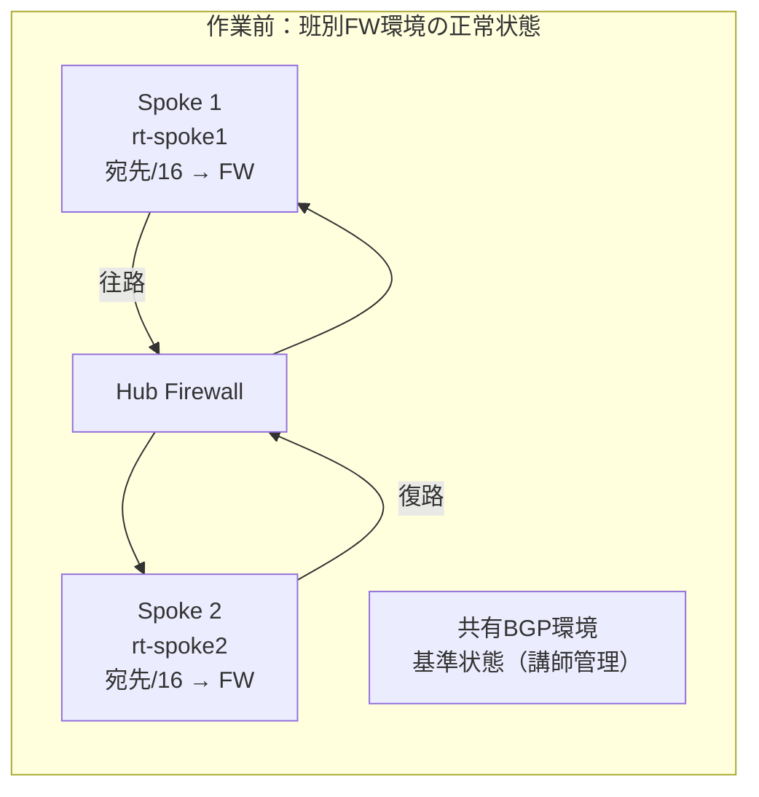
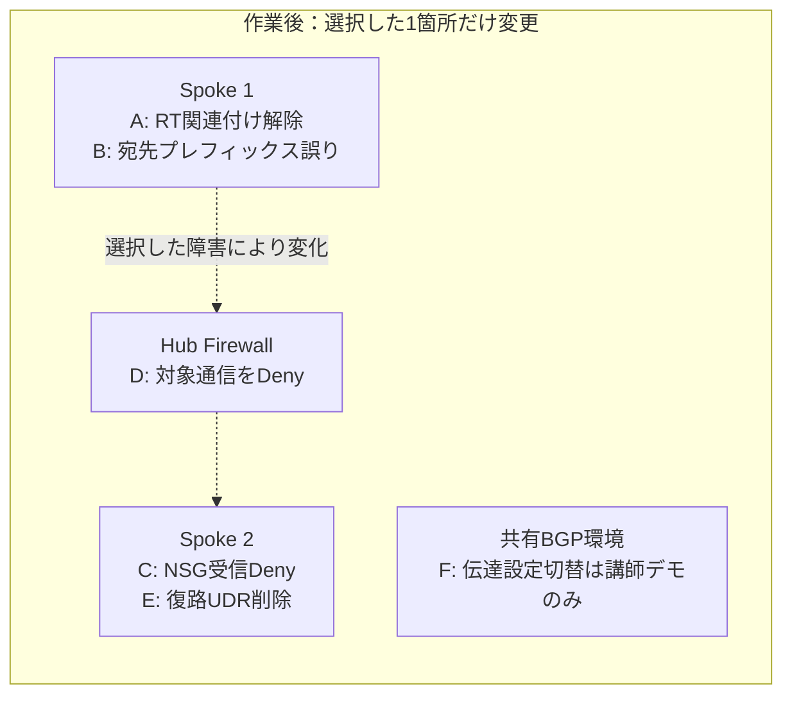
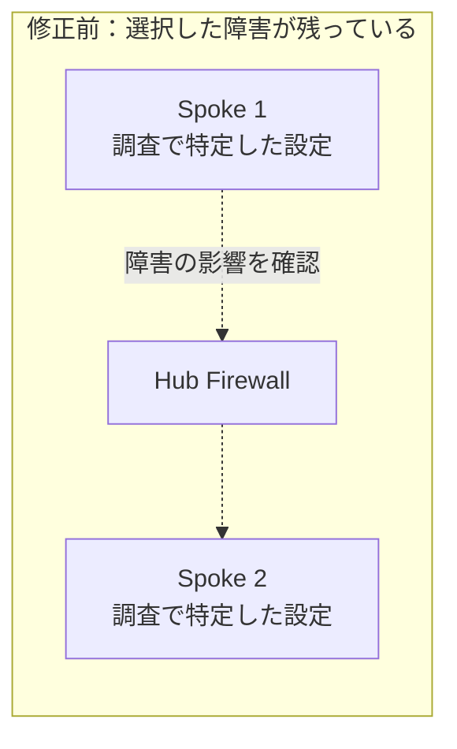
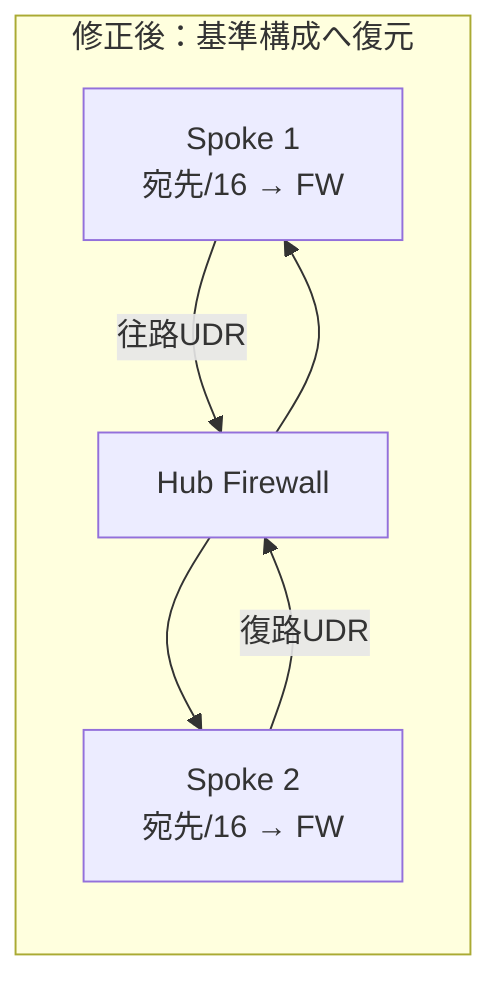

# 障害解析チャレンジとAI活用

## 1. ゴールと進め方

[座学のトラブルシューティング](../座学/03-トラブルシューティング.md)と[よくある失敗](../座学/04-よくある失敗.md)を、実際の証拠で説明できるか確認します。

1. 講師が班別Firewall演習の正常状態を確認し、基準値を保存する。共用BGP環境は読み取り専用の正常状態を別途記録する。
2. 講師が下表から**1つだけ**障害を注入し、受講者には症状だけを伝える。
3. 受講者は通信条件を固定し、参照・診断操作で原因を絞る。
4. 原因候補、根拠、最小変更、影響範囲、切り戻しを講師へ説明する。
5. 承認後に1か所ずつ修正し、同じ条件で再試験する。
6. 対象通信だけでなく、逆向きに開始するpingと影響外の通信も確認する。

正常時の直接Spokeピアリングと一時`/0`UDRはありません。各変更の反映後にpingを実行し直し、試験時刻を記録します。任意のTCP試験を行う場合は、既存セッションを使い回さず新しい接続で試験します。

## 2. 作業前後の構成

作業前は班別Firewall環境の正常状態を保存します。講師は次の図に示すうち**1箇所だけ**を選んで設定を変更し、作業後は受講者がどの観測点で差を確認できるかを調べます。A～Eは班別環境、Fは独立したクラス共用BGP環境の講師デモです。





図は障害注入の対象箇所を示す概略です。A/BではVM 1側の経路、Cでは宛先VMのNSG、DではFirewall規則、EではVM 2側の戻り経路、Fでは共有Spokeの経路伝達設定を個別に変更します。Fは班別Firewall環境と接続しません。

修正作業後は、注入した設定差分だけを戻し、次の基準構成へ復元します。作業前と同じ経路・接続関係になったことを、両方向のNext hopとpingで再確認してください。





## 3. 障害カード（講師用）

| ID | 注入する変更 | 受講者に伝える症状 | 決め手になる観測 | 切り戻し |
|---|---|---|---|---|
| A：関連付け | Spoke 1の`snet-vm`から`rt-spoke1`を外す | VM 1→VM 2が失敗 | VM 1の有効なルートに対象UDRがなく、Next hopが`None`。RT内のUDR自体は残る | 元のRTを同じサブネットへ再関連付け |
| B：プレフィックス | `rt-spoke1`の宛先を`10.2.0.0/16`から`10.20.0.0/16`へ変更 | 設定変更後からVM 1→VM 2が失敗 | UDRはあるが宛先`10.2.1.4`に一致しない | 保存した`10.2.0.0/16`へ戻す |
| C：NSG | VM 2側NSGに、VM 1からのICMP受信Denyを、競合Allowより高い優先度で追加。ポート欄は`*` | Next hopは正しいのにVM 1→VM 2のpingが失敗 | NSG diagnosticsのICMP受信評価がDenyで、注入規則と一致 | 追加したDeny規則だけ削除 |
| D：FW規則 | VM 1→VM 2のICMPに一致する高優先度Network DenyをFW Policyへ追加 | VM 1→VM 2のpingが失敗。ICMPのNSG評価はAllow | Next hop正常、FWの対象ICMPログがDeny | 追加したFW規則／コレクションだけ削除 |
| E：復路不足 | `rt-spoke2`の`to-spoke1-via-fw`だけ削除 | VM 1→VM 2が失敗 | VM 1の次ホップはFWだが、VM 2→VM 1は`None` | 同名の`10.1.0.0/16 -> FW実IP`を復元 |
| F：BGP経路伝達（講師デモのみ） | 講師がクラス共用BGP環境の`rt-bgp-spoke`でゲートウェイルート伝達を切り替える | 切替前後の経路・疎通差を観測 | Gatewayの広告・学習、共有Spokeの有効ルート・Next hop、ping試験を事前実測値と比較 | 講師が保存した基準設定へ戻す |

受講者が行う障害注入は班別Firewall環境だけです。最初はAまたはCを推奨します。Fはクラス共用BGP環境に影響するため**講師デモ専用**とし、受講者は読み取り・記録だけを行います。切替の期待値は講師の実機予行で確認してください。DはFW Policy変更の反映時間を見込み、事前に確実にDenyが優先される構成を予行します。

Eは**復路が存在しない障害**です。直接ピアリングへ戻る非対称ルーティングとは呼び分けます。非対称経路を追加で再現する場合は別枠とし、演習3の直接ピアリングと片方向UDRを使う専用の予行済み構成で実施します。

## 4. 受講者の調査ガイド

| 順序 | 取得する情報 | 判断すること |
|---|---|---|
| 1 | 発生時刻、送信元、宛先、プロトコルICMP、直前変更（TCPの場合はポートも） | 同じ通信条件で比較できているか |
| 2 | 両VMの有効なルート、相手宛てNext hop | 往路・復路のどちらに経路差があるか |
| 3 | NSG diagnostics：ICMPでVM 1の送信、VM 2の受信を評価 | NSGで拒否されるか、どの規則か |
| 4 | ICMPを指定したFWログ | FWの許可・拒否、対象規則 |
| 5 | 宛先VMのOSファイアウォール・ICMP応答設定、必要ならキャプチャ | Echo Request到着・Echo Reply送信 |
| BGPの場合 | ピア状態、Gatewayの広告・学習、Spokeの有効なルート | セッション・経路交換・VMへの伝達のどこか |

NSG diagnosticsでは、対象VM/NIC、方向、送信元・宛先IP、プロトコル`ICMP`を揃えて評価します。ポート入力が必要な場合は`*`を使い、ICMPの通信条件としてTCPの8080を指定しません。NSGのAllowはFWやOSも許可している証拠にはしません。

**任意のTCP診断**：IP flow verifyはTCP/UDP専用です。TCP 8080の試験環境を準備した場合だけ、Connection troubleshootのTCP診断と併せて使います。VM 2の受信評価ならInbound、Localは`10.2.1.4:8080`、Remoteは`10.1.1.4:<送信元ポート>`です。実際の送信元ポートが未取得なら診断用の値と明記します。この結果をICMPの許可確認に流用しないでください。

## 5. 任意：AIを調査補助として使う

### 前提

- 組織で承認されたAIとデータ取り扱いルールを使用する。
- 実IPやリソース名を入力できない場合は、一貫した仮名・演習用アドレスへ置換する。資格情報、キー、トークン、個人情報は入力しない。
- 外部AIへのログ転送を前提にしない。承認されていなければ実行せず、下記の架空の教材データでプロンプトを検討する。
- Microsoft Copilot in Azureを使う場合も、利用可否、権限、対象機能を講師が事前確認する。AIによる自動変更は使わない。

### ステップ1：変更前に仮説を整理させる

次は架空の教材データです。実験で同じ結果が出たと主張するものではありません。

```text
Azure Hub-Spokeのping疎通障害を調べています。
通信：VM 1 10.1.1.4 -> VM 2 10.2.1.4、ICMP Echo
期待経路：VM 1 -> Hub FW 10.0.1.4 -> VM 2。復路もFW経由です。
構成：Hubと両Spokeはピアリング済み。直接Spokeピアリングはありません。
観測：
- pingを4回送信しましたが応答がありません。
- VM 1の有効なルート：10.2.0.0/16、User、VirtualAppliance 10.0.1.4。
- VM 1の相手IP宛てNext hop：VirtualAppliance 10.0.1.4。
- NSG diagnosticsのICMP評価は、VM 1送信・VM 2受信ともAllowです。
- 復路のNext hop、FWログ、VM 2のICMP応答設定は未確認です。
時刻は、この教材データでは未指定です。ICMPにポート番号はありません。

事実、仮説、未確認事項を分離してください。
原因を断定せず、次の3つの確認を優先順に示してください。
各確認について「対象」「使う診断」「結果ごとの次の判断」を表にしてください。
設定変更コマンドはまだ出さないでください。
```

### ステップ2：人が追加証拠を取得する

AIが提案した確認をそのまま実行せず、対象、権限、参照か変更かを確認します。受講者自身が診断し、取得時刻と結果を記録します。

### ステップ3：追加証拠と仮説を照合する

```text
追加の教材データ：
VM 2から10.1.1.4へのNext hopはNoneでした。
VM 2側RTに10.1.0.0/16のUDRがありません。
直接Spokeピアリングはありません。

先の仮説を更新し、今回の証拠で言えることと言えないことを分けてください。
最小の修正案、影響範囲、切り戻し、再試験項目を示してください。
「復路なし」と「別経路を通る非対称ルーティング」を区別してください。
```

### ステップ4：AI利用の効果を評価する

- 未確認事項を勝手に正常・異常と仮定していないか。
- Next hop正常やNSG Allowから、通信全体が正常と飛躍していないか。
- 往路・復路、BGP学習・サブネットへの伝達を区別できているか。
- 存在しない設定や危険な広域許可を提案していないか。
- AIの回答で減った作業と、追加で検証が必要になった作業は何か。

## 6. 提出用の切り分けシート

| 項目 | 記入欄 |
|---|---|
| 班／対象環境 | |
| 発生時刻・タイムゾーン／試験時刻 | |
| 送信元VM・NIC・IP／宛先IP／プロトコル（ICMPはポートなし） | |
| 期待する往路・復路 | |
| 現象と正常な範囲 | |
| 取得した事実（有効なルート、Next hop、NSG、FWログ等） | |
| 原因候補／候補を除外した根拠 | |
| 特定した原因と決め手の証拠 | |
| 最小変更／影響範囲／切り戻し | |
| 再試験結果（対象ping、逆向きに開始するping、影響外の通信。TCPは任意） | |
| 任意：AIへの入力、仮説、誤り、人が確認した証拠 | |

## 7. 合格基準

- 症状ではなく、取得した証拠で原因を説明できた。
- 広域許可や複数同時変更ではなく、原因へ対応する最小変更で復旧した。
- 同じ条件のping再試験、逆向きに開始するping、影響外の通信を確認した。
- 正常構成への復元を確認し、AIの推測と実測結果を分けて記録した。

## 参考資料

- [NSG diagnostics（ICMPのNSG評価）](https://learn.microsoft.com/en-us/azure/network-watcher/nsg-diagnostics-overview)
- [IP flow verify](https://learn.microsoft.com/ja-jp/azure/network-watcher/ip-flow-verify-overview)
- [Microsoft Copilot in Azureでのネットワーク調査](https://learn.microsoft.com/ja-jp/azure/copilot/copilot-networking)
