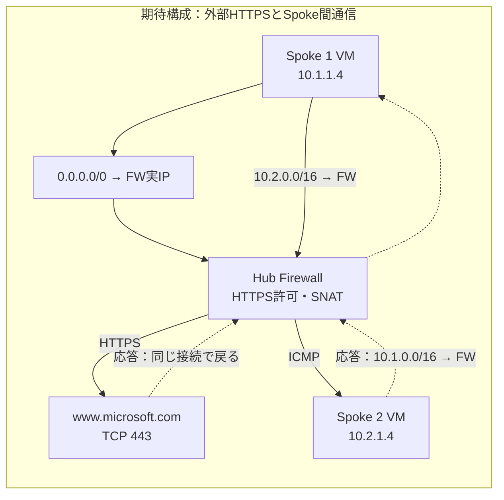

# 障害解析チャレンジとAI活用

## 状況設定：外部サイトにも隣のSpoke VMにも接続できない

> あなたはAzure上の検証環境を担当しています。Spoke 1のVMで作業中、外部サイト `https://www.microsoft.com/` にHTTPSで接続できないことが分かりました。
>
> 続けて確認したところ、隣のSpoke 2のVMへのpingにも応答がないことが分かりました。両VMにはBastionで接続できます。
>
> この環境は、インターネット向け通信もSpoke間通信もHubのAzure Firewallを経由する設計です。原因を調べて必要な設定を修正し、外部HTTPS接続とSpoke間の疎通を復旧してください。

調査対象は、指定URLへの**HTTPS（TCP 443）接続**と、**Spoke 1 VMからSpoke 2 VMへのping（ICMP）**です。同じ原因と決めつけず、それぞれの通信条件と結果を記録します。組織のルールにより別のサイトを指定された場合は、本書のURL・ホスト名をその値へ置き換えてください。原因は実環境の観測から探します。

## 1. ゴールと進め方

[座学のトラブルシューティング](../../座学/03-トラブルシューティング.md)と[よくある失敗](../../座学/04-よくある失敗.md)を、実際の証拠で説明できるか確認します。

1. 障害解析用に用意された自分のFW環境へ接続し、対象VM・URLと配布された正常時の記録を確認する。自分で障害を注入する必要はない。
2. VM内から指定URLへのHTTPS接続と隣のVMへのpingを試し、症状と試験時刻を別々に記録する。
3. ツールや調査順序を自分で選び、通信条件を固定して参照・診断操作で証拠を集める。
4. 詰まった場合だけ、第4節の段階的ヒントを使う。原因候補、根拠、最小変更、影響範囲、切り戻しを整理する。
5. 自分の判断で1つずつ修正し、同じ条件で再試験する。変更のたびに講師の確認を受ける必要はない。改善しなくても修正が誤りとは限らないため、設定の改善と疎通結果を分けて確認する。
6. HTTPS接続とSpoke間通信の両方を再試験し、管理接続など影響外の通信も確認する。

40分の目安は、自由調査15分、必要に応じたヒントと原因整理8分、修正・再試験12分、共有・解説5分です。修正・再試験にはFW Policyの反映待ちを含みます。任意のAI活用は調査・原因整理の中で最大5分とし、復旧確認の時間を残します。

本演習の期待構成では、基本演習と異なり、インターネット向けの`0.0.0.0/0 → FW実IP`のUDRを使用します。直接Spokeピアリングは使用しません。各変更後は新しい`curl`プロセスで接続し直します。操作対象は自分専用のFW環境のみとし、講師専用BGPデモ環境は読み取りのみです。BGPデモ用のSpoke・Hub・Gateway・模擬側は変更しません。FWログの取得・表示待ちは完了条件に含めません。

環境の準備が済んでいない場合は、[演習03用Bicepのデプロイ手順](./bicep/README.md)を先に実施してください。演習01用の初期環境へ演習03の構成を適用する手順です。準備済み環境では再デプロイせず、調査から始めます。デプロイ時間は本演習の40分に含めません。

## 2. 課題と期待構成

期待する経路は、**Spoke 1 VM → Hub Firewall → 指定した外部HTTPSサイト**です。Firewallで送信元アドレスを変換（SNAT）してインターネットへ送信します。外部からVMへの新規接続を許可したり、VMへ公開IPを追加したりする必要はありません。

Spoke間は、**Spoke 1 VM → Hub Firewall → Spoke 2 VM**、応答は**Spoke 2 VM → Hub Firewall → Spoke 1 VM**が期待経路です。プライベートIP間の通信では送信元IPを保持する構成です。

開始前に次の情報を確認してください。IPは教材の例です。実環境と異なる場合は自分の値へ置き換えます。調査中はテンプレートの差分ではなく、実環境の設定と診断結果を根拠にしてください。

| 確認項目 | 記録する内容 |
|---|---|
| 対象環境 | サブスクリプション、自分専用のリソースグループ |
| 試験元 | Spoke 1のVM名、NIC名、プライベートIP（例：`10.1.1.4`） |
| 試験先 | URL、ホスト名、DNSで解決されたIPv4アドレス、TCP 443 |
| 隣のVM | Spoke 2のVM名、NIC名、IP（例：`10.2.1.4`）、ICMP |
| 中継先 | Hub Firewallの実プライベートIP |
| 管理接続 | 各VMのBastion接続方法 |
| 比較用の記録 | 配布されたHTTPS正常時の結果と、基本演習で保存したSpoke間の経路・ping |



## 3. 調査・修正・復旧確認

### ステップ1：症状を再現する

1. BastionでSpoke 1のVMへ接続する。Cloud Shellや自分のPCからの接続試験では、VMの障害を再現できない。
2. 次のコマンドを実行し、試験時刻・タイムゾーン、名前解決結果、`curl`の接続先IP・エラーまたはHTTPステータスを第6節へ記録する。

```bash
date -Is
getent ahostsv4 www.microsoft.com
curl -4 --noproxy '*' --connect-timeout 5 --max-time 15 -v -I https://www.microsoft.com/
```

`curl`はリダイレクト先を自動追跡せず、指定ホストへの接続だけを確認します。IPv4に固定し、プロキシ経由ではなくVMから直接送信します。`Could not resolve host`、TCP接続タイムアウト、TLSエラー、HTTP応答を区別してください。`-k`で証明書検証を無効にしないでください。`curl`や`getent`がない場合は、外部接続を必要とするインストールを始めず講師へ連絡してください。

3. 同じSpoke 1 VMから隣のSpoke 2 VMへpingを送信する。

```bash
date -Is
ping -c 4 -W 2 10.2.1.4
```

4. 試験元・試験先、ICMP、応答数・損失率をHTTPSの記録とは別に保存する。正常時の記録と比較し、失敗する通信と、引き続き利用できる管理接続などを分けて記録する。

### ステップ2：証拠から原因を絞る

1. 調べる対象とツールを自分で選び、設定を変更せずに情報を集める。
2. 観測した事実、原因の仮説、まだ確認していないことを分けて記録する。
3. 仮説を確かめる追加の確認を行い、原因候補を絞る。進め方に迷ったら第4節のヒントを1つずつ開く。

### ステップ3：最小変更で修正する

1. 変更するリソース・設定、根拠、影響範囲、変更前の値、切り戻し方法を記録する。対象が自分専用のFW環境内であることを確認する。
2. 調査結果に基づいて、自分で修正を**1つずつ**実施する。どの変更が何を改善したか分かるように、複数の設定をまとめて変更せず、変更のたびに次の再試験を行う。通信を通すためだけに「すべての送信元・プロトコルを許可する」といったルールを追加せず、原因となった設定を修正する。
3. 反映を待ち、同じURL・IPv4・TCP 443の条件で`curl`を、同じVM間でpingをやり直す。どちらが改善し、何が残るかを記録する。外部サイトの接続先IPが変わった場合は、Next hopやNSGの評価対象IPも更新する。
4. 接続が失敗する場合は追加の証拠を集め、原因整理と修正を繰り返す。管理接続を失った場合や、影響範囲が分からない場合は追加変更を止め、講師へ相談する。

FWログは、診断設定・Log Analytics・参照権限が準備済みで、時間がある場合だけ追加確認します。取り込みを待つ必要はありません。ログがないだけでFWの拒否と断定せず、AllowログだけでHTTPSの成功とも判断しません。

### ステップ4：復旧を確認する

| 確認対象 | 復旧時の期待結果 |
|---|---|
| DNS | 指定ホストのIPv4アドレスを解決できる |
| Spoke 1 NICの有効なルート・宛先IPへのNext hop | 対象IPに採用される経路がFW実IPの`VirtualAppliance` |
| 対象TCP 443のNSG送信評価 | Allow。適用ルールも記録 |
| FWのHTTPS許可 | 対象VMから、指定URLのホスト名へのHTTPS 443がアプリケーションルールで許可されている |
| 同じURLへの`curl` | TLSの証明書検証に成功し、正常時と同様のHTTP 2xxまたは3xx応答を取得 |
| 両Spoke NICの相手VM宛て有効なルート・Next hop | 往路・復路ともFW実IPの`VirtualAppliance` |
| Spoke間ICMPのNSG評価 | 対象の送信・受信ともAllow |
| Spoke 1→Spoke 2と、Spoke 2→Spoke 1のping | それぞれ新しく4回送信し、安定後に4回応答 |
| 管理接続・正常時に記録した影響外の通信 | 変更前と同じように利用可能 |

HTTP 4xx／5xxが返ればTCP・TLSの接続とは分けて、応答元・内容を確認します。HTTP応答があるだけで期待するサイトに正常接続できたとは判断しません。外部サイトへのpingや、外部からVMへの新規接続試験は不要です。

結果を正常時の記録と比較し、第6節のシートを完成させてください。修正後に初期構築用Bicepを再実行しないでください。再デプロイは復旧操作の代わりにはなりません。

## 4. 自由調査と段階的ヒント

最初は本節のヒントを開かず、Portal、Cloud Shell／Azure CLI、Network Watcher、VM内のコマンドなどから使うツールを選びます。変更前に証拠を保存し、取得時刻、通信条件、分かったこと、未確認事項を記録してください。参照・診断操作であっても対象・権限を確認し、Packet captureなどエージェントや保存先の準備が必要な機能は講師へ相談します。

<details>
<summary>ヒント1：切り分ける観点</summary>

- 名前解決、TCP接続、TLS、HTTP応答のどの段階で失敗していますか。
- 解決された宛先IPへの経路は、期待するFW経由ですか。
- 隣のVMへの往路だけでなく、相手VMからの戻りの経路も確認しましたか。
- 経路が正しくても、通信が許可されているとは限りません。
- 1か所の修正で何が改善し、何がまだ失敗しているかを分けてください。

</details>

<details>
<summary>ヒント2：使えるツール</summary>

| 取得する情報 | ツール・観測点 | 判断すること |
|---|---|---|
| 試験時刻、名前解決、接続先IP、TCP・TLS・HTTPの結果 | VM内の`getent`、`curl -v -I` | 同じ条件で比較できているか、どの段階で失敗するか |
| 宛先IPへの有効なルート、Next hop | NICの有効なルート、Network WatcherのNext hop | FW経由の経路が採用されているか |
| Spoke間の往路・復路 | 両Spoke NICの有効なルート、相手VM宛てNext hop、両方向のping | 相手へ送る経路と戻る経路がそれぞれあるか |
| Spoke間ICMPの送信・受信評価 | Network WatcherのNSG diagnostics | 経路の問題と通信制御の問題を区別できるか |
| TCP 443の送信評価と適用ルール | Network WatcherのNSG diagnostics／IP flow verify | NSGで拒否されるか、どのルールか |
| TCP 443の接続診断（追加確認） | Network WatcherのConnection troubleshoot | 接続上の問題と、診断が対象にする範囲 |
| 対象ホストのHTTPS許可 | FW Policyのアプリケーションルール。FWログは任意 | 接続先が許可されているか |

</details>

<details>
<summary>ヒント3：具体的な確認箇所</summary>

- ルートテーブル内のUDRだけでなく、対象サブネットへの関連付けとNICの有効なルートを照合します。
- Spoke間では、VM 1から`10.2.1.4`と、VM 2から`10.1.1.4`のNext hopをそれぞれ確認します。往路が正常でも応答が戻るとは限りません。復路が存在しない状態と、別の経路を使う非対称ルーティングは区別します。
- NSG diagnosticsは**Azure Network Watcherの機能**です。Spoke 1のVM／NICを対象に、方向`Outbound`、送信元はVMのプライベートIP、宛先は今回接続する外部サイトのIPv4アドレス、プロトコル`TCP`、宛先ポート`443`で評価します。
- IP flow verifyを使う場合は、方向`Outbound`、Localは`10.1.1.4:<送信元ポート>`、Remoteは`<接続先IPv4>:443`です。送信元ポートは`curl`が使う一時ポートであり、443ではありません。実値が未取得なら診断用の値（例：50000）と明記します。
- NSGの評価結果と適用ルール・優先度を確認します。NSG AllowはFWやOSも許可している証拠にはしません。
- 対象FWに関連付くFirewall Policyの「アプリケーションルール」を開き、適用されるルールの送信元、Allow／Deny、プロトコル`HTTPS`・ポート`443`、ターゲットFQDNを、期待する接続条件と照合します。FQDNにはURL全体ではなくホスト名を指定します。設定を修正した場合はPolicyの更新完了を確認してから`curl`を再実行します。
- Spoke間pingのNSG評価は、実際の送信元・宛先IPと`ICMP`を指定します。IP flow verifyのTCP評価をICMPの許可確認に流用しないでください。

</details>

**診断の範囲**：IP flow verifyはTCP/UDPのNSG評価であり、実際にHTTPS通信を行う機能ではありません。Connection troubleshootのTCP診断も、TLS・HTTPや、指定ホスト名に対するFWアプリケーションルールの動作を`curl`と同じ条件で検証するものではありません。最終確認には指定URLへの`curl`を使います。

## 5. 任意：Copilot in AzureのTroubleshooting Agentで調査する

手動調査で取得した記録を残したうえで、Copilot in Azureの**Troubleshooting Agent（トラブルシューティング エージェント）**を使い、診断結果と次の確認事項を比較します。一般的なチャットへログを貼り付けるだけでなく、対象のAzureリソースを指定して診断を依頼します。調査・原因整理の中で最大5分を目安とし、修正・再試験の時間を残してください。

### 利用前の確認

- 組織でCopilot in Azureとエージェントの利用が許可され、対象サブスクリプション・リソースへアクセスできることを確認する。エージェントは自分のIDとAzure RBACの範囲で動作する。
- 診断の範囲・深さはリソース種別、問題、利用可能な診断データによって異なる。今回のUDR・NSG・FWを含む経路全体や、すべての原因を自動で特定できるとは限らない。
- 資格情報、キー、トークン、個人情報は入力しない。リソース名・IP・診断結果も組織のデータ取り扱いルールに従う。
- この演習では診断と提案の確認までを行う。修正の実行・承認やサポート要求の送信は行わず、設定変更は第3節の手順で実施する。

### ステップ1：Troubleshooting Agentを開く

1. Azure Portalで自分の送信元VM（VM 1）を開き、サブスクリプションとリソースグループが自分専用環境であることを確認する。
2. Copilot in Azureを開き、**New chat（新しいチャット）→ Troubleshooting（トラブルシューティング）**を選択する。
3. 対象VMのリソースIDを確認し、診断対象として指定する。追加の対象確認を求められた場合は、自分専用のVM・NIC・VNet・FWであることを確認して回答する。

**Troubleshootingが表示されない場合**は、講師または管理者へ利用可否を確認してください。利用できない場合は本節をスキップし、手動の調査・修正・復旧確認を続けます。

### ステップ2：対象リソースと症状を指定して診断する

次の例の`<...>`を自分の環境・試験結果に置き換えて入力します。IPも自分の実値へ置き換えます。復旧済みの場合は、障害時の記録と現在の状態を区別して伝え、再現のために環境を壊し直さないでください。

```text
このVMから外部HTTPSサイトにも隣のSpoke VMにも接続できない問題を診断してください。
送信元VMのリソースID：<VM 1のリソースID>
宛先URL：https://www.microsoft.com/
通信：10.1.1.4 -> <今回の名前解決で得たIPv4>、TCP 443
期待経路：VM 1 -> Hub Firewall <FW実IP> -> インターネット。FWでSNAT。
隣のVMのリソースID：<VM 2のリソースID>
隣のVMへの通信：10.1.1.4 -> 10.2.1.4、ICMP Echo
Spoke間の期待経路：往路・復路ともHub Firewall経由。プライベートIP間はSNATなし。
両VMには公開IPがなく、Bastionでの管理接続はできます。
試験時刻・タイムゾーン：<記入>
名前解決結果とcurlの出力：<記入>
Spoke間pingの試験時刻・応答数・損失率：<記入>
現在の状態：<障害継続中／修正途中／復旧済み>

参照・診断のみを行い、設定変更やサポート要求の作成・送信はしないでください。
診断したリソース、確認した証拠、原因候補、未確認事項を示してください。
DNS、経路、NSG、FWのHTTPS許可・SNAT、TLS・HTTPを区別し、
Spoke間は往路・復路を別々に確認してください。2つの症状を同じ原因とは決めつけず、
診断できない項目は未確認として、次に人が確認する対象とツールを示してください。
```

エージェントが提示する対象と実行内容を確認してから進めてください。変更を伴う操作が提示された場合は実行・承認しません。診断の完了を待つ間も、残り時間を確認します。

### ステップ3：診断結果を手動調査と照合する

結果に表示された根拠や参照先を開き、自分が取得した診断結果と比較します。エージェントが確認していない項目を「正常」と扱わないでください。

| 比較する観点 | 照合する証拠 |
|---|---|
| 対象と時刻 | 自分のVM・NIC・IPを診断しているか。修正前後を混同していないか |
| DNS・経路 | 解決されたIPv4、Spoke 1 NICの有効なルート、宛先IPへのNext hop |
| Spoke間の往路・復路 | 両Spoke NICの相手VM宛て有効なルート・Next hop |
| 通信制御 | TCP 443送信のNSG評価・適用ルール、FW Policy。FWログは任意 |
| 実通信 | `curl`のTCP接続、TLS、HTTPの結果と、Spoke間pingの結果 |
| 原因候補と限界 | 診断で確認済みの事実か、推測か、権限・対応範囲による未確認か |
| 修正提案 | 対象が最小範囲か。管理接続や他の通信を壊さないか |

追加確認した結果や、自分で手動修正した結果を、同じセッションへ入力します。

```text
手動で追加確認した結果：
<対象リソース、ツール、時刻、観測結果>
手動で変更した設定（未変更なら「なし」）：
<変更対象、変更前後の値>
同じ条件での再試験結果：
<名前解決、外向き・Spoke間往復の経路、NSG評価、curlとpingの結果>

先の診断と照合し、改善した点、残る原因候補、未確認事項を整理してください。
提案だけで復旧済みとは判定せず、復旧確認に必要な証拠を示してください。
引き続き参照・診断のみとし、設定変更やサポート要求の作成・送信はしないでください。
```

### ステップ4：結果を記録して手動の復旧確認へ戻る

- エージェントが診断した範囲、提示した証拠、原因候補、診断できなかった範囲を第6節へ記録する。
- 手動調査と一致した点、異なった点、追加で必要になった確認を記録する。Next hop正常やNSG Allowだけで通信全体を正常と判断していないか確認する。
- 診断や修正提案を得たことと、復旧したことを区別する。第3節に戻り、自分で判断した最小変更と同じ条件での再試験を行う。

## 6. 提出用の切り分けシート

| 項目 | 記入欄 |
|---|---|
| 班／対象環境 | |
| 発生時刻・タイムゾーン／試験時刻 | |
| 送信元VM・NIC・IP／宛先URL・名前解決したIPv4／TCP 443 | |
| 隣のSpoke VM・NIC・IP／ICMPの試験条件 | |
| 期待するFW経由の経路とSNAT | |
| Spoke間で期待する往路・復路と、それぞれの観測値 | |
| 現象と正常な範囲 | |
| 取得した事実（DNS、有効なルート、Next hop、NSG、FW Policy、curl、ping。FWログは任意） | |
| 原因候補／候補を除外した根拠 | |
| 特定した原因と決め手の証拠（原因ごとに記録） | |
| 最小変更／影響範囲／切り戻し（変更ごとに記録） | |
| 各変更後の経路・NSG評価・FW Policy・curl・pingの変化と残る問題 | |
| 最終再試験結果（同じURLのHTTPS、Spoke間の両方向ping、管理接続） | |
| 任意：Troubleshooting Agentの診断対象・証拠・提案・未確認事項、手動調査との比較 | |

## 7. 合格基準

- 症状ではなく、取得した証拠で原因を説明できた。
- 特定した各原因について、設定と診断結果を対応させて説明できた。
- 広域許可や複数同時変更ではなく、原因へ対応する最小変更で復旧した。
- 1つ目の修正後も再試験し、改善した設定と残る障害を分けて確認した。
- 同じURLへのHTTPS接続、FW宛てNext hop、NSGのTCP 443送信Allow、FW Policyの対象ホストへのHTTPS許可、影響外の通信を確認した。FWログの取得は必須ではない。
- Spoke間の往復経路と両方向のpingを確認し、HTTPS接続とは分けて復旧を説明できた。
- 正常構成への復元を確認し、AIの推測と実測結果を分けて記録した。

## 参考資料

- [NSG diagnostics](https://learn.microsoft.com/en-us/azure/network-watcher/nsg-diagnostics-overview)
- [IP flow verify](https://learn.microsoft.com/ja-jp/azure/network-watcher/ip-flow-verify-overview)
- [Microsoft Copilot in Azureでのネットワーク調査](https://learn.microsoft.com/ja-jp/azure/copilot/copilot-networking)
- [Azure Copilot Troubleshooting Agent](https://learn.microsoft.com/en-us/azure/copilot/troubleshooting-agent)
