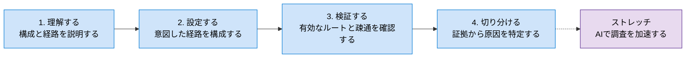

# 0. NW座学のゴール

## この座学で目指すこと

この座学では、Azureネットワークの用語を覚えるだけでなく、**構成を読み、変更の影響を予測し、自分で設定し、問題発生時に根拠をもって切り分けられること**を目指します。

## 必達ゴール1：Azureのネットワークアーキテクチャと、ルーティング切り替えの影響を理解する

VNet、サブネット、VNetピアリング、Hub-Spoke、Azure FirewallまたはNVA、VPN／ExpressRouteなどの役割と関係を理解します。

さらに、UDRの追加・変更、ピアリング、ゲートウェイルートの伝達などによって、パケットの経路がどのように変わるかを説明できるようにします。

### 到達の判断基準

- 構成図を見て、送信元・宛先・想定する次ホップを説明できる。
- システムルート、UDR、BGPルートの違いを説明できる。
- 最長プレフィックス一致と、同一プレフィックスでの優先順位を使って、採用される経路を予測できる。
- 往路と復路を分けて考え、非対称ルーティングの可能性を指摘できる。
- ルーティング変更によるFirewall経由、インターネット送信、オンプレミス接続、管理接続への影響を事前に検討できる。

### 対応する章

- [1. Azureルーティングの基礎](./01-Azureルーティングの基礎.md)
- [2. 代表的な構成と設計ポイント](./02-代表的な構成と設計ポイント.md)

## 必達ゴール2：意図したAzureネットワーク構成を自分で設定できる

設計内容をAzureの設定へ落とし込み、設定後に期待どおり反映されたことまで確認できるようにします。

### 到達の判断基準

- 通信要件から、必要なVNetピアリングとUDRを整理できる。
- ルートテーブルを作成し、正しい送信元サブネットへ関連付けられる。
- Firewall／NVAを次ホップにする場合に必要な、経路、転送、通信許可を区別して設定できる。
- Hubのゲートウェイを共有する場合に、Gateway TransitとUse Remote Gatewaysの役割を区別できる。
- インターネット接続が必要な場合に、暗黙の動作へ依存せず、明示的な送信方式を選択できる。
- 設定後にNICの有効なルートとNext hopを確認し、期待値と一致したことを説明できる。

### 完了条件

「Azure Portalで設定できた」だけでは完了としません。次の3点を揃えて完了とします。

1. **設計値**：送信元、宛先、プレフィックス、期待する次ホップ
2. **設定値**：作成・変更したピアリング、UDR、関連付け、転送・許可設定
3. **確認結果**：有効なルート、Next hop、疎通結果

## 必達ゴール3：ネットワーク障害を自分でトラブルシューティングできる

「つながらない」という事象に対し、設定を手当たり次第に変更するのではなく、観測結果から原因のある層を絞り込みます。

### 到達の判断基準

- 発生時刻、送信元、宛先、IP、プロトコル、ポート、期待経路を具体化できる。
- DNS、ルーティング、NSG、Firewall／NVA、復路、アプリケーションを分けて調べられる。
- 有効なルート、Next hop、IP flow verify、Connection troubleshootを目的に応じて使い分けられる。
- Firewall／NVAログ、VNetフローログ、パケットキャプチャなどから、観測した事実を整理できる。
- 正常な範囲と異常な範囲を区別し、次に確認する場所を説明できる。
- 原因、変更内容、再試験結果を記録し、別の担当者が判断を再現できる形で報告できる。

### 対応する章

- [3. トラブルシューティング](./03-トラブルシューティング.md)
- [4. よくある失敗](./04-よくある失敗.md)

## ストレッチゴール：AIを活用してトラブルシューティングを加速する

AIは、調査の代替ではなく、**調査条件の整理、仮説の列挙、診断手順やクエリの作成、観測結果の要約**を支援する道具として利用します。

### 目指す使い方

1. 発生時刻、送信元、宛先、ポート、期待経路、変更履歴をAIへ渡す。
2. 考えられる原因を、DNS、経路、通信許可、転送、復路、アプリケーションに分類させる。
3. 各仮説を検証するために必要なAzureの観測情報と、確認順序を提案させる。
4. Network Watcherやログから得た結果を入力し、事実と推測を分離して整理させる。
5. 最終判断は、実際の構成、診断結果、ログ、製品の公式仕様で検証する。

### AIへ依頼する例

> VM `10.1.1.4`からVM `10.2.1.4`のTCP 443へ接続するとタイムアウトします。期待経路は`10.1.1.4 -> NVA 10.0.1.4 -> 10.2.1.4`です。送信元のNext hopは`VirtualAppliance / 10.0.1.4`でした。事実と未確認事項を分け、次に確認する項目を優先順に示してください。設定変更はまだ提案せず、各確認で何が分かるかも説明してください。

### AI活用時の原則

- AIの回答だけを根拠に、本番環境の設定を変更しない。
- IPアドレス、構成情報、ログなどを入力する前に、組織のデータ取り扱い方針を確認する。
- シークレット、資格情報、アクセストークン、個人情報を入力しない。
- AIが示したコマンドやクエリは、対象、権限、変更の有無を確認してから実行する。
- AIの推測と、Azureから取得した事実を明確に分ける。
- 変更する場合は、影響範囲、切り戻し方法、変更後の確認項目を先に決める。

> Microsoft Learn：[Microsoft Copilot in Azureを使用したネットワークの設計、トラブルシューティング、セキュリティ保護](https://learn.microsoft.com/ja-jp/azure/copilot/copilot-networking)  
> Azureネットワークに関するCopilotの利用例と、アクセス権に基づく動作を確認できます。
>
> Microsoft Learn：[接続のトラブルシューティングの概要](https://learn.microsoft.com/ja-jp/azure/network-watcher/connection-troubleshoot-overview)  
> AIの提案を検証する際に使用する、Network Watcherの診断機能を確認できます。

## この座学を終えたときの成果物

- 対象構成のネットワーク図と、主要通信の往路・復路
- 主要宛先に対するルート設計表
- 実際に設定したUDRとサブネットの関連付け
- 正常時の有効なルート、Next hop、疎通結果
- 障害発生時の切り分け記録
- ストレッチとして、AIへの入力、AIが提示した仮説、実際の証拠による検証結果

## 学習を始める

[1. Azureルーティングの基礎](./01-Azureルーティングの基礎.md)へ進み、パケットの経路がどのように決まるかを確認します。
