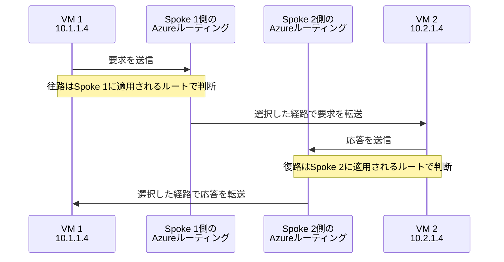
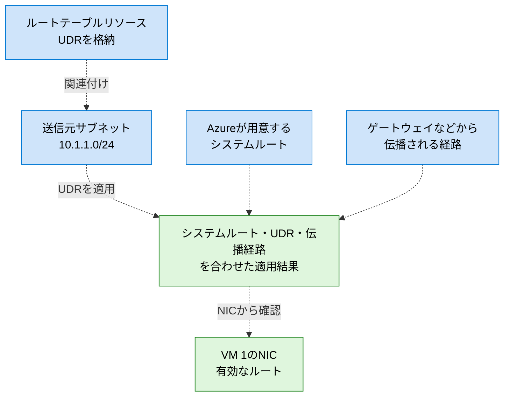
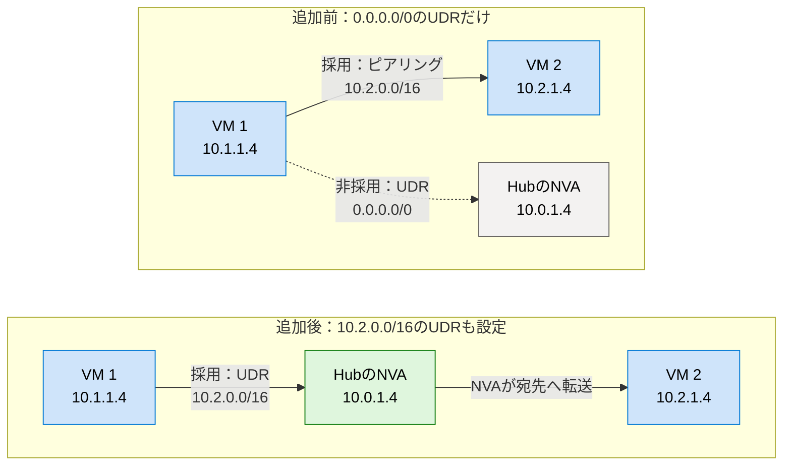
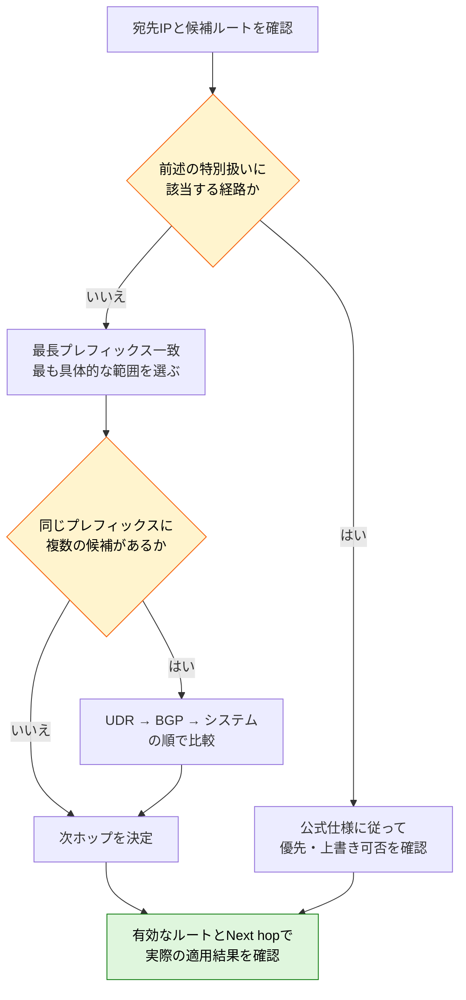

# 1. Azure ルーティングの基礎

[0. NW座学のゴール](./00-NW座学のゴール.md)で、座学全体の必達ゴールとストレッチゴールを確認してから開始してください。

## この章のゴールと対象範囲

この章では、「あるVMから送信したパケットが、なぜその経路を通るのか」を説明できるようになることを目指します。対象はAzure Virtual Network（VNet）上のIPv4通信です。VM、サブネット、IPアドレス、CIDRの基本を理解していることを前提とします。

IPv6、BGPの詳細な属性設計、個々のPaaSサービスのネットワーク仕様は扱いません。まずはシステムルート、ユーザー定義ルート（UDR）、BGPルートの関係を押さえます。

本文中のMermaid図は、GitHubやMermaid対応のMarkdownプレビューで表示できます。図は説明のために単純化しているため、各図の「読み取りポイント」と併せて確認してください。Microsoft Learnの画像は、出典を明記して公式サイトから参照しています。

## 1.1 パケットを見るときは「宛先」と「送信元のサブネット」から考える

ルーティングは、パケットを宛先まで届けるために、次にどこへ転送するかを決める仕組みです。Azureでは、送信元VMが所属するサブネットに適用されるルートをもとに、宛先IPアドレスに対する次ホップが決まります。

たとえば、`10.1.1.4`のVMから`10.2.1.4`へ接続する場合、最初に見るのは送信元VM側の経路です。宛先側のルートテーブルだけを確認しても、送信時の経路は説明できません。

### 図1：往路と復路では、ルートを確認する側が変わる

**読み取りポイント**：要求の宛先は`10.2.1.4`、応答の宛先は`10.1.1.4`です。Azureルーティングは論理的な処理を表し、図中の装置を利用者が配置するわけではありません。途中のFirewall / NVA / ゲートウェイ、ゲストOSの処理は省略しています。

NSGなどの制御も別途適用されるため、ルートが存在するだけでは通信成功を保証しません。また、ゲストOSのルーティングテーブルとAzure側のルートは別のものです。

応答パケットは宛先VMから見た送信通信になります。**往路と復路は、それぞれの送信元で別々に経路が決まる**ことが、後で扱う非対称ルーティングを理解する出発点です。

## 1.2 Azureのルートは3つの由来を区別する

| 由来 | 誰が用意するか | 主な用途 |
|---|---|---|
| システムルート | Azure | 同一VNet内、ピアリング先、その他の宛先への基本的な転送 |
| ユーザー定義ルート（UDR） | 利用者 | FirewallやNVAへの誘導、特定宛先の破棄 |
| BGPルート | ゲートウェイなどを通じた経路交換 | オンプレミスなどの宛先への動的な経路学習 |

### システムルート

Azureはサブネットに基本的なルートを自動適用します。利用者がルートテーブルリソースを作成していなくても、ルートは存在します。

たとえば、VNetのアドレス空間が`10.1.0.0/16`なら、そのVNet内へ転送するルートが用意されます。VNetピアリングを構成すると、相手VNetのアドレス空間に対するルートも追加されます。

ほかに`0.0.0.0/0`から`Internet`への既定ルートや、接続先がないプライベートアドレス範囲を`None`で破棄するルートがあります。プライベートIPアドレスだからといって、接続していない別VNetやオンプレミスへ自動的に到達できるわけではありません。

### ユーザー定義ルート（UDR）

UDRは、宛先プレフィックスと次ホップを利用者が指定するルートです。たとえば、`10.2.0.0/16`宛てをHubにあるNVAの`10.0.1.4`へ転送する、と指定できます。

UDRを格納する「ルートテーブル」リソースを作成し、**送信元のサブネットに関連付けて**適用します。1つのサブネットに関連付けられるルートテーブルは最大1つですが、1つのルートテーブルを複数のサブネットで共有できます。

関連付け後もシステムルートがすべて消えるわけではありません。システムルート、UDR、伝播された経路を組み合わせて、実際に使用するルートが決まります。

### 図2：UDRは、サブネットへの関連付けによって適用される

**読み取りポイント**：破線は設定・経路情報の関係であり、パケットが通る順番ではありません。UDRを格納したリソースを作成するだけでは適用されず、関連付け先のサブネットが重要です。「有効なルート」は、利用者が作ったUDRだけの一覧ではありません。

### BGPルート

BGPは、ネットワーク間で到達可能なアドレス範囲を交換する仕組みです。VPN GatewayでBGPを使用する場合やExpressRouteなどで、オンプレミスの経路をAzure側へ伝播できます。

ルートテーブルの「ゲートウェイルートの伝達」を無効にすると、そのサブネットで必要なオンプレミス経路を受け取れなくなる場合があります。これはUDRの追加とは別の設定です。無効化するなら、代わりの経路をどう確保するかまで設計します。

> Microsoft Learn：[Azure 仮想ネットワーク トラフィックのルーティング](https://learn.microsoft.com/ja-jp/azure/virtual-network/virtual-networks-udr-overview)  
> システムルート、UDR、BGPによる経路伝播を一通り確認する際の基本資料です。

## 1.3 ルートは「最長プレフィックス一致」を先に見る

一般的なルート選択では、宛先IPアドレスに一致するルートのうち、最も具体的なアドレス範囲を選びます。これを最長プレフィックス一致と呼びます。`/24`は`/16`より具体的で、`/16`は`/0`より具体的です。

次の例は、Spoke 1に適用される候補ルートです。

| ルートの由来 | 宛先プレフィックス | 次ホップ |
|---|---|---|
| UDR | `0.0.0.0/0` | HubのNVA `10.0.1.4` |
| システムルート | `10.2.0.0/16` | ピアリング先のSpoke 2 |

`10.2.1.4`は両方に一致しますが、`/16`の方が具体的なので、ピアリング先へのルートが選ばれます。「UDRがあるから必ずNVAへ行く」とは限りません。

ここに次のUDRを追加すると、同じプレフィックスの競合になります。

| ルートの由来 | 宛先プレフィックス | 次ホップ |
|---|---|---|
| UDR | `10.2.0.0/16` | HubのNVA `10.0.1.4` |
| システムルート | `10.2.0.0/16` | ピアリング先のSpoke 2 |

同じ宛先プレフィックスでは、基本的に次の順で優先されます。

1. UDR
2. BGPルート
3. システムルート

この例ではUDRが選ばれ、NVAへ転送されます。

### 図3：具体的なUDRを追加すると、選ばれる経路が変わる

この比較では、Spoke 1とSpoke 2が**直接ピアリングされている構成**を仮定します。第2章の基本構成とは異なり、直接接続のルートが存在する点に注意してください。

**読み取りポイント**：追加前はプレフィックス長の比較で`/16`が勝ちます。追加後は同じ`/16`同士の比較となり、UDRが勝ちます。実線は選択された要求の経路、破線は選択されない候補です。図は往路のみで、追加後のNVAの転送設定やHubからSpoke 2への到達性は成立しているものとします。復路は別途設計します。

### 基本ルールを機械的に当てはめない

Azureには例外があります。VNet内、VNetピアリング、サービスエンドポイントに関するシステムルートは、より具体的なBGPルートよりも優先される特別な扱いがあります。また、サービスエンドポイントを次ホップとするルートは、UDRでも上書きできません。

このため、設計では基本ルールで候補を考え、最後にNICの「有効なルート」と宛先ごとの「Next hop」で確認します。サービスエンドポイントとPrivate Endpointは別の機能であり、この例外をそのままPrivate Endpointに当てはめてはいけません。

### 図4：ルート選択で考える順序

**読み取りポイント**：「UDRが最優先」から考え始めず、基本は宛先範囲の具体性を先に比較します。この図は学習時の確認手順であり、Azure内部の実装順序を示すものではありません。特別扱いに該当する場合は、単純な優先順位だけで判断しません。

> Microsoft Learn：[Azureによるルート選択の仕組み](https://learn.microsoft.com/ja-jp/azure/virtual-network/virtual-networks-udr-overview#how-azure-selects-routes-for-traffic-routing)  
> 最長プレフィックス一致、同一プレフィックスでの優先順位、例外を確認してください。

## 1.4 次ホップの種類を読み取る

次ホップは「このパケットを次にどう扱うか」を表します。表示名はポータルやAPIによって異なる場合があります。

| 主な種類 | 意味 | 読み取るポイント |
|---|---|---|
| `VnetLocal` | 自分のVNet内へ転送 | 同一VNet内のサブネット間通信など |
| `VNetPeering` | ピアリング先VNetへ転送 | その通信はHubのFirewallを経由せず直接進む可能性がある |
| `VirtualAppliance` | 指定したアプライアンスのプライベートIPへ転送 | FirewallまたはNVAのIPが正しいか |
| `VirtualNetworkGateway` | 仮想ネットワークゲートウェイ側へ転送 | VPNやExpressRouteなど、構成と経路の由来も確認する |
| `Internet` | Internet向けの転送 | 外部通信に必要な送信接続方式まであるとは限らない |
| `None` | 破棄 | 意図した遮断か、必要な接続・経路が不足しているか |

`VNetPeering`は有効なルートなどで観察する種類であり、UDRで任意の次ホップとして指定するものではありません。

また、**有効なルートにゲートウェイ経由と表示されること**と、**UDRでゲートウェイを指定できること**は別です。`VirtualNetworkGateway`を次ホップとするUDRは、公式仕様で対応するVPN Gateway構成に限られます。ExpressRoute Gateway、Route Server、Virtual WANハブルーターへ同じ方法で誘導できるわけではありません。

## 1.5 ルーティング、通信許可、送信接続を分けて考える

| 確認対象 | 答える問い | 代表的な設定 |
|---|---|---|
| ルーティング | どちらへ転送するか | UDR、BGP、ピアリング |
| フィルタリング | その通信を許可するか | NSG、Azure Firewall、NVA、OSファイアウォール |
| インターネットへの送信接続 | 外部と通信するための送信元変換・出口があるか | NAT Gateway、Azure FirewallのSNATなど |
| アプリケーション | その宛先でサービスが応答するか | 待ち受けポート、プロセス、TLS設定 |

NSGでTCP 443を許可しても、経路がなければ通信できません。逆に、正しいUDRがあってもNSGが拒否すれば通信できません。`Internet`へのルートがあっても、外部へ出るための明示的な送信接続方式がなければ失敗する場合があります。

NSGはステートフルです。許可された接続の応答について、同じ接続のためだけに逆向きの許可規則を追加する必要はありません。ただし、相手から新しく開始する接続は別に評価されます。また、NSGの状態追跡と、Firewallを含む往復のルーティング設計は別問題です。

### 図5：NSGは「経路」ではなく、サブネットやNICで通信を許可・拒否する

出典：[Microsoft Learn：ネットワーク セキュリティ グループによってネットワーク トラフィックをフィルター処理する方法](https://learn.microsoft.com/ja-jp/azure/virtual-network/network-security-group-how-it-works)（Microsoft提供の画像を外部参照）。

**読み取りポイント**：

- 左端のVM 1には、サブネットのNSG 1とNICのNSG 2が適用されます。経路が正しくても、適用されるいずれかのNSGで拒否されると通信できません。
- 新しい受信通信ではサブネット側、NIC側の順に評価され、送信通信ではNIC側、サブネット側の順に評価されます。これらの評価順と、UDRのルート選択は別の話です。
- 公式図の例はHTTPのTCP 80です。本教材で使用する宛先TCP 443などを調べる場合は、その通信条件で規則を確認します。

この図はNSGの適用箇所を示すものであり、Internet向けの送信接続方式や、Firewallを通る経路を保証するものではありません。

> Microsoft Learn：[ネットワーク セキュリティ グループの概要](https://learn.microsoft.com/ja-jp/azure/virtual-network/network-security-groups-overview)  
> NSGの規則評価とステートフルな動作を確認できます。
>
> Microsoft Learn：[Azureでの既定の送信アクセス](https://learn.microsoft.com/ja-jp/azure/virtual-network/ip-services/default-outbound-access)  
> 暗黙の外部接続に依存せず、明示的な送信方式を設計する理由を確認できます。

## 1.6 理解度チェック

1. ルートテーブルを作成しただけで、VMの経路は変わりますか。
2. `0.0.0.0/0`のUDRと`10.2.0.0/16`のピアリングルートがある場合、`10.2.1.4`宛てはどちらを選びますか。
3. Next hopが想定どおりなら、TCP接続も成功したと言えますか。

### 解答と解説

1. 変わりません。対象VMが所属する送信元サブネットへの関連付けが必要です。
2. より具体的な`10.2.0.0/16`を選びます。UDRの優先順位は、基本的に同じプレフィックスで比較するときに使います。
3. 言えません。次ホップ以降の転送、復路、フィルタリング、アプリケーションの応答は別に確認します。

## 次の章

[2. 代表的な構成と設計ポイント](./02-代表的な構成と設計ポイント.md)では、この仕組みを使ってHub-Spoke構成を設計します。
